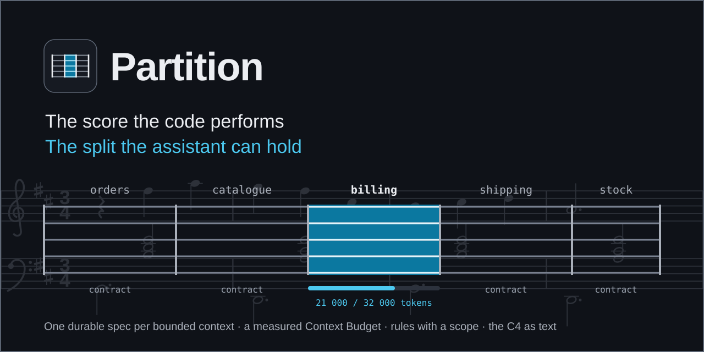
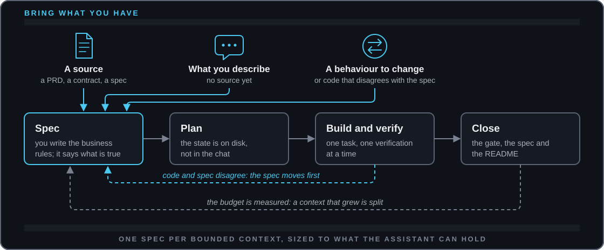
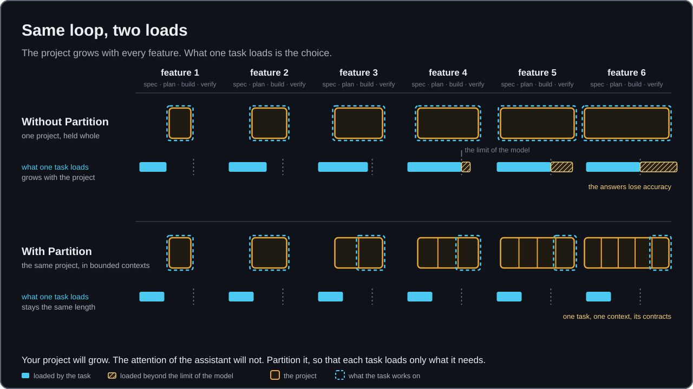
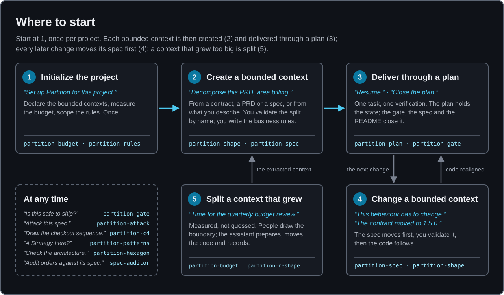
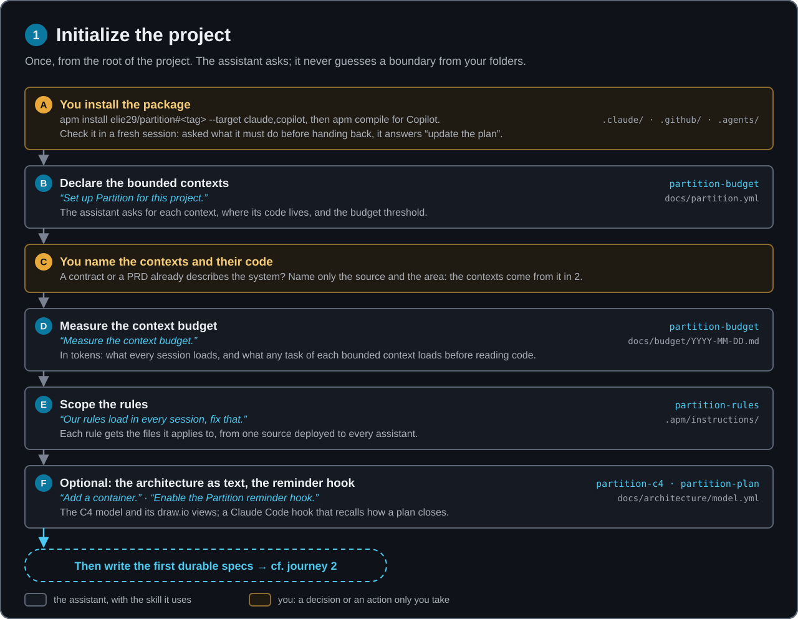
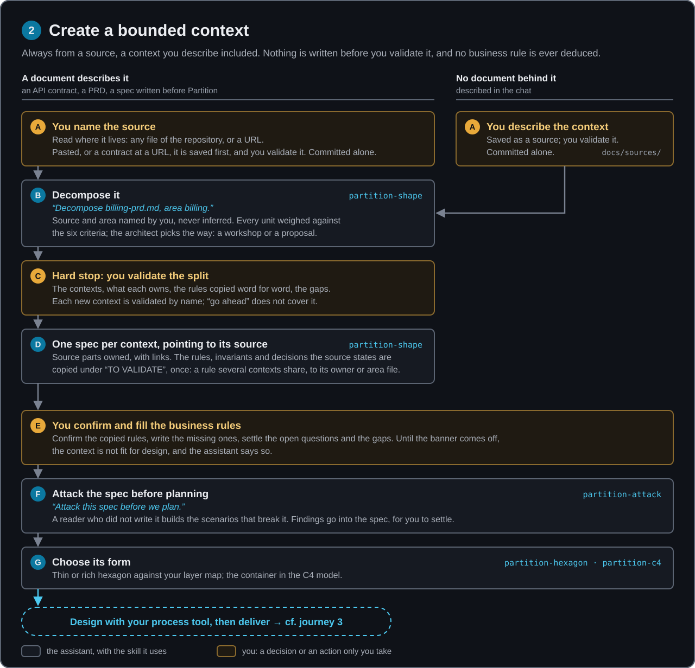
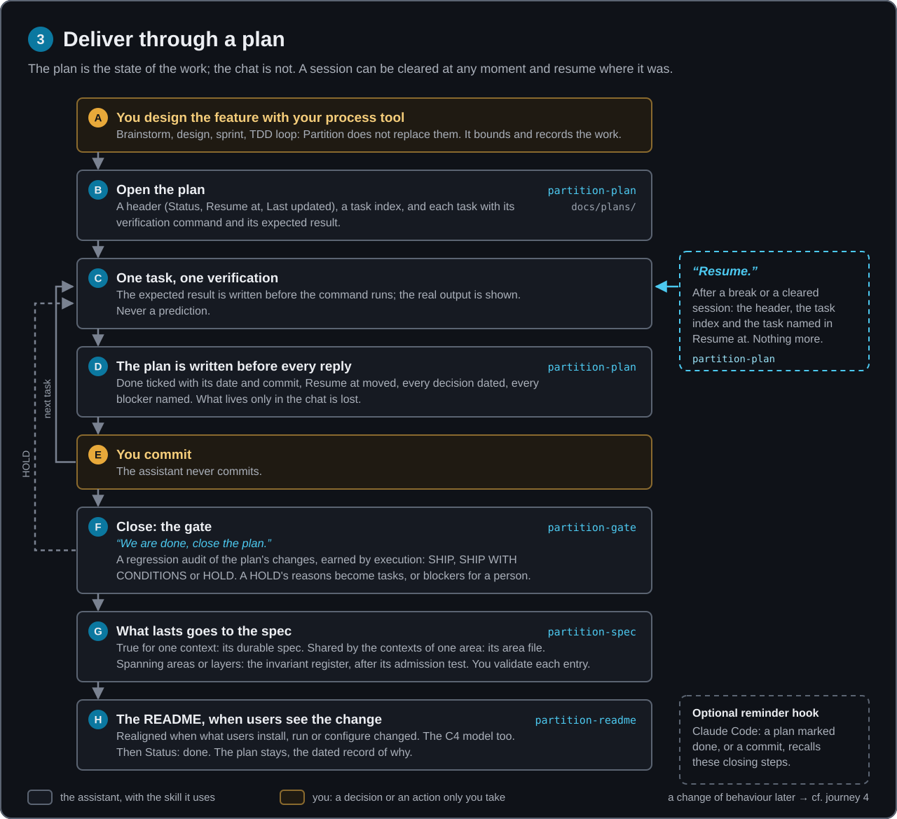
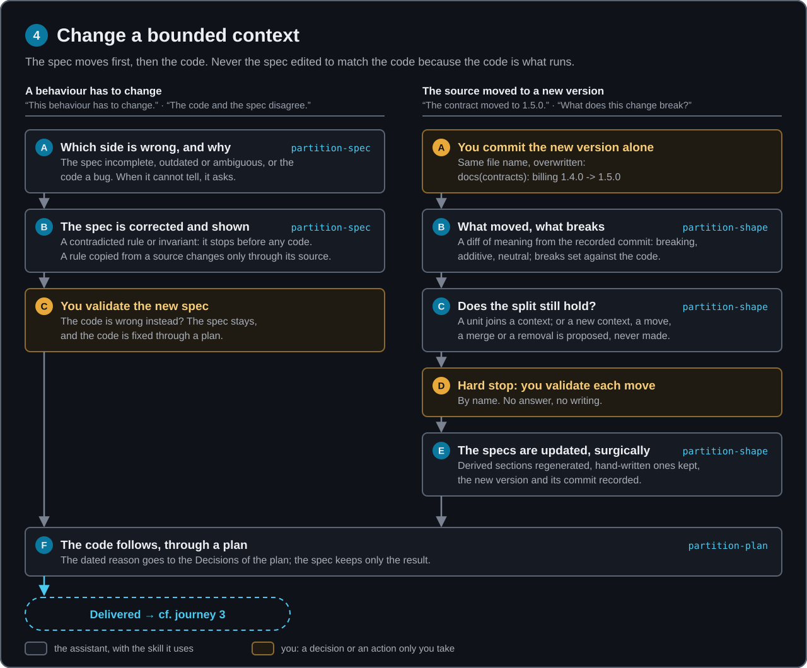
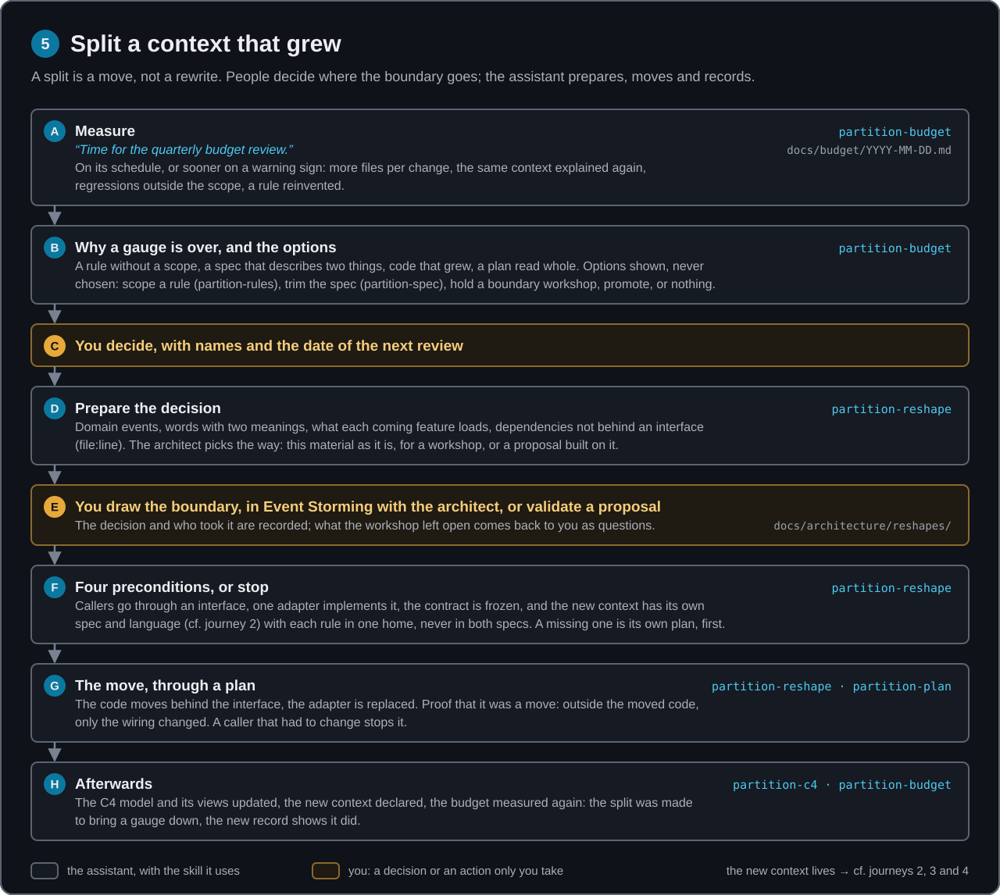

<p align="center">
  
</p>

# Partition

[](LICENSE)  

**The living specification and the Context Budget, as agent skills.**

A _partition_ is the score the musicians perform: the specification the code implements. It is also the split of a system into bounded contexts an AI assistant can hold in full. Partition gives your assistant the skills to keep both: one durable spec per bounded context, a budget that is measured, rules that load only where they apply, and an architecture written as text.

It is a method, not a shelf of skills. Five journeys carry a project from its first day to the split of a context that grew: initialize the project, create a bounded context, deliver it through a plan, change it with the spec first, split it once the budget measures it too big. The skills are the steps; the always-on instruction keeps the assistant on the journey in every session, and you validate every boundary and write every business rule. [Where to start](#where-to-start-and-what-follows) draws all five.

It has no workflow engine, no cast of role agents and no ceremony: it runs beside whatever drives your process.

<p align="center">
  
</p>

## Why

An AI assistant works wonders while it can hold the whole project. As the project grows, its answers lose accuracy. The model has not changed: what it has to hold has grown, and every request pays for it, in tokens, in review time, in regressions outside the scope asked, and in explaining the same context again. The pressure is the size of what the assistant holds, whatever the age of the project.

<p align="center">
  
</p>

Two things fix that, and neither is a prompt:

- **A specification that stays true.** The spec is the source of truth, the code implements it, and when something breaks the spec moves first. Otherwise the next session reintroduces the old behaviour from the old document.
- **Boundaries the assistant can hold.** A bounded context that fits the budget, neighbours known through their contract only. The split is paid for once, instead of an oversized context on every request.

## How to work with Partition

Three practices, and the always-on instruction makes the assistant keep all three in every session. The words they use are explained in the [glossary](.apm/skills/partition-spec/references/glossary.md).

### The durable spec is the truth

Each bounded context has one durable spec. `docs/partition.yml` declares where it lives: the specs folder under `paths:`, the area of each bounded context. [Where a rule lives](docs/guides/where-a-rule-lives.md#the-project) shows the full structure. The spec says what is true now, in the present tense; the code implements it.

- **The spec moves first.** When a behaviour must change, or when the code and the spec disagree, the assistant says which side is wrong, corrects the spec and has you validate it, and only then changes the code. It never edits the spec to match the code because the code is what runs.
- **You write the business rules.** No skill deduces one from a field name, an example or the code. Rules that a source states (a PRD, a contract description) are copied word for word and marked "from source", under a "TO VALIDATE" banner until you confirm them. While a banner stands, the bounded context is not fit for design, and the assistant says so.
- **What a source decided stays with the spec.** Its `Decisions` section holds the decisions the source states, with their reason. You do not fill it by hand: `partition-shape` copies them word for word when it decomposes the source (journey 2) and adds the ones a new version states (journey 4); a person confirms them. A decision taken while building lives in the plan that took it.
- **What is shared goes up one level, once.** A rule shared by the bounded contexts of one area goes to its area file; what spans areas or layers goes to the invariant register, after its admission test. You do not write them by hand: `partition-shape` places what a source states (journey 2), `partition-plan` proposes what a closed plan established (journey 3), `partition-reshape` moves what a split or a merge shares (journey 5), each where `partition-spec` sends it. You validate every entry, and most work admits nothing. [Where a rule lives](docs/guides/where-a-rule-lives.md) walks through an example.

Skills: `partition-spec` to write or change a spec, `partition-attack` to challenge it before planning; the `spec-auditor` agent audits the code of one context against its spec.

### The state is in the plan, not in the chat

A session can be cleared at any moment. What exists only in the chat is lost, so the plan of the feature is the only place the state of the work lives.

- **Where:** the plans folder declared in `docs/partition.yml` (`docs/plans/` by default). When none is declared, `partition-plan` takes the folder a project instruction names, or finds it on disk, and records it there; it asks you when neither settles it.
- **What it holds:** `partition-plan` opens it from its template: a header (`Status`, `Resume at`, `Last updated`), a task index with a checkbox per task, each task with its verification command and expected result, then `## Decisions` and `## Blockers`. When `bridge` names a tool, that tool writes the body and `partition-plan` adds the header, the index and the two sections.
- **Every turn:** before it replies, the assistant writes the plan: what is done (with the date and the commit sha, or `uncommitted`), where to resume, every decision made in the conversation, every blocker. It does not commit; you do.
- **Resume:** _"Resume."_ The assistant reads the header, the task index, the one task named in `Resume at` and `## Blockers`, nothing more, and announces where it restarts.
- **Close:** when the last task is ticked, in this order: a `partition-gate` verdict on the plan's changes (HOLD keeps the plan open; each reason of a HOLD and each condition becomes a task, or a blocker when only a person can act); what the work established goes to the durable spec, the area file, the invariant register or a rule file, each entry and each line validated by you; the README is realigned with `partition-readme` when what users install, run or configure changed, users including the people who build and maintain the project; then `done`.

Skill: `partition-plan`, with `partition-gate` and `partition-readme` at closing. The optional [reminder hook](#the-reminder-hook-optional-claude-code) catches a plan closed without those steps.

### Bounded contexts come from a source

A bounded context is found from what the system is specified by: an API contract, a PRD, a spec written before Partition, or a context you describe. Every new bounded context comes from one, through `partition-shape`; only the split of a context that grew comes from `partition-reshape`. _"Decompose `docs/sources/billing-prd.md` into bounded contexts, area `billing`."_

- **A source is read where it lives.** Any file of the repository, whatever its folder, or a URL. An old spec stays where it is and is never changed: it cannot be used as is, so it is decomposed like any other source, its rulings read as the decisions and rules it states.
- **A pasted or described source is saved first.** A source given in the chat is written to `docs/sources/`, a contract pasted or read from a URL to `docs/contracts/`, and validated by you before anything is derived from it. A context with no document behind it is described this way.
- **The spec points to its source.** Each spec lists the parts of the source its context owns (operations, requirements, sections), each with a link. Fields, requirement text and error codes stay in the source, so nothing drifts. Only the business rules, invariants and decisions the source states are copied.
- **You decide the split; the assistant proposes.** Before a boundary moves, it asks how you want to decide: a workshop, whose result it saves to `docs/sources/` and challenges against the criteria, or a proposal of two or three options with one recommended. A point you keep against a criterion is recorded, and not proposed again. Then it shows the plan (contexts, what each owns, the gaps) and stops. A new context, a merge, a removal, a move is validated by name.
- **The criteria are written down:** a context needs a root aggregate of its own and one more reason (its own language, its own life cycle, its own external dependencies); shared data or shared business rules argue against a split.
- **When the source changes**, the delta says what moved, what breaks, and whether the split still holds.

Skill: `partition-shape`. Once a boundary is decided, `partition-reshape` carries out the move; `partition-budget` tells you when a context has grown too big to hold.

## Install

You need the [APM CLI](https://microsoft.github.io/apm), Git and Node.js 22 or later. Python 3 and Bash are used by one skill (`partition-gate`) and by the optional hook.

From the root of your project:

```bash
# Claude Code
apm install elie29/partition#v1.0.0 --target claude

# GitHub Copilot
apm install elie29/partition#v1.0.0 --target copilot
apm compile

# both
apm install elie29/partition#v1.0.0 --target claude,copilot
apm compile
```

While the repository is private, give APM a credential first: `apm auth github.com`.

What lands in your project:

|  | Claude Code | GitHub Copilot |
| --- | --- | --- |
| 12 skills | `.claude/skills/partition-*/` | `.agents/skills/partition-*/` |
| 1 agent | `.claude/agents/spec-auditor.md` | `.github/agents/spec-auditor.agent.md` |
| 1 always-on instruction | `.claude/rules/partition.md` | `.github/instructions/partition.instructions.md`, and `AGENTS.md` after `apm compile` |

`apm compile` also writes the instruction into `.github/copilot-instructions.md`, unless you wrote that file by hand: APM never overwrites a hand-authored one, and tells you how to hand it over.

Commit `apm.yml`, `apm.lock.yaml` and the deployed files, so every clone has them. APM ignores `apm_modules/` for you; it is a download folder you can delete, and `apm install` recreates it from the lockfile. Run `apm install` again before `apm compile`, which reads the instruction from there.

**Check the install.** Open a fresh session and ask what the assistant must do before it hands control back. It should answer from the instruction: update the plan first. If it does not, the instruction is not loaded.

## Update

Your project pins a tag. To move to a newer one:

```bash
apm outdated                 # what is behind
apm update                   # shows the plan, then applies it
apm compile                  # Copilot only
```

or change the tag in `apm.yml` and run `apm install`.

An update replaces the skills, the agent and the instruction. It never touches what your project owns: your specs, your invariants, your plans, your rules, your `docs/partition.yml`, your C4 model. Templates are copied into your project only when the file does not exist yet. The install itself writes nothing under `docs/`: `docs/partition.yml` and the other files appear when a skill first needs them, starting with step 1 below. An update can still make the budget stop on a `docs/partition.yml` it used to accept, when the file carries a key the schema does not list (see [What your project owns](#what-your-project-owns)); the message names each key to fix.

To remove it: `apm uninstall elie29/partition`.

## Use

You do not call the skills by name. You say what you are doing, and the assistant picks the skill.

### The first day

1. **Set up Partition.** _"Set up Partition for this project."_ The assistant creates `docs/partition.yml` with you: the budget threshold and the schedule of the assessment. It asks for no bounded context and does not guess one from your folders: `contexts:` stays empty until `partition-shape` declares each one it retains from a source, at step 4 (a contract, a PRD, a spec written before Partition, a context you describe).
2. **Measure.** _"Measure the context budget."_ You get, in tokens, what every session loads before any work starts, and what any task of each bounded context loads before reading code.
3. **Scope your rules.** _"Our rules load in every session, fix that."_ Each rule gets the files it applies to and one source for every assistant.
4. **Derive the first durable specs from a source**: _"Decompose `shop.openapi.json` into bounded contexts, area `catalog`"_, _"Decompose this PRD"_, or a context you describe, saved as a source first.
5. **Fill and confirm the business rules yourself.** No skill deduces one; rules copied from a source wait for your confirmation. A context whose business rules are empty or unconfirmed is not fit for design, and the assistant will say so.

### Day to day

| You say | Skill |
| --- | --- |
| "This behaviour has to change" · "the code and the spec disagree" | `partition-spec` |
| "Attack this spec before we plan" | `partition-attack` |
| "Resume" · "where were we?" | `partition-plan` |
| "We are done, close the plan" | `partition-plan`, with `partition-gate` and `partition-readme` |
| "Enable the reminder hook" | `partition-plan` |
| "Is this safe to ship?" · "did I break anything?" · "check my last commit" | `partition-gate` |
| "Decompose this PRD" · "decompose our old spec" · "a new context: here is what it does" · "the contract moved to 1.5.0" · "what does this change of the source break?" | `partition-shape` |
| "Add a container" · "draw the checkout sequence" · "turn our draw.io into the model" | `partition-c4` |
| "Should this be a Strategy?" · "audit our patterns" | `partition-patterns` |
| "Does this module need a domain layer?" · "check the architecture" | `partition-hexagon` |
| "Add a rule" · "move our rules" | `partition-rules` |
| "Time for the quarterly budget review" | `partition-budget` |
| "We decided to extract billing", "merge refund into payment" | `partition-reshape` |
| "Update the README" | `partition-readme` |
| "Audit orders against its spec" | the `spec-auditor` agent |

### Where to start, and what follows

<p align="center">
  
</p>

New to the method? The [getting-started series](docs/learn/README.md), for a tech lead deciding to adopt Partition, explains why it works this way, maps the repository, walks through each journey below, shows how to adopt it on an existing project, and says where a rule lands.

In each journey below, a blue step is the assistant with the skill it uses; an amber step is yours: a decision or an action only you take.

#### 1. Initialize the project

<p align="center">
  
</p>

#### 2. Create a bounded context

<p align="center">
  
</p>

#### 3. Deliver through a plan

<p align="center">
  
</p>

#### 4. Change a bounded context

<p align="center">
  
</p>

#### 5. Split a context that grew

<p align="center">
  
</p>

A merge, a removal or the move of a unit goes through `partition-reshape` the same way: validated by name, its preconditions checked, carried out through a plan.

## What is in the package

Twelve skills, one agent (`spec-auditor`, a reader who did not write the code), one always-on instruction of about 600 tokens, and six scripts that do the mechanical work exactly, so the assistant does not read what a script can count. What each one does, where it lands and when it is loaded: [CONTENT.md](CONTENT.md).

An optional hook for Claude Code reminds the assistant to close a plan properly: see [The reminder hook](#the-reminder-hook-optional-claude-code) below.

## The reminder hook (optional, Claude Code)

Closing a plan is the step people forget. What the work established for good has to reach the durable spec, the area file or the invariant register before the plan is marked `done`; otherwise the next session starts from a spec that is already out of date. The hook is the safety net for that step. It reminds the assistant; it does not write the spec itself.

| When | What happens |
| --- | --- |
| A plan file is written with `Status: done` | A reminder is put into the session: close the plan as `partition-plan` says. First a `partition-gate` verdict on its changes; HOLD keeps the plan in progress. Then move what is true for one bounded context into its durable spec and what the bounded contexts of one area share into its area file, run the rest through the admission test of the invariant register, write no entry before the owner validates it, then report the entries touched and the candidates rejected. Last, realign the README with `partition-readme` when what users install, run or configure changed, the people who build and maintain the project included. |
| A `git commit` is about to run | The same reminder. |
| Anything else | Nothing. The hook stays silent. |

It reads the hook input and prints one message. It opens no other file, writes nothing and calls nothing.

**It is off by default.** Installing the package does not enable it. To turn it on, ask in a Claude Code session:

> Enable the Partition reminder hook.

It needs Python 3 (`python3`, `python` or `py`); the skill writes the one it finds on your machine. That command is this machine's: a teammate on another machine may need `python3` where you have `py -3`, and the hook stays silent when its interpreter is missing. Commit what the skill wrote if the whole team should have it. What it writes, and how to turn it off, is in [SECURITY.md](SECURITY.md).

What it does not cover:

- **GitHub Copilot.** There the closing rests on the always-on instruction and on `partition-plan`.
- **A contradiction found during the work.** When the code is about to contradict the spec or an invariant, the instruction tells the assistant to stop and flag it; no hook fires.
- **A plan outside a `plans/` folder.** The hook recognises a plan by its path.

## What your project owns

```text
.apm/instructions/                 your rules: one source, deployed to every assistant
docs/
├── partition.yml                  bounded contexts, paths, thresholds, layer maps
├── specs/
│   ├── invariants.md              what spans areas or layers: INV-{CAT}-{NNN}
│   └── <area>/
│       ├── bounded-contexts.md    how a source was split, and why
│       ├── area.md                the language and the rules shared in the area: AR-n
│       └── <bounded-context>/spec.md   the durable spec of one bounded context
├── contracts/                     by default, API contracts pasted or read from a URL
├── sources/                       by default, PRDs and contexts pasted or described in the chat, and workshop results
├── designs/  plans/               one per feature, a plan per bounded context: the input, and the state
├── architecture/model.yml         the C4, as text
├── architecture/patterns-grid.md  your rulings on patterns
├── architecture/reshapes/         one record per split, merge, removal, move or promotion
└── budget/YYYY-MM-DD.md           one record per day of assessment
```

The folders under `paths:` in `docs/partition.yml` are yours to change: specs, the invariant register, contracts, sources, plans and, if you document it, your persistence schema. The file follows `partition.schema.json`, shipped with `partition-budget`: its first line points your editor at the schema, and the budget stops on a key it does not know, naming each key to fix.

| Key | Default | What it holds | Kind |
| --- | --- | --- | --- |
| `specs` | `docs/specs` | one durable spec per bounded context, by area | [Durable spec](.apm/skills/partition-spec/references/glossary.md#documents) |
| `invariants` | `<specs>/invariants.md` | what spans areas or layers | [Invariant register](.apm/skills/partition-spec/references/glossary.md#documents) |
| `plans` | `docs/plans` | one per feature and bounded context: its state and its decisions | [Plan](.apm/skills/partition-spec/references/glossary.md#documents) |
| `contracts` | `docs/contracts` | where an API contract pasted or read from a URL is saved; one elsewhere in the repository is read where it lives | [Contract](.apm/skills/partition-spec/references/glossary.md#documents) |
| `sources` | `docs/sources` | where a source pasted or described in the chat is saved; one elsewhere, an old spec included, is read where it lives | [Source](.apm/skills/partition-spec/references/glossary.md#documents) |
| `schemas` | none: declare it only if you document your persistence | the schema documents of your persistence | schema documents |

## It keeps its own budget

A package about budget that ignored its own would not be believed. Every session of a project that installs Partition pays for the instruction and for the name and description of each skill, whether they are used or not: about **1 700 tokens**. The tests fail above 2 000, and above 3 000 for any single skill file.

```bash
npm run budget
```

### What a session of your project loads

The budget record gives two figures. The second contains the first, so they do not add up:

```text
Every session  = your entry file (CLAUDE.md, AGENTS.md, ...)
               + about 1 700   (the Partition instruction and the skill and agent descriptions)
               + every rule file without a scope
               + the invariant register

Always (per bounded context) = Every session
                             + the spec of that bounded context
                             + its area file
                             + the rule files scoped to its code
```

For example, with a 1 000-token entry file and a 7 000-token spec, a session that touches no bounded context loads about 2 700 tokens. A task in that bounded context loads about 9 700, its [_Always_ gauge](.apm/skills/partition-spec/references/glossary.md#budget), compared with the threshold (32 000 by default). The body of each skill used comes on top, 800 to 2 600 tokens each, and only for the skills that run.

## Beside your process tools

Partition does not brainstorm, plan a sprint or run a TDD loop. Use what you already use for that. Name the tool that writes the body of your plans in `bridge` of `docs/partition.yml` (`superpowers` for the Superpowers plugin of Claude Code, `bmad`, another): it writes the body of each plan and Partition adds its header and its closing on top of it. The key is information for the reader; the plans stay in the folder `paths.plans` declares.

## The method

The reasoning behind every folder above:

- [The Living Specification: How I Keep AI-Written Code Correct](https://elienehme.fr/writing/the-living-specification-how-i-keep-ai-written-code-correct/) ([Hashnode](https://elie29.hashnode.dev/the-living-specification-how-i-keep-ai-written-code-correct))
- [Plus le projet grossit, plus l'IA se trompe : le bounded context comme investissement](https://elie29.hashnode.dev/plus-le-projet-grossit-plus-l-ia-se-trompe) (Context Budget, in French)
- [AI Writes the Code. So What Is the Engineer's Job Now?](https://elienehme.fr/writing/ai-writes-the-code-so-what-is-the-engineers-job-now/)
- More on [elienehme.fr](https://elienehme.fr) and [elie29.hashnode.dev](https://elie29.hashnode.dev)

The specification of this package is in [docs/specs/partition/spec.md](docs/specs/partition/spec.md): its business rules and where not to give in.

## Contributing

Read [CONTRIBUTING.md](CONTRIBUTING.md) first: a skill costs every session of every project, so the bar for adding one is high. Security reports: [SECURITY.md](SECURITY.md). Changes: [CHANGELOG.md](CHANGELOG.md). Releasing a version, for the maintainer: [RELEASING.md](RELEASING.md).

```bash
npm ci          # once, Node 22 or later: Prettier, and a pre-commit hook that formats and tests
npm test
```

## License

[MIT](LICENSE) © Elie Nehmé · [elienehme.fr](https://elienehme.fr)
