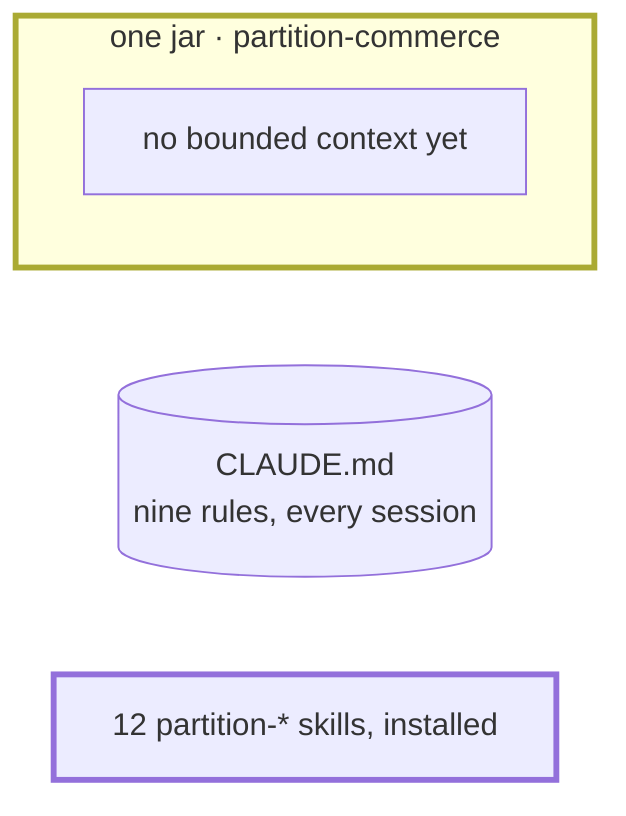

# Step 00 — An empty folder → a jar and the package

## The situation

You start from nothing: an empty folder, `partition-commerce`, and the rules the team wrote before Partition, nine of them, all in one `.claude/CLAUDE.md` that every session loads. No business exists yet: no bounded context, no spec, no plan.

## What you bring

- [TL] The skeleton: a Spring Boot 4.1 jar on Java 21, generated by Spring Initializr with Flyway, H2 and the Maven wrapper, and its configuration, [`src/main/resources/application.yaml`](00-provided/src/main/resources/application.yaml): the database is a file under `.local/`, kept out of every commit.
- [TL, architect] The team's rules, [`.claude/CLAUDE.md`](00-provided/.claude/CLAUDE.md), each from the role that owns it: constructor injection, no controller calling a repository, one package per bounded context, a domain without Spring, a merged migration never edited, the API generated from its contract, never log a card number, plans in `docs/plans/`. Keep it as it is: step 01 migrates it.
- [TL] The license, [`LICENSE`](00-provided/LICENSE), MIT. All three are in [`00-provided/`](00-provided/).

You build the skeleton once, then install the package with APM, for Claude Code: `apm install elie29/partition --target claude`.

## What you ask

Once the package is installed, in a fresh session: the instruction loads when a session starts, so a session opened before the install never sees it.

> What must you do before you hand control back to me?

## What partition does

1. **The install adds, and changes nothing of yours.** APM deploys the skills, the `spec-auditor` agent and the instruction under `.claude/`. Your `CLAUDE.md` and your `LICENSE` stay as they were: an install never touches what the project owns.
2. **Nothing runs unasked.** No `docs/` folder, no configuration, no plan appears: the package waits until there is work.
3. **The answer comes from the instruction, not from a skill.** Write the plan first: tick what is done with its date and its commit, or `uncommitted`; set `Resume at`; append the decisions and the blockers. Then reply. And never commit: committing is yours.
4. **It creates nothing to answer.** No plans folder is guessed: step 01 settles it, when there is work to plan.

**Why it works this way.** The instruction is the one part of the package in context from the first turn (BR-6); every skill is found later by its description, when a request calls for it. The plan, not the chat, holds the state of the work, so a session cleared at any moment loses nothing.

## Worth noticing

- If the answer does not say "plan first", the instruction is not loaded: stop there, nothing after this step would hold.

## The shape after

**New:** the Spring Boot skeleton; the package, installed by APM.

**Cost:** the descriptions of the package's skills load in every session, from now on.
