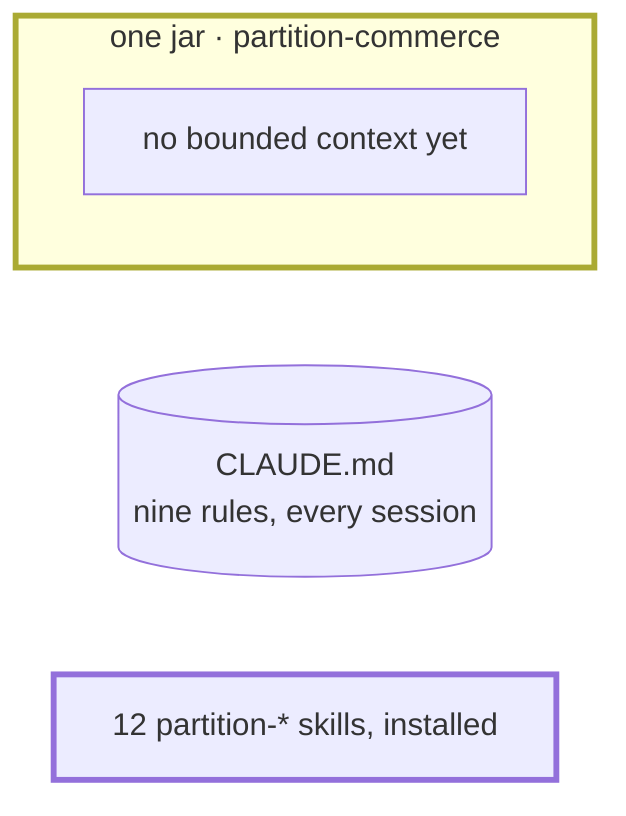

# Step 00 — From an empty folder to an installed package

> **Session:** you need none until the package is installed, then open a **fresh session**. The instruction is loaded when a session starts (BR-6): a session you open before `apm install` never sees it.

## The problem

You start from nothing: an empty folder, and the rules the team wrote before Partition, all in one `.claude/CLAUDE.md`.

## Before

You start from nothing: create an empty folder, `partition-commerce`, and an empty private repository of the same name on GitHub.

Your machine needs Java 21 on the path, Git, Node.js 22, the APM CLI, and Claude Code with the Superpowers plugin. You do not need Maven: the skeleton brings its wrapper. Your own instructions (`~/.claude/CLAUDE.md`) load in every project too.

## Provided

`[TL]` gives you the skeleton of the application: the stack, and nothing of the business. Generate it with Spring Initializr, at the root of `partition-commerce`:

```bash
curl -s https://start.spring.io/starter.zip -d type=maven-project -d language=java \
  -d bootVersion=4.1.1 -d javaVersion=21 -d groupId=com.commerce -d artifactId=partition-commerce \
  -d name=commerce -d packageName=com.commerce -d packaging=jar -d configurationFileFormat=yaml \
  -d dependencies=web,flyway,h2,actuator,lombok -o skeleton.zip
unzip -q skeleton.zip && rm skeleton.zip
rm HELP.md
printf "apm_modules/\n.local/\n" >> .gitignore
```

You get a `pom.xml` under `spring-boot-starter-parent` 4.1.1, with `spring-boot-starter-webmvc`, `spring-boot-starter-flyway`, `spring-boot-h2console`, `spring-boot-starter-actuator`, `h2` at runtime, `lombok` as an optional annotation processor, and their test starters; `CommerceApplication`; one test, `CommerceApplicationTests.contextLoads`; an `application.yaml`, the only configuration file; a `.gitignore`; the Maven wrapper, `mvnw` and `mvnw.cmd`, on Maven 3.9.16. From here on, run every build with `./mvnw`.

`[TL]` gives you the configuration, [`src/main/resources/application.yaml`](00-provided/src/main/resources/application.yaml). It replaces the whole `application.yaml` the skeleton brings. The database is a file under `.local/`, which `.gitignore` keeps out of every commit; Flyway runs on Spring Boot's defaults.

### CLAUDE.md

`[TL]` and `[architect]` give you the team's rules, written before Partition, in [`.claude/CLAUDE.md`](00-provided/.claude/CLAUDE.md), the one file every session loads. Each rule comes from the role that owns it: the architect owns 2, 3, 4 and 7; the tech lead owns the others. You migrate the file at step 01; keep it as it is here:

```markdown
<!-- .claude/CLAUDE.md -->

# partition-commerce

Spring Boot service that sells products from price lists and bills them.

## Build

- `./mvnw clean install` builds and runs every test.

## Rules

1. Constructor injection only; no field injection.
2. A controller never calls a repository.
3. One package per bounded context under `com.commerce`.
4. The domain does not import Spring.
5. Every schema change is a new Flyway file `V<n>__<what>.sql`; a migration already merged is never edited.
6. Tests: JUnit 5 and AssertJ; one test class per use case.
7. The HTTP API is generated from its OpenAPI contract; a controller implements the generated interface.
8. Never log a payment card number.
9. Plans live in `docs/plans/`, not in `docs/superpowers/plans/`.
```

`[TL]` gives you the license, [`LICENSE`](00-provided/LICENSE), MIT: the repository is opened after the first release of Partition.

Copy the three files of [`00-provided/`](00-provided/) into `partition-commerce`, at its root, once the skeleton is there.

## Prompt

In a terminal, at the root of `partition-commerce`, run:

```bash
git init
./mvnw clean install
git add . && git commit -m "chore: skeleton"
apm auth github.com # while the package repository is private
apm install elie29/partition --target claude
git add . && git commit -m "chore: install partition"
```

Then open a **fresh session** in `partition-commerce` and ask:

> What must you do before you hand control back to me?

## Expected

**The build.** You should see `./mvnw clean install` end on `BUILD SUCCESS` and exit 0, with one test run, `CommerceApplicationTests.contextLoads`: `Tests run: 1, Failures: 0, Errors: 0, Skipped: 0`. The test opens the database, which creates `.local/h2/`. Check that `.local/` is in neither commit, and that `LICENSE` is in the first.

**The install.** You should see `apm install` add these files, and nothing else ([README, _What lands in your project_](../../../README.md#install), the Claude Code column):

```text
+ apm.yml
+ apm.lock.yaml
+ .claude/skills/partition-attack/ … partition-spec/      12 skills
+ .claude/agents/spec-auditor.md
+ .claude/rules/partition.md                             the instruction
```

`--target claude` deploys nothing for Copilot: no `.agents/`, no `.github/`, no `AGENTS.md`, and no `apm compile` to run.

- Every deployed skill folder carries `LICENSE`, the MIT notice of the package: APM deploys the folder without the package's root `LICENSE`.
- Your `.claude/CLAUDE.md` and `LICENSE` are untouched: an install never changes what your project owns.
- You find no `docs/` folder, no `docs/partition.yml`, no plan: nothing runs unasked (BR-4).
- You delete `apm_modules/`, where APM resolved the package, after the install; it is absent from the second commit.

**The answer.** The assistant answers from the instruction (`.claude/rules/partition.md`, _State_), not from a skill: update the plan first — tick what is done with the date and the commit or `uncommitted`, set `Resume at`, append the decisions and the blockers — then reply; and never commit, because you commit. If the answer does not say "plan first", the instruction is not loaded: stop here.

The assistant creates nothing to answer: no plan, no plans folder, no `docs/partition.yml`. You settle the plans folder at step 01, when there is work to plan.

### The shape after



**New:** the Spring Boot skeleton; the package, installed by APM.

**Cost:** the descriptions of the package's skills load in every session, from now on.

## Verdict

- [x] `./mvnw clean install` ends on `BUILD SUCCESS`, exit 0, `Tests run: 1, Failures: 0, Errors: 0, Skipped: 0`
- [x] `.local/h2/` exists after the build, and `.local/` is in neither commit
- [x] `LICENSE` is in the first commit
- [x] `apm install` adds the files listed, and nothing else — run 2026-10-12 from the local path of `partition` (branch `guide-run`), so `apm.yml` names that path
- [x] Each of the 12 deployed skill folders carries `LICENSE`
- [x] `.claude/CLAUDE.md` and `LICENSE` are untouched
- [x] No `docs/` folder, no `docs/partition.yml`, no plan
- [x] `apm_modules/` is absent from the second commit
- [x] The answer says plan first, then reply, and never commit
- [x] The answer creates nothing: no plan, no plans folder, no `docs/partition.yml`
