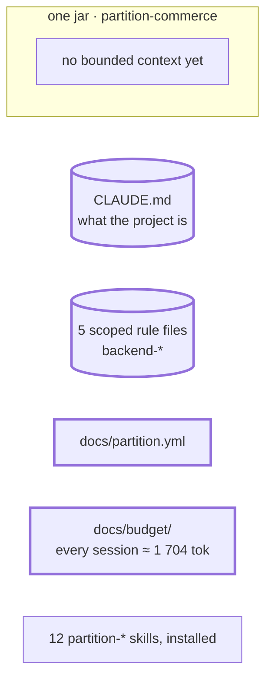

# Step 01 — Every rule loads in every session → scoped rules, a configuration, a first measure

## The situation

Every rule of the team loads in every session, from `.claude/CLAUDE.md`, whatever the task touches. There is no `docs/` folder yet: nowhere to keep a plan, and no measure of what a session loads before it reads any code.

## What you bring

Nothing to copy: the people answer from the code and from their roles.

- [TL] Where the code, the migrations and the tests live: these become the scopes of the rules.
- [architect] The contracts live in `docs/contracts/**`. Card numbers are a scoped rule over `src/main/**`, broken by a log call or the logging configuration: not the invariant register.
- [TL, architect] What stays in the entry file: plans in `docs/plans/`, one package per bounded context. The build command goes to the README.
- [architect] The budget: the default threshold, 32 000, assessed every quarter. No bounded context yet: the first comes from a source at step 02.

The assistant asks other questions along the way. You answer them as the role would.

## What you ask

> Open a plan to set up Partition in this project: its configuration, the rules of `.claude/CLAUDE.md` moved to scoped rules, a first measure of the budget.

After each question answered, or each validation given, when the plan stops without one:

> Go on with the plan.

When the plan reaches the rules:

> Migrate the rules of `.claude/CLAUDE.md`.

At the end, optional, Claude Code only:

> Enable the Partition reminder hook.

## What partition does

1. **The plans folder, taken from your rule.** `partition-plan` finds no configuration, but `CLAUDE.md` names `docs/plans/`: your team has decided, so it does not ask. It says your global instructions name another folder, and records `docs/plans` in `docs/partition.yml`, which wins from now on.
2. **The configuration.** `partition-budget` asks only what the file cannot say: the threshold and the review. It asks for no bounded context and guesses none from the folders. Every other key is written with its default and its comment, and the file is checked against its schema.
3. **The migration, proposed.** `partition-rules` lists `CLAUDE.md` as the entry file, loaded by every session, then proposes one file per topic with its scope: architecture, database, testing, API contract, security. It quotes what is said twice, the plans folder in `CLAUDE.md` and in `docs/partition.yml`, and stops. Your answers decide, not its proposal.
4. **The migration, carried out.** Each rule moves unrewritten into `.apm/instructions/`, under a `description` and an `applyTo`. The old lines stay until you remove them, and it tells you that the rules load twice meanwhile. `apm install` deploys them, each scoped.
5. **The first measure.** `partition-budget` shows the every-session total before and after, and no rule "without a scope". The record of the day goes to `docs/budget/`, its figures pasted from the run: the baseline.
6. **The hook, if you want it.** It finds a Python interpreter, installs the reminder and tells you how to remove it.
7. **The closing**, in the same turn as the last tick: the gate says what it ran and what it could not verify; nothing is established for a spec, and "zero" is the normal outcome; `partition-readme` offers a README, which receives the build command.

**Why it works this way.** A rule has one source and a scope (BR-23): it loads only when its files are in play, and only the entry file stays unscoped. The plans folder is declared once (BR-25), so no plugin or later answer moves it.

## Worth noticing

- `bridge` only says which plugin writes the body of a plan. It never moves the plans folder.

## The shape after

**New:** `docs/partition.yml`, the plans folder, five rule files loaded by the code they match, the first budget record: the baseline.

**Cost:** one more file to keep true, `docs/partition.yml`.
