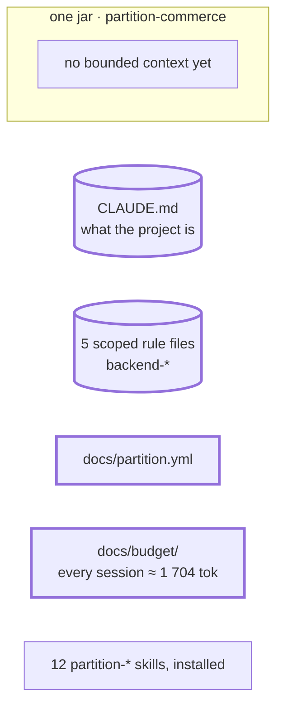

# Step 01 - Plans folder, `docs/partition.yml`, rules migrated and scoped, first budget

> **Session:** you can stay in the session you ended step 00 in; nothing here tests a cold start. Type the four prompts below in order, in one session, under one plan.

## The problem

Every rule of the team loads in every session, from `.claude/CLAUDE.md`, and there is no `docs/` folder yet: nowhere to keep a plan, and no measure of what a session loads.

## Before

Your `partition-commerce` project should be at the commit of step 00: the skeleton, `.claude/CLAUDE.md` with its nine rules, the package installed. There is no `docs/` folder yet.

## Provided

`[TL]` and `[architect]` give you the answers that the configuration, the rules migration and the budget record ask for, each from the role that owns it. They come from the code and from those two roles:

| Question | Answer | From |
| --- | --- | --- |
| Where does the backend code live? | `src/main/java/**` | `[TL]` |
| Where do the migrations live? | `src/main/resources/db/migration/**` | `[TL]` |
| Where do the tests live? | `src/test/java/**` | `[TL]` |
| Where do the contracts live? | `docs/contracts/**`, generated into `target/generated-sources/openapi/**` | `[architect]` |
| Which rule holds everywhere, in the entry file \* | "Plans live in `docs/plans/`" and "One package per bounded context" | `[TL]` the first, `[architect]` the second |
| Build command | goes to the README, created at closing; stays in the entry file until then | `[TL]` |
| Card numbers | a scoped rule, `src/main/**`: a log call or the logging configuration breaks it; not the invariant register | `[architect]` |
| Pointer line to `.apm/instructions/` | none: each rule loads by its scope | `[TL]` |
| What is said twice with your global file | left as it is: outside the plan; you align your own file | you |
| Budget threshold | the default, 32 000; assessment every quarter | `[architect]` |
| `bridge` | `none`: plans stay in `docs/plans/` | `[TL]` |
| Bounded contexts | none yet: the first comes at step 02 | `[architect]` |
| Paths of specs, invariants, designs, sources | the template's defaults; `paths.schemas` stays undeclared | `[architect]` |
| Who holds the budget assessment | you, as `[architect]` and `[TL]`; no product owner yet | you |
| Next assessment | one quarter from today | `[architect]` |
| What is coming | the billing PRD (step 02); its bounded context is not declared yet | `[architect]` |
| Warning signs | none observed: the project has no history yet | `[TL]` |
| Budget decision | nothing: no gauge is over its threshold | `[architect]` |

\* **N.B.** The [rules](00-empty-folder.md#claudemd) that apply to the whole project, not to one folder, stay in the entry file (`CLAUDE.md` / `AGENTS.md`). Every other rule becomes a scoped rule, loaded only when the agent touches files that match its scope.

## Prompt

**01.a** - Init

> Open a plan to set up Partition in this project: its configuration, the rules of `.claude/CLAUDE.md` moved to scoped rules, a first measure of the budget.

The assistant loads each skill by itself, from what the prompt asks:

- `partition-plan`: the plan is the file that holds the state of the work, so a cleared session loses nothing.
- `partition-rules`: every session loads `.claude/CLAUDE.md` whole; a rule given a scope (`applyTo`) loads only when its files are in play (BR-23).
- `partition-budget`: the tokens loaded before any code is read, measured against the threshold of `docs/partition.yml` and recorded by date in `docs/budget/`; the first record is the baseline (BR-16).

**01.b** - once the plan is open, answer each question it asks from **Provided**. When it stops without a question, or after each validation it asks you for, type:

> Go on with the plan.

When your answers alone carry it to the next task, you do not need this prompt.

**01.c** - when the plan reaches the rules, type:

> Migrate the rules of `.claude/CLAUDE.md`.

**01.d** - at the end, optional, Claude Code only:

> Enable the Partition reminder hook.

## Expected

### 01.a - The plans folder is taken from the project's rule, then recorded

You should see `partition-plan` fire (_Where the plans are_). `docs/partition.yml` does not exist, so nothing is declared there; `.claude/CLAUDE.md` names `docs/plans/`: your team has decided, so the assistant **does not ask**. It tells you that your global instructions name `docs/superpowers/plans/`: the two disagree, and once `docs/partition.yml` declares a folder, that declaration wins.

```text
+ docs/partition.yml                       one key under the template's first line
+ docs/plans/<name>.md                     the plan, from the template of partition-plan
```

The skill names no file: any name will do.

```yaml
# docs/partition.yml
# yaml-language-server: $schema=../.claude/skills/partition-budget/assets/partition.schema.json
paths:
  plans: docs/plans
```

The first line is the template's, rewritten for the target `claude` as its second line says; the second line itself is not copied.

The plan opens with the header (`Status: in progress`, `Resume at`, `Last updated · uncommitted`), the `## Tasks` index, the goal, one section per task with its verification and its **expected result written before** it runs, then `## Decisions` (the plans folder, with today's date and the reason) and `## Blockers`. With Superpowers installed, its `writing-plans` skill may write the body: you still find the header, the index and the two sections.

### 01.b - The configuration

`docs/partition.yml` exists now, with one key. `partition-budget` (_Configuration_) asks you for what the file does not say: the bounded contexts and the paths of their code, the threshold, the review. It does not guess a bounded context from the folder tree: there is none yet, so `contexts:` stays absent or empty. It fills the file from the template `assets/partition.yml` with your answers: every other key is written with its default and its comment, so you see each key when you adjust the file by hand.

```yaml
# yaml-language-server: $schema=../.claude/skills/partition-budget/assets/partition.schema.json
# Partition - project configuration.
# ...the template's comments...

version: 1
target: claude
bridge: none

paths:
  specs: docs/specs
  invariants: docs/specs/invariants.md
  designs: docs/designs
  plans: docs/plans
  contracts: docs/contracts
  sources: docs/sources

budget:
  always: 32000
  chars_per_token: 4
  review: quarterly
```

`paths.schemas` stays undeclared: your project documents its persistence nowhere but in its Flyway files. Every spec will then read "No schema documents are declared for this project" under `Persistence`.

`node .claude/skills/partition-budget/scripts/budget.mjs` checks the file against the schema before it measures: you should see no finding.

### 01.c - The rules migrated

You should see `partition-rules` fire (_Migrate existing rules_). Nothing moves before you validate:

1. It runs `partition-budget` and lists `.claude/CLAUDE.md` as the entry file, loaded by every session.
2. It proposes one file per topic, each with its scope, and what leaves the entry file. Its proposal may move rule 3 into `backend-architecture`, remove rule 9 as said twice with `paths.plans`, or add a line pointing to `.apm/instructions/`: your answers from **Provided** bring it back to this table:

   | File in `.apm/instructions/` | `applyTo` | From `.claude/CLAUDE.md` |
   | --- | --- | --- |
   | `backend-architecture.instructions.md` | `src/main/java/**` | constructor injection; controller never a repository; domain without Spring |
   | `backend-database.instructions.md` | `src/main/resources/db/migration/**` | one new Flyway file per change, never edit a merged one |
   | `backend-testing.instructions.md` | `src/test/java/**` | JUnit 5 and AssertJ, one test class per use case |
   | `backend-api-contract.instructions.md` | `docs/contracts/**`, `src/main/java/**` | the API generated from its contract |
   | `backend-security.instructions.md` | `src/main/**` | never log a card number |
   | stays in `.claude/CLAUDE.md` | - | what the project is; one package per bounded context; plans in `docs/plans/` |
   | goes to the README | - | `./mvnw clean install`: a command to build belongs to the README |

3. It quotes what is said twice, if anything (rule 9 and `paths.plans` of `docs/partition.yml`), and **waits for you to validate**.
4. After your validation, each file starts with `description` and `applyTo`, has no `#` or `##` heading (its sections start at `###`, BR-32), and carries the text moved without rewriting it.
5. The old lines stay in `.claude/CLAUDE.md` until you remove them, and it tells you so: while both exist, the rules load twice.
6. Run `apm install`: it deploys them as `.claude/rules/backend-*.md`, each scoped by its `applyTo`.
7. `partition-budget` runs again and shows the every-session total before and after. Once you have removed the moved lines from `.claude/CLAUDE.md`, the total goes down, and no rule is listed "without a scope" but the package's `.claude/rules/partition.md`, unscoped by design. The entry file is listed by its name, with no such label.

### The first budget record

You should get `docs/budget/YYYY-MM-DD.md`, from `assets/assessment.md`, with the output of `budget.mjs` pasted unedited:

```text
## Loaded by every session
| .claude/CLAUDE.md                      | (its size after the migration)
| .claude/rules/partition.md             | the instruction
| 13 skill and agent descriptions        | 12 skills, 1 agent
## Bounded contexts                      none declared yet
## Plans in progress                     the setup plan: whole file against what a resume reads
## Files touched per change              not enough history for a trend
```

Every figure in it comes from the run; none is written by hand.

### 01.d - The hook

You should see `partition-plan` (_Reminder hook_) find Python 3 by trying `python3`, `python`, `py -3` in that order; copy `assets/hook/partition-reminder.py` to `.claude/hooks/`; merge the two entries of `assets/hook/settings.json` into `.claude/settings.json` with `<python>` replaced; and tell you that removing those two entries disables it, and that the interpreter written is this machine's. The plans folder is `docs/plans/`: the hook knows a plan by its `plans/` folder, so both reminders fire.

The plan is already `done` and you commit, so neither event comes by itself. Check each reminder by feeding the script the payload Claude Code would send, with the interpreter written in `.claude/settings.json`:

```bash
echo '{"tool_name":"Bash","tool_input":{"command":"git commit -m x"}}' \
  | python .claude/hooks/partition-reminder.py PreToolUse
echo '{"tool_name":"Edit","tool_input":{"file_path":"docs/plans/x.md","new_string":"> **Status:** done"}}' \
  | python .claude/hooks/partition-reminder.py PostToolUse
```

Each should print one JSON object whose `additionalContext` starts with "A commit is about to be created." and "A plan has just been marked done." respectively.

### Closing the plan

When the assistant ticks the last task, it starts the closing **in the same turn**, without you asking (`partition-plan`, _Close_):

- `partition-gate` on the plan's changes, from the commit before its first task to the working tree. No Java changed: the verdict says what ran (`./mvnw clean install`) and what could not be verified.
- What the plan established for good: nothing for a spec, an area file or the register. "Zero" is the normal outcome, and the assistant reports it.
- The README: there is none. `partition-readme` offers to create one from the code: the build command moved out of `.claude/CLAUDE.md` lands there.
- `Status: done`, `Resume at: - (nothing; every task is checked)`.

### Watch

`bridge: superpowers` puts the plans under `docs/superpowers/plans/`, and `paths.plans` names a folder: the skill does not say which wins when both are set. You use Superpowers and keep your plans in `docs/plans/`, so the run should keep `bridge: none`. If it sets `bridge: superpowers`, that is a gap.

### The shape after



**New:** `docs/partition.yml`, the plans folder, five rule files loaded by the code they match, the first budget record: the baseline.

**Cost:** one more file to keep true, `docs/partition.yml`.

## Verdict

- [x] 01.a - `partition-plan` takes `docs/plans/` from `.claude/CLAUDE.md` without asking, and says your global instructions name another folder
- [x] 01.a - `docs/partition.yml` holds only `paths.plans: docs/plans`, under the template's first line rewritten for `claude`; the template's second line is not copied
- [x] 01.a - A plan is created in `docs/plans/` from the template of `partition-plan`
- [x] 01.a - The plan has the header (`Status: in progress`, `Resume at`, `Last updated · uncommitted`), the `## Tasks` index and the goal
- [x] 01.a - Each task has its own section, with its verification and its expected result written before it runs
- [x] 01.a - `## Decisions` records the plans folder, with today's date and the reason; `## Blockers` is present
- [x] 01.b - `partition-budget` asks for the bounded contexts and their code paths, the threshold and the review
- [x] 01.b - No bounded context is guessed from the folder tree: `contexts:` stays absent or empty (`contexts: []`)
- [x] 01.b - `docs/partition.yml` is the template filled with your answers: `budget.always: 32000`, `budget.review: quarterly`, every other key at its default, no bounded context, `paths.schemas` undeclared — the first run of 2026-10-12 left out `budget.chars_per_token`: fixed in BR-31 and `partition-budget`, replayed
- [x] 01.b - `budget.mjs` checks the file against the schema: no finding
- [x] 01.c - `partition-rules` runs `partition-budget` and lists `.claude/CLAUDE.md` as the entry file
- [x] 01.c - It proposes the five files of the table, each with its `applyTo`, what stays in `.claude/CLAUDE.md`, and `./mvnw clean install` going to the README - its proposal moved rule 3 and removed rule 9; your answers brought it back to the table
- [x] 01.c - It quotes what is said twice, if anything, and nothing moves before validation
- [x] 01.c - Each file starts with `description` and `applyTo`, has no `#` or `##` heading, and carries the text unrewritten
- [x] 01.c - The old lines stay in `.claude/CLAUDE.md`, and it says the rules load twice while both exist
- [x] 01.c - `apm install` deploys `.claude/rules/backend-*.md`, each scoped by its `applyTo`
- [x] 01.c - `partition-budget` shows the every-session total before and after; once the moved lines are removed, the total goes down and only `.claude/rules/partition.md` is listed without a scope
- [x] Budget - `docs/budget/YYYY-MM-DD.md` comes from `assets/assessment.md`, with the output of `budget.mjs` pasted unedited
- [x] Budget - It lists `.claude/CLAUDE.md`, `.claude/rules/partition.md`, 13 descriptions (12 skills, 1 agent), no bounded context, the setup plan, not enough history for a trend; no figure is written by hand
- [x] 01.d - Python 3 is found by trying `python3`, `python`, `py -3`, in that order
- [x] 01.d - `partition-reminder.py` is copied to `.claude/hooks/`, and the two entries are merged into `.claude/settings.json` with `<python>` replaced — written by the assistant; in the headless run of 2026-10-12 the permissions refused both writes, and the hook is left for you to install
- [x] 01.d - It says removing those two entries disables the hook, and that the interpreter written is this machine's
- [x] 01.d - Both reminders fire
- [x] Closing - It starts in the same turn as the last tick, unasked
- [x] Closing - `partition-gate` covers the plan's changes; its verdict says what ran (`./mvnw clean install`) and what could not be verified
- [x] Closing - Nothing is established for a spec, an area file or the register, and "zero" is reported
- [x] Closing - `partition-readme` offers to create a README from the code, with the build command moved out of `.claude/CLAUDE.md`
- [x] Closing - `Status: done`, `Resume at: - (nothing; every task is checked)`
- [x] Watch - `bridge` stays `none`: `bridge: superpowers` is not set
