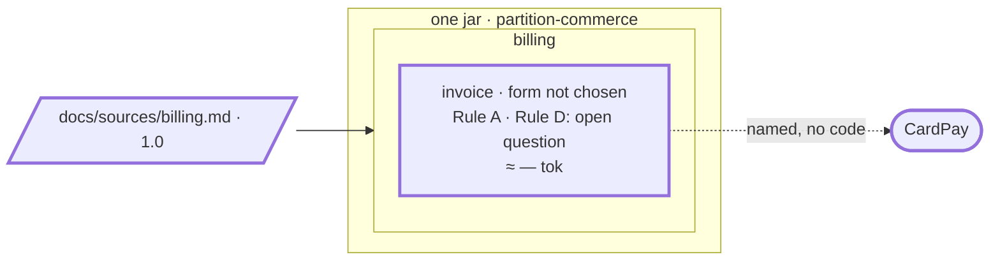

# Step 02 — The billing PRD → one bounded context, `invoice`; "Cancelled" parked

## The situation

The product owner hands you the billing PRD 1.0, in the chat. Nothing in the project says yet what billing is, or where its rules live: no specs, no sources. In this version, paying is something that happens to an invoice, never a thing named on its own.

## What you bring

- [PO] The PRD, [`billing-prd-1.0.md`](02-provided/billing-prd-1.0.md), in [`02-provided/`](02-provided/): five requirements, REQ-1 to REQ-5, one decision, a glossary. You paste it in the chat; you do not copy it into the project.
- [architect] The way to decide the boundary: _a proposal_. The decision stays the architect's.
- [PO] On the requirements that contradict each other: _REQ-3 against REQ-5 and REQ-2 against REQ-5 stay as written in 1.0, knowingly; REQ-1 against REQ-2 stays open, for a later version._
- [BA] The six copied rules confirmed, and the language of `invoice`, where "Cancelled" carries two meanings: _voided before any payment, at no fee_, and _reversed within 24 hours_.

The assistant asks other questions along the way (the name of the file, the area, the code path). You answer them as the role would.

## What you ask

In a fresh session, so that the assistant finds `partition-shape` from its description alone, paste the PRD, then:

> Here is our billing PRD. Find its bounded contexts.

Once the source is saved, commit it alone before the prompt that reads it: its sha is what the next delta starts from. Then:

> Go on.

When the assistant asks how to decide the boundary:

> A proposal.

At the hard stop, you validate by name: _"Create the bounded context `invoice`."_ Before validating the rules:

> Which hexagon form should `invoice` have?

Then the business analyst's answer:

> I confirm BR-1 to BR-6 as written; there is no other rule. Here is the language of `invoice`: (the BA's terms).

## What partition does

1. **The source becomes a file first.** `partition-shape` never decomposes from the chat. It asks for a name, writes `docs/sources/billing.md`, shows it and waits for your validation.
2. **Nothing is inferred.** The area is asked, even though the title says "Billing". Once you commit the source, its sha is the version every spec will record.
3. **The inventory.** The units are the five requirements, by anchor; the decision and the glossary are not units. Each requirement acts on the invoice.
4. **The boundary is yours.** Before showing a decision, it tells you what is at stake (five units, one candidate aggregate) and asks the way: a workshop or a proposal. With a proposal, it says the criteria leave a single option: splitting off `payment` fails C2, since every unit acts on the invoice. It invents no second option, and the decision not to split is justified as explicitly as a split would be.
5. **The hard stop.** Choosing the option does not validate the writing: the plan is shown, with the decomposition record, the spec of `invoice`, the bounded context declared in `docs/partition.yml`, and the six rules and DEC-1 quoted word for word. Nothing is written before you name `invoice`.
6. **A pointer, not a copy.** The spec links each requirement by its anchor and copies only the rules and the decision, under a "TO VALIDATE" banner. The contradictions go to the PO, each asked which requirement holds; no wording is proposed, no rule rewritten. The report says `invoice` is not usable while the banner stands.
7. **No form under a banner.** `partition-hexagon` reads the form from the confirmed rules only: it says the form cannot be chosen yet, and gives no reading of the rules either.
8. **One meaning per word.** `partition-spec` removes the banner on the BA's confirmation and writes Invoice, Issued and Paid, but refuses "Cancelled" with two meanings. It asks which one holds, recalls that a word meaning something else in a neighbour marks a boundary, and parks the question under `Open questions`: one bounded context or two?

**Why it works this way.** A rule is never deduced: it is copied word for word from its source and holds only once a person confirms it (BR-13). And Partition never decides a boundary (BR-17): it shows what is at stake, proposes what the criteria leave, and the architect chooses.

## Worth noticing

- Once the banner is gone, the assistant may offer a form and a layer map at once. Leave it: step 03 records the form, under its own plan.
- The parked question is the one the workshop of step 06 answers.

## The shape after

**New:** the area `billing`, the bounded context `invoice` and its spec, `bounded-contexts.md`; the source, committed alone.

**Cost:** "Cancelled" means two things inside `invoice`. It stays an open question: the price of not splitting before the code says it must.
