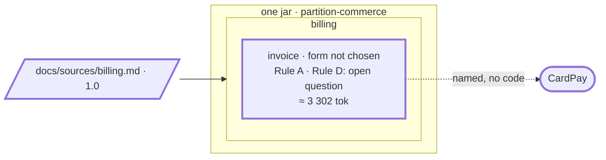

# Step 02 — The billing PRD, pasted in the chat: one bounded context, `invoice`

> **Session:** 📌 open a **fresh session.** The assistant must find `partition-shape` from its description alone, in a session that knows nothing of the PRD yet.

## The problem

`[PO]` gives you the billing PRD 1.0, in the chat. There is no `docs/specs/` and no `docs/sources/` yet: nothing says what billing is, or where its rules live.

## Before

Your `partition-commerce` project should be at the commit of step 01: `docs/partition.yml` with the plans folder and the budget, the rules scoped. There is no `docs/specs/` and no `docs/sources/` yet.

## Provided

`[PO]` gives you the billing PRD, version 1.0, [`billing-prd-1.0.md`](02-provided/billing-prd-1.0.md). It covers invoices and their payment: in this version a payment is something that happens **to an invoice**, never named as a thing of its own. You paste it in the chat: do not copy it into `partition-commerce`, the step tests how the assistant saves a source it receives in the chat.

`[TL]` gives you the code path of the bounded context, when the assistant asks: `src/main/java/com/commerce/invoice/**`.

`[architect]` gives you the way to decide the boundary, when the assistant asks: _a proposal_. The decision stays the architect's; the assistant proposes.

`[PO]`, the owner of the PRD, gives you the answer when the assistant reports requirements that contradict each other: _REQ-3 against REQ-5 and REQ-2 against REQ-5 stay as written in 1.0, knowingly. REQ-1 against REQ-2 stays open: a later version of the PRD settles it._

`[BA]` gives you the validation of the copied rules (there is no other rule), and the language of `invoice`:

| Term      | Meaning                                                                 |
| --------- | ----------------------------------------------------------------------- |
| Invoice   | What the customer owes for one confirmed order, line by line.           |
| Issued    | Sent to the customer; from then on never modified.                      |
| Paid      | Its amount has been paid in full.                                       |
| Cancelled | Voided before any payment, at no fee. — and — Reversed within 24 hours. |

## Prompt

**02.a** — open [`billing-prd-1.0.md`](02-provided/billing-prd-1.0.md), paste its content in the chat, then type:

> Here is our billing PRD. Find its bounded contexts.

Answer the assistant's questions: the file name `billing.md`; the area `billing`. Once the source is saved, commit it alone:

```bash
git add docs/sources/billing.md && git commit -m "docs(sources): billing 1.0"
```

📌 **Do not skip this commit.** The decomposition records the sha of the source's commit in the `Provenance` line of `bounded-contexts.md`, and every later delta starts from that sha (step 05 is the first). Decomposed uncommitted, the source is recorded as `uncommitted`: the next delta has no base, cannot run, and sends you to a new decomposition to set one. The same holds for every source and contract of this guide: commit each alone, before the prompt that reads it.

> Go on.

When the assistant asks how to decide the boundary, answer:

> A proposal.

Validate the writing plan by name: _"Create the bounded context `invoice`."_ Give the code path when the assistant asks.

**02.b** — before you validate the rules, ask:

> Which hexagon form should `invoice` have?

**02.c** — give the business analyst's validation, as in **Provided**:

> I confirm BR-1 to BR-6 as written; there is no other rule. Here is the language of `invoice`: (the table above).

Then commit the specs:

```bash
git add docs && git commit -m "docs(specs): shape billing 1.0 into invoice"
```

## Expected

### 02.a — The source is saved first, and nothing is inferred

You should see `partition-shape` fire (_Which procedure_, first row): the source is in the chat, not a file. It **never decomposes from the chat**. It asks you under which name to save it, writes `docs/sources/billing.md` (the default of `paths.sources`), shows it, and waits for you to validate.

`area` is mandatory and **never inferred**, not even from the title "Billing" (_Inputs_): the assistant asks you, showing that `docs/specs/` has no folder yet.

Committed alone before you go on, the source is recorded by its sha, and the assistant says that commit is the version the specs will record; uncommitted, it would be recorded as `uncommitted`. Its sha anchors every later delta.

### The inventory and the decision

`bounded-contexts.md` is absent: the initial decomposition (`references/decompose.md`), read for a document (`references/sources/document.md`). The units are the five requirements, by anchor; the decisions and the glossary are not units.

| Anchor | Entity it acts on, quoted | Rules stated |
| ------ | ------------------------- | ------------ |
| REQ-1  | "an invoice is issued"    | 2            |
| REQ-2  | "an issued invoice"       | 1            |
| REQ-3  | "cancel an invoice"       | 1            |
| REQ-4  | "pays an issued invoice"  | 1            |
| REQ-5  | "cancel a paid invoice"   | 1            |

`5 in scope / 5 in the source`. Every unit acts on the invoice: C2 fails between "Invoices" and "Paying an invoice", whatever C3 or C5 say (CardPay is named by REQ-4 and REQ-5 only). R1 is not met: **one bounded context**, `invoice`, and the decision not to split is justified as explicitly as a split would be (`references/criteria.md`, _The three outcomes_).

Before it shows that decision, the assistant tells you what is at stake (5 units, one candidate aggregate, the invoice), that the decision is the architect's, and asks you the way: a workshop, or a proposal (`references/boundary-decision.md`, _The choice_). With _a proposal_, the criteria leave a **single split**, and it says so: two bounded contexts, `invoice` and `payment`, fall on C2, every unit acting on the invoice. It invents no other option to make up two or three.

### The hard stop

```text
Source             : docs/sources/billing.md
Version            : 1.0
Provenance         : <sha of "docs(sources): billing 1.0">
Scope              : whole source
Units read         : 5 in scope / 5 in the source
Out of scope       : none
Bounded contexts   : invoice (1 retained)
Decided            : proposal, option 1 · you, as [architect]

Writing plan:
  + docs/specs/billing/bounded-contexts.md
  + docs/specs/billing/invoice/spec.md
  ≈ docs/partition.yml                      (declares invoice: area billing, code paths to ask)

Copied from the source (word for word, to confirm):
  invoice  rules      : "An invoice is issued once per order" (REQ-1), "The amount of an invoice is the sum
                        of its lines" (REQ-1), "An issued invoice is never modified" (REQ-2), "An invoice is
                        cancelled only before any payment, at no fee" (REQ-3), "An invoice is paid once its
                        amount is paid in full" (REQ-4), "A paid invoice is cancelled only within 24 hours of
                        being paid; the invoice is then unpaid again" (REQ-5)
           invariants : none stated
           decisions  : "Card payments go through CardPay", because "it is the provider the company already
                        has a contract with" (DEC-1)
  billing  rules      : none shared
```

No `area.md`: no rule is stated for units of several bounded contexts. Nothing is written before you validate `invoice` **by name**.

### What is written

You should get `docs/specs/billing/bounded-contexts.md`: the header lines (source, version 1.0, provenance with the sha, `whole source`, `5 / 5`, `Decided` with the date, your name and `proposal: option 1`); `Bounded contexts retained`: `invoice`, REQ-1 to REQ-5; `Decisions not to split`: REQ-4 and REQ-5 kept with REQ-1 to REQ-3, C2 failing; `Kept against the criteria`: "None"; `Coverage`: five lines; `History`: empty; `Gaps detected`: the requirements that contradict each other — REQ-1 and REQ-2 (once per order, a correction issues a new one), REQ-3 and REQ-5 (cancelled before any payment, a paid invoice cancelled), REQ-2 and REQ-5 (never modified, unpaid again) — each reported to the PO, asked which requirement holds, no wording proposed, no rule rewritten: the first two kept as written in 1.0, knowingly; REQ-1 and REQ-2 left asking, until 1.0.1 settles it at step 05.

`docs/specs/billing/invoice/spec.md`:

- the five header lines of the template, kept: the spec is derived from a source;
- `Language`: **empty** — a person writes it (6.b);
- `Source parts owned`: REQ-1 to REQ-5, each a link to its anchor in `docs/sources/billing.md`, one line each, no requirement text copied; the glossary is not a unit, but it is pointed to on a line of its own (`references/sources/document.md`: what is not copied is pointed to);
- `Business rules`: the six rules, word for word, under the **"TO VALIDATE"** banner:

  | # | Rule | Source |
  | --- | --- | --- |
  | BR-1 | An invoice is issued once per order. | from source: REQ-1 |
  | BR-2 | The amount of an invoice is the sum of its lines. | from source: REQ-1 |
  | BR-3 | An issued invoice is never modified. | from source: REQ-2 |
  | BR-4 | An invoice is cancelled only before any payment, at no fee. | from source: REQ-3 |
  | BR-5 | An invoice is paid once its amount is paid in full. | from source: REQ-4 |
  | BR-6 | A paid invoice is cancelled only within 24 hours of being paid; the invoice is then unpaid again. | from source: REQ-5 |

  BR-3 is Rule A of [where a rule lives](../where-a-rule-lives.md#step-1--rule-a-one-owner).

- `Decisions`: DEC-1, with its reason and anchor;
- `Persistence`: "No schema documents are declared for this project";
- `External dependencies`: CardPay, charging and reversing a card payment;
- `Contracts with neighbours`: empty, a person writes it;
- `Applicable area rules and invariants`: "None";
- `Open questions`: what the PRD leaves open, one per line, for example what a line holds, which currencies.

`docs/partition.yml` gains:

```yaml
contexts:
  - id: invoice
    area: billing
    code:
      - src/main/java/com/commerce/invoice/**
```

The closing report tells you `invoice` is **not usable**: its rules carry the "TO VALIDATE" banner.

### 02.b — No form while a banner stands

You should see `partition-hexagon` read the form from the `Business rules` of the spec: while that section carries its banner **the form cannot be chosen**. It tells you so and chooses nothing: no reading of the copied rules against its table either.

### 02.c — "Cancelled" cannot be written twice

You should see `partition-spec` (_Write the spec of a new bounded context_, step 5) keep one meaning per word, no synonym. It writes Invoice, Issued and Paid, removes the banner on the BA's confirmation, and **refuses to write "Cancelled" with two meanings** in one bounded context. It asks you which meaning holds here, and recalls that a word meaning something else in a neighbour marks a boundary. Give the BA's answer for now: both meanings are needed, the question is open.

`Open questions` gains, in words that can be answered: _"Cancelled" means "voided before any payment" for an unpaid invoice and "reversed within 24 hours" for a paid one: one bounded context or two?_ This is the question the workshop of step 06 answers.

With the banner gone, the assistant may offer the hexagon form and a layer map right away. Do not accept it: step 03 records the form, under its plan.

### Watch

If the decomposition retains a `payment` bounded context right away (reading REQ-4 and REQ-5 as acting on a payment), the story still holds: step 06 then has nothing to split, and you record that as the verdict here.

### The shape after



**New:** the area `billing`, the bounded context `invoice` and its spec, `bounded-contexts.md`; the source, committed alone.

**Cost:** "Cancelled" means two things inside `invoice`. It stays an open question: the price of not splitting before the code says it must.

## Verdict

- [x] 02.a — `partition-shape` does not decompose from the chat: it asks the file name, writes `docs/sources/billing.md`, shows it and waits for validation
- [x] 02.a — It asks for the area, showing that `docs/specs/` has no folder yet; the area is not inferred from "Billing"
- [x] 02.a — It reads the sha of the source's commit and says it is the version the specs will record
- [x] 02.a — Initial decomposition: the units are REQ-1 to REQ-5, by anchor; the decisions and the glossary are not units; `5 in scope / 5 in the source`
- [x] 02.a — Before the decision, it says what is at stake and that the decision is the architect's, and asks the way: a workshop or a proposal
- [x] 02.a — With a proposal, it says the criteria leave a single split and shows why two bounded contexts fall (C2); no option is invented
- [x] 02.a — One bounded context, `invoice`: C2 fails, and the decision not to split is justified explicitly
- [x] 02.a — The hard stop shows the block above: `Provenance` is the sha of `docs(sources): billing 1.0`, the writing plan has its three files, the six rules and DEC-1 are copied word for word
- [x] 02.a — No `area.md`, and nothing is written before you validate `invoice` by name
- [x] 02.a — `bounded-contexts.md`: the header lines with the sha, `5 / 5` and `Decided` (`proposal: option 1`), `Kept against the criteria` "None", `invoice` retained with REQ-1 to REQ-5, the decision not to split, five `Coverage` lines, an empty `History`
- [ ] 02.a — `Gaps detected` lists the three contradictions; the PO, asked which holds, keeps two as written, knowingly, and leaves REQ-1 against REQ-2 open; no rule rewritten
- [x] 02.a — `invoice/spec.md`: the five header lines kept, `Language` empty, `Source parts owned` REQ-1 to REQ-5 as links, the glossary pointed to, no requirement text copied
- [x] 02.a — `invoice/spec.md`: BR-1 to BR-6 word for word, under the "TO VALIDATE" banner
- [x] 02.a — `invoice/spec.md`: DEC-1 with its reason and anchor, `Persistence` "No schema documents are declared for this project", CardPay as external dependency, `Contracts with neighbours` empty, area rules "None"
- [x] 02.a — `invoice/spec.md`: `Open questions` lists what the PRD leaves open, one per line
- [x] 02.a — `docs/partition.yml` gains `invoice`, area `billing`, code `src/main/java/com/commerce/invoice/**`
- [x] 02.a — The closing report says `invoice` is not usable: its rules carry the "TO VALIDATE" banner
- [x] 02.b — `partition-hexagon` says the form cannot be chosen while the banner stands, and chooses nothing, not even a reading of the copied rules against its table
- [x] 02.c — `partition-spec` writes Invoice, Issued and Paid, and removes the banner on the BA's confirmation
- [x] 02.c — It refuses to write "Cancelled" with two meanings, asks which one holds, and recalls that a word meaning something else in a neighbour marks a boundary
- [x] 02.c — `Open questions` gains the "Cancelled" question: one bounded context or two?
- [x] Watch — Whether the decomposition retains a `payment` bounded context right away is recorded — not retained once PRD 1.0 named no payment entity (2026-10-08); the run before that fix offered it
