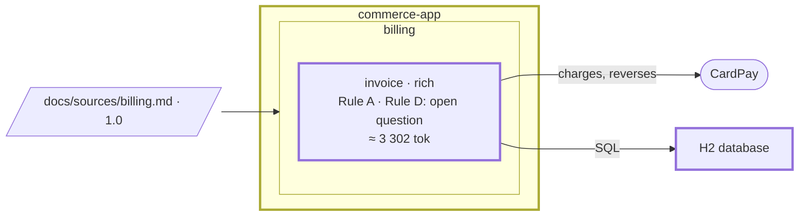

# Step 03 — A hand-drawn diagram becomes the C4 model; the `invoice` hexagon; the first pattern ruling

> **Session:** stay in the session of step 02, or open a fresh one: nothing here tests a cold start. Type the prompts in order, under one plan.

## The problem

The only picture of the system is the team's hand-drawn diagram: plain boxes, and nothing says which is a system, a container or a component. Nobody has said either how the status of an invoice and its forbidden transitions are coded.

## Before

Your `partition-commerce` project should be at the commit of step 02: `invoice` declared in area `billing`, its spec validated (banner removed), "Cancelled" left as an open question. There is no `docs/architecture/` yet.

## Provided

`[architect]` gives you the diagram the team drew before Partition, [`docs/architecture/commerce.drawio`](03-provided/docs/architecture/commerce.drawio). Plain boxes, as people draw them: nothing in the file says which box is a system, a container or a component. Copy [`03-provided/`](03-provided/) into `partition-commerce`, at its root.

`[architect]` gives you the answers the model asks for:

| Box                        | Kind and parent                                                       |
| -------------------------- | --------------------------------------------------------------------- |
| Commerce app (Spring Boot) | a container of the system `commerce`, technology Spring Boot 4.1, jar |
| Invoicing                  | a component of that container, bounded context `invoice`              |
| H2                         | a container of `commerce`, the database                               |
| CardPay                    | an external system                                                    |

`[architect]` gives you the form of the `invoice` hexagon and its layer map:

```yaml
hexagons:
  - id: invoice
    form: rich
    reason: an invoice moves from issued to paid or cancelled under BR-3 to BR-6, and some transitions are forbidden
    layers:
      domain: src/main/java/com/commerce/invoice/domain/**
      application: src/main/java/com/commerce/invoice/application/**
      inbound: src/main/java/com/commerce/invoice/inbound/**
      outbound: src/main/java/com/commerce/invoice/outbound/**
    allowed:
      - application -> domain
      - inbound -> application
      - outbound -> application
      - outbound -> domain
```

`[architect]` gives you the question for the grid: _how should the status of an invoice and its forbidden transitions be coded?_

If the assistant holds the ruling on the gaps `bounded-contexts.md` records (what "unpaid again" allows, whether a change of status modifies an issued invoice), `[architect]` answers: _rule on the rules as confirmed; the gaps stay open questions, and the ruling says what would change its mind._

If the closing proposes an entry for the invariant register from the layer map or the build check (the domain depending on nothing outside itself), `[architect]` answers: _no: it stays in the map, the build check and the architecture rule; nothing goes to the register._

## Prompt

**03.a** — type:

> Open a plan for the architecture baseline: the C4 model from `docs/architecture/commerce.drawio`, the hexagon of `invoice`, and how the status of an invoice is coded.

**03.b** — when the assistant asks you what a box is, answer from the table of **Provided**.

**03.c** — when the assistant asks for the form of the hexagon, give the form and the layer map of **Provided**. When it proposes a build check, choose ArchUnit.

**03.d** — when the plan reaches the status of an invoice, let the assistant set out the candidates, then rule. If it holds the ruling on the open gaps, give the architect's answer of **Provided**.

## Expected

### 03.a — The plan

You should see `partition-plan` open a plan in `docs/plans/` (the skill names no file), declared at step 01: the assistant asks you nothing about the folder this time.

### 03.b — The drawing becomes the model, once

You should see `partition-c4` (_Change the architecture_, step 1) find no `docs/architecture/model.yml`, read the hand-drawn file **once**, and write the model from its boxes, nesting and arrows. The kinds the drawing leaves open are **questions**, never guesses: it asks you what "Commerce app", "Invoicing", "H2" and "CardPay" are.

```yaml
# docs/architecture/model.yml (the shape, not the exact wording)
title: Commerce
elements:
  - id: customer # person
  - id: accountant # person
  - id: commerce # system
  - id: commerce-app # container, in commerce, Spring Boot 4.1
  - id: invoice # component, in commerce-app, context: invoice
  - id: database # container, in commerce, H2
  - id: cardpay # system, external: true
relations:
  - customer -> commerce-app: pays
  - accountant -> commerce-app: issues, cancels
  - invoice -> database: SQL
  - invoice -> cardpay: charges, reverses
views:
  - id: context # kind: context, of: commerce
  - id: containers # kind: containers, of: commerce
  - id: components # kind: components, of: commerce-app
```

`commerce` is a system the drawing does not show as a box: the model needs one to hold the containers, and the architect's answer names it. A relation is written once, at the lowest level known (`invoice -> cardpay`, not `commerce-app -> cardpay`).

```bash
node .claude/skills/partition-c4/scripts/c4-drawio.mjs --check     # no error
node .claude/skills/partition-c4/scripts/c4-drawio.mjs             # writes docs/architecture/c4.drawio
```

The assistant shows you both outputs. `commerce.drawio` stays where it is, untouched: the model is the source from now on, and the generated `c4.drawio` is not edited by hand except to move, resize or reroute.

### 03.c — The hexagon

You should see `partition-hexagon` find no banner on the rules since step 02, so the form can be chosen. The spec shows "a status that moves under conditions, with transitions that are forbidden" (BR-3, BR-4, BR-6): **rich**, with its reason. The entry of `invoice` in `docs/partition.yml` gains the `hexagons:` block of **Provided**.

A form with no reason is refused. The map is the architect's; it is not inferred from the folders, which do not exist yet.

The project has no dependency check: it **proposes one** with the tool of the ecosystem, ArchUnit (`references/build-checks.md`), and lets you choose. With ArchUnit chosen, the check is a test class generated from the map: one rule per line of `allowed`, a default that forbids the rest, the domain importing nothing from outside itself, no hexagon importing another. There is no class in `com.commerce.invoice` yet: the test is written with the first classes, at step 04, and the plan says so.

### 03.d — The first ruling

`partition-patterns` (_At design time_): the grid does not exist; it is created from `assets/patterns-grid.md` at `docs/architecture/patterns-grid.md` with this first ruling.

1. The problem in one sentence, without naming a pattern.
2. The candidates, **"no pattern" always among them**: for example the State pattern (one class per status), an enumeration with the transitions guarded by the aggregate, no pattern (plain checks in each method).
3. Each criterion of the grid answered with facts from this code base: the three statuses and the four transitions that exist today, the files a change of BR-4 touches with and without each candidate, what a test needs to start.
4. A recommendation, and what would change its mind. You rule.
5. `P-1`, with where (`invoice`), the pattern, the ruling, one cell per criterion, the reason, the date. If "no pattern" wins, it is recorded like any ruling, so the question is not asked again next month.
6. The candidates that lost, and why, go to `## Decisions` of the plan.

"More flexible" or "cleaner" is not an answer to a criterion. A State pattern justified by a status that does not exist yet is refused.

### Closing the plan

In the same turn as the last tick: `partition-gate` on the plan's changes (no Java yet: it says what it could not run); nothing established for the spec, the area file or the register; the README realigned by `partition-readme`: the one of step 01 lists the Partition files, so it gains `docs/architecture/` and the two C4 commands; the C4 model was updated and generated in the plan itself. `Status: done`.

### The shape after



**New:** the C4 model, generated from `model.yml`; the form of `invoice`, rich, and its layers; P-1 in the pattern grid.

**Cost:** a model to keep in step with the code; a rich hexagon is more code than a thin one.

## Verdict

- [x] 03.a — `partition-plan` opens a plan in `docs/plans/`, with no question about the folder
- [x] 03.b — `partition-c4` reads `commerce.drawio` once and writes `docs/architecture/model.yml` from its boxes, nesting and arrows
- [x] 03.b — It asks what "Commerce app", "Invoicing", "H2" and "CardPay" are; no kind is guessed
- [x] 03.b — `model.yml` has the shape above: the system `commerce`, seven elements, four relations, three views
- [x] 03.b — Each relation is written once, at the lowest level known (`invoice -> cardpay`)
- [x] 03.b — `c4-drawio.mjs --check` reports no error, `c4-drawio.mjs` writes `docs/architecture/c4.drawio`, and both outputs are shown
- [x] 03.b — `commerce.drawio` is untouched
- [x] 03.c — `partition-hexagon` chooses `rich`, with its reason, from BR-3, BR-4 and BR-6
- [x] 03.c — The entry of `invoice` in `docs/partition.yml` gains the `hexagons:` block of **Provided**, not inferred from the folders
- [x] 03.c — It proposes ArchUnit as the dependency check, and lets you choose
- [x] 03.c — The check: one rule per line of `allowed`, a default that forbids the rest, the domain importing nothing from outside itself, no hexagon importing another
- [x] 03.c — The plan says the test is written with the first classes, at step 04
- [x] 03.d — `docs/architecture/patterns-grid.md` is created from `assets/patterns-grid.md`
- [x] 03.d — The problem is stated in one sentence, without naming a pattern
- [x] 03.d — The candidates include "no pattern"
- [x] 03.d — Each criterion is answered with facts from this code base, never "more flexible" or "cleaner"
- [x] 03.d — A recommendation, and what would change its mind; you rule — ruled by Claude for the owner, on the recommendation, "no pattern"
- [x] 03.d — `P-1` holds where (`invoice`), the pattern, the ruling, one cell per criterion, the reason, the date
- [x] 03.d — The candidates that lost, and why, are in `## Decisions` of the plan
- [x] 03.d — No pattern is justified by a status that does not exist yet
- [x] Closing — In the same turn as the last tick, `partition-gate` runs and says what it could not run
- [x] Closing — Nothing established for the spec, the area file or the register; the README gains `docs/architecture/` and the C4 commands
- [x] Closing — The C4 model is updated and generated in the plan itself
- [x] Closing — `Status: done`
