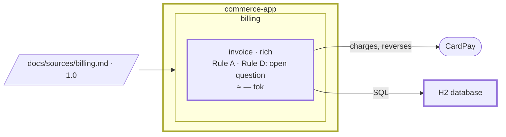

# Step 03 — Plain boxes → the C4 model; `invoice` is rich

## The situation

`invoice` has a validated spec, and "Cancelled" waits as an open question. The only picture of the system is the team's hand-drawn diagram: plain boxes, and nothing says which is a system, a container or a component. Nobody has said either how the status of an invoice and its forbidden transitions are coded.

## What you bring

- [architect] The diagram the team drew before Partition, [`docs/architecture/commerce.drawio`](03-provided/docs/architecture/commerce.drawio), in [`03-provided/`](03-provided/).
- [architect] What each box is: "Commerce app" a Spring Boot container of a system `commerce` the drawing never shows; "Invoicing" a component, the bounded context `invoice`; "H2" the database container; "CardPay" an external system.
- [architect] The form of `invoice`, _rich: an invoice moves from issued to paid or cancelled under BR-3 to BR-6, and some transitions are forbidden_, and its layer map: domain, application, inbound, outbound, and the dependencies allowed between them. ArchUnit as the build check.
- [architect] The question for the pattern grid: _how should the status of an invoice and its forbidden transitions be coded?_ On the gaps the PRD left open: _rule on the rules as confirmed; the gaps stay open questions._ On the domain depending on nothing: _it stays in the map, the build check and the architecture rule; nothing goes to the register._

The assistant asks other questions along the way. You answer them as the role would.

## What you ask

> Open a plan for the architecture baseline: the C4 model from `docs/architecture/commerce.drawio`, the hexagon of `invoice`, and how the status of an invoice is coded.

Then you answer what it asks: what each box is, the form and the map, the build check. When the plan reaches the status of an invoice, you let it set out the candidates, then you rule.

## What partition does

1. **A plan, in the folder already declared.** `partition-plan` asks nothing about where it goes.
2. **The drawing, read once.** `partition-c4` finds no model, reads `commerce.drawio` once and writes `docs/architecture/model.yml` from its boxes, nesting and arrows. The kinds the drawing leaves open are questions, never guesses. Each relation is written once, at the lowest level known: `invoice` charges CardPay, not the container. The model is checked, the diagram generated from it, and the hand-drawn file left as it was.
3. **The form, read from the rules.** `partition-hexagon` finds no banner since step 02, and the spec shows a status that moves under conditions with forbidden transitions: rich, with its reason. A form without a reason is refused; the map is the architect's, not inferred from folders that do not exist yet. Both go under `invoice` in `docs/partition.yml`.
4. **A build check proposed, not yet written.** The project has no dependency check: it proposes the tool of the ecosystem, and you choose ArchUnit. A test generated from the map has nothing to check while `com.commerce.invoice` holds no class: you choose to write it with the first classes, in the plan of the first behaviour of `invoice`; this plan records the choice.
5. **The first ruling.** `partition-patterns` creates the grid, states the problem in one sentence without naming a pattern, and sets out the candidates with "no pattern" among them. Each criterion is answered with facts from this code base: three statuses, four transitions, the files a change of BR-4 would touch. It recommends, says what would change its mind, and you rule. `P-1` goes to the grid; the candidates that lost, and why, to the plan's `## Decisions`.
6. **A line bound to `invoice`, shown first.** The independence of the domain binds one hexagon: it fails the admission test, and the architect keeps it out of the register. A line of the architecture rule that binds `invoice` alone goes to a rule file of that topic scoped to its code (`backend-architecture-invoice.instructions.md`, over `src/main/java/com/commerce/invoice/**`), never to the file every backend change loads. `partition-rules` shows the line, its file and its scope, and writes nothing before you validate.
7. **The closing**, in the same turn as the last tick. The gate says what it could not run: there is no Java yet. Nothing goes to a spec, an area file or the register. The README gains `docs/architecture/` and the two C4 commands, which anyone working on the repository now runs. The gate then runs again, so its verdict covers the closing's own writes.

**Why it works this way.** The model is text and the drawing its input, read once: from now on a diagram is regenerated, never redrawn (BR-20). A form is read from confirmed rules, not from code (BR-21). And "no pattern" is a ruling like any other, recorded so the question is not asked again next month (BR-22).

## Worth noticing

- A State pattern justified by a status that does not exist yet is refused: the grid answers with what the code has today.

## The shape after

**New:** the C4 model, generated from `model.yml`; the form of `invoice`, rich, and its layers; P-1 in the pattern grid.

**Cost:** a model to keep in step with the code; a rich hexagon is more code than a thin one.
