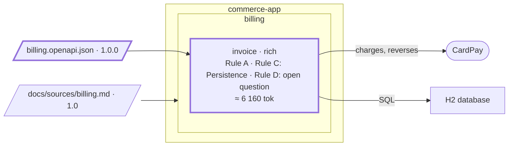

# Step 04 — The first feature; Rule C goes from the plan to the spec

> **Session:** 📌 open a **fresh session** at 04.a. 📌 Open a **fresh session again** at 04.d: you clear the session in the middle of the plan on purpose, to see the work resume from the plan alone.

## The problem

The accountant must issue the invoice of a confirmed order, and anyone must be able to read it back. There is no Java under `com.commerce.invoice` and no contract yet.

## Before

Your `partition-commerce` project should be at the commit of step 03: `invoice` validated and rich, the C4 model, `P-1` in the grid. There is no Java under `com.commerce.invoice` and no contract yet.

## Provided

`[PO]` gives you the feature: _the accountant issues the invoice of a confirmed order, and anyone can read it back._

`[architect]` gives you the contract of `invoice`, [`docs/contracts/billing.openapi.json`](04-provided/docs/contracts/billing.openapi.json). The excerpt below leaves out only the descriptions of the 201 and 200 responses; you copy the whole file at 04.b:

```json
{
  "openapi": "3.1.0",
  "info": { "title": "Billing API", "version": "1.0.0" },
  "paths": {
    "/invoices": {
      "post": {
        "operationId": "issueInvoice",
        "tags": ["Invoice"],
        "requestBody": {
          "required": true,
          "content": { "application/json": { "schema": { "$ref": "#/components/schemas/IssueInvoice" } } }
        },
        "responses": {
          "201": { "content": { "application/json": { "schema": { "$ref": "#/components/schemas/Invoice" } } } },
          "409": { "description": "An invoice was already issued for this order" }
        }
      }
    },
    "/invoices/{invoiceId}": {
      "get": {
        "operationId": "getInvoice",
        "tags": ["Invoice"],
        "parameters": [{ "name": "invoiceId", "in": "path", "required": true, "schema": { "type": "string" } }],
        "responses": {
          "200": { "content": { "application/json": { "schema": { "$ref": "#/components/schemas/Invoice" } } } },
          "404": { "description": "No such invoice" }
        }
      }
    }
  },
  "components": {
    "schemas": {
      "Money": {
        "type": "object",
        "required": ["amountMinor", "currency"],
        "properties": {
          "amountMinor": { "type": "integer", "format": "int64" },
          "currency": { "type": "string", "pattern": "^[A-Z]{3}$" }
        }
      },
      "Line": {
        "type": "object",
        "required": ["label", "price"],
        "properties": { "label": { "type": "string" }, "price": { "$ref": "#/components/schemas/Money" } }
      },
      "IssueInvoice": {
        "type": "object",
        "required": ["orderId", "customerId", "lines"],
        "properties": {
          "orderId": { "type": "string" },
          "customerId": { "type": "string" },
          "lines": { "type": "array", "minItems": 1, "items": { "$ref": "#/components/schemas/Line" } }
        }
      },
      "Invoice": {
        "type": "object",
        "properties": {
          "invoiceId": { "type": "string" },
          "orderId": { "type": "string" },
          "status": { "type": "string", "enum": ["ISSUED", "PAID", "CANCELLED"] },
          "amount": { "$ref": "#/components/schemas/Money" },
          "lines": { "type": "array", "items": { "$ref": "#/components/schemas/Line" } }
        }
      }
    }
  }
}
```

`[TL]` gives you the generator, to add to `pom.xml`, with the property `openapi-generator.version` at `7.26.0`. The version and the options are the tech lead's, checked against Spring Boot 4.1 and Jackson 3: without the last three options the generated code imports Swagger annotations and `jackson-databind-nullable`, a Jackson 2 library:

```xml
<plugin>
  <groupId>org.openapitools</groupId>
  <artifactId>openapi-generator-maven-plugin</artifactId>
  <version>${openapi-generator.version}</version>
  <executions>
    <execution>
      <id>billing</id>
      <goals><goal>generate</goal></goals>
      <configuration>
        <inputSpec>${project.basedir}/docs/contracts/billing.openapi.json</inputSpec>
        <generatorName>spring</generatorName>
        <apiPackage>com.commerce.invoice.inbound.api</apiPackage>
        <modelPackage>com.commerce.invoice.inbound.api.model</modelPackage>
        <configOptions>
          <interfaceOnly>true</interfaceOnly>
          <openApiNullable>false</openApiNullable>
          <annotationLibrary>none</annotationLibrary>
          <documentationProvider>none</documentationProvider>
        </configOptions>
      </configuration>
    </execution>
  </executions>
</plugin>
```

The generated code validates the request with Jakarta Validation: `[TL]` adds `spring-boot-starter-validation`, its version from Spring Boot.

The contract is JSON on purpose: the script of `partition-shape` reads JSON only, and one file serves both the generator and the skills.

`[TL]` gives you the build check the architect chose at step 03: `com.tngtech.archunit:archunit-junit5`, test scope, version `1.5.1`.

`[architect]` gives you the decision taken while designing, the first rung of Rule C: _every amount is stored in minor units, with its currency_ — a `BIGINT` and a three-letter ISO 4217 code, never a decimal.

`[TL]` gives you a convention of the code, which is not a business rule: _an amount column is named `<what>_minor` and its currency column `<what>_currency`._

`[architect]` gives you a rule of the architecture, which the team had kept unwritten: _the Spring configuration is YAML, `application.yaml`, the tests' own included; never a `.properties` file._

`[architect]` asks the design for the issue as a sequence diagram drawn from the C4 model: the accountant, `invoice`, the database.

The attack and the plan raise questions the feature leaves open. The answers, each from the role that owns it:

| Question | Answer | From |
| --- | --- | --- |
| Is reading an invoice a requirement? Who reads? | yes: anyone holding its identifier, as `getInvoice` shows it; who may read stays open | `[PO]` |
| Does the accountant replace the issue on confirmation? | his action is how REQ-1's issue happens for now; an automatic issue waits for an order context | `[PO]` |
| "Issued" means "sent to the customer"; the contract sends nothing | Issued: recorded by the issue, with an identifier of its own; nothing is sent to the customer in this version, and there is no state before it; from then on never modified | `[BA]` |
| Who owns the order, its customer, its items? | no bounded context yet: the request carries `orderId`, `customerId` and the lines | `[architect]` |
| What does a line hold? | what the contract says: a label and a price; no quantity, no tax | `[PO]` |
| A second issue for the same order | refused: 409, its description only, no body (BR-1) | `[PO]` |
| The identifier of an invoice | a UUID, made by `invoice` when it issues | `[architect]` |
| Who may issue? | no login in this version: an open question | `[PO]` |
| Lines in different currencies; a negative price | refused, 400, no body | `[PO]` |
| A request the contract refuses; a blank value | 400, no body; a label holds at most 255 characters | `[architect]` |
| A sum of prices beyond the range of the amount | refused, 400, no body | `[PO]` |
| An identifier that is not a UUID | 404, as any identifier that names no invoice | `[architect]` |
| A currency | a three-letter ISO 4217 code: the contract checks its form, the code that the code is known | `[PO]` |
| How the code talks to the database | `JdbcClient` | `[TL]` |
| `orderId`, `customerId` | any non-blank text of at most 255 characters | `[PO]` |
| Blank | empty or only white space | `[PO]` |
| A price of 0 | allowed | `[PO]` |
| Amount; price | the sum of the prices of an invoice's lines; what one line costs | `[PO]` |
| Two issues of one order at the same moment | the database refuses the second: 409 (BR-1) | `[architect]` |
| A refused content and BR-1 | the 400 comes before BR-1 is checked | `[architect]` |
| What the contract does not declare (400, 255, blank) | the code enforces it; the contract stays 1.0.0 | `[architect]` |
| Anyone can issue first; the H2 console | accepted for this version; open questions, the console the tech lead's | `[PO]`, `[TL]` |
| What is logged | the identifiers only, nothing of a line or a price | `[TL]` |

## Prompt

**04.a** — 📌 in a fresh session, type:

> Attack the spec of `invoice` before we plan the feature: the accountant issues the invoice of a confirmed order, and anyone can read it back.

**04.b** — type:

> Plan this feature.

When the design asks for the API, copy [`04-provided/`](04-provided/) into `partition-commerce`, at its root, commit the contract, and give the assistant its path, the generator and the build check of **Provided**:

```bash
git add docs/contracts/billing.openapi.json && git commit -m "docs(contracts): billing 1.0.0"
```

Commit the contract alone, as every source and contract of this guide: the next delta starts from its sha.

Give, with the contract, the decision on amounts, the convention of the columns, the rule on YAML and the request for the sequence diagram: its `Money` already carries `amountMinor` and `currency`, so the assistant has no reason to ask how an amount is stored, and would decide it alone, out of `## Decisions`. Answer the plan's questions from the table of **Provided**.

**04.c** — type:

> Carry out the plan up to the migration and the domain, then stop.

Then commit:

```bash
git add . && git commit -m "feat(invoice): domain and migration"
```

**04.d** — clear the session (`/clear`), 📌 open a fresh one, and type only:

> Resume.

**04.e** — let the assistant carry the plan to its end. If the closing did not start with the last tick, type:

> We are done, close the plan.

When it shows the closing, validate what it proposes for the spec. Once the plan is `done`, deploy the rule its answers added and commit:

```bash
apm install
git add -A && git commit -m "feat(invoice): issue and read back"
```

## Expected

### 04.a — The attack writes into the spec

You should see `partition-attack` read the spec of `invoice`, the area file (none), the register (none) and the contracts it names (none yet). It writes its findings **into the spec**, under `Open questions`, and changes nothing else. For example:

- **The rules.** BR-1 "issued once per order": two confirmations of the same order at the same time — which one wins? BR-2: what is the amount of a line, and in which currency?
- **The inputs.** Which shared definition validates an amount and a currency?
- **The words.** "Cancelled", already open since step 02.
- **The budget, the session, the access** — skipped with the reason when they do not apply: a report that omits an attack reads the same whether it was tried or not.

No implementation is proposed. No compliment.

### 04.b — The plan, and Rule C on its first rung

You should see `partition-plan` open the plan in `docs/plans/`. Superpowers may brainstorm and write a design first; the plan still has the Partition header, the task index, a verification and its **expected result** per task, `## Decisions` and `## Blockers`. The rules of `invoice` carry no banner: the design may start.

The design names the contract of **Provided** and a sequence diagram of the issue, drawn from the model: `partition-c4` adds a `dynamic` view (`issue-invoice`: accountant → invoice → database), runs `--check`, and prints it with `--mermaid issue-invoice` to paste in the design. Every participant is an element of the model; nothing is drawn by hand beside it.

The contract is given for `invoice`, which exists and was decomposed from the PRD: it is not a second source of that decomposition, and no shaping procedure is entered for it. It is the contract `invoice` shows: `invoice/spec.md` records `billing.openapi.json` under `Contracts with neighbours`, and `bounded-contexts.md` keeps the PRD as its only source, its provenance unchanged.

The decision on amounts goes to `## Decisions` of the plan, with its date, its reason and what lost (a decimal column): **Rule C is born in the plan.**

The convention of the columns goes to a rule file, not to the spec: `partition-rules` (_Add or change one rule_) adds one line to `.apm/instructions/backend-database.instructions.md`, whose scope fits, after checking that no rule says it already; then `apm install`. How code is written here is a rule; what must be true of the business is the spec.

The rule on YAML goes the same way to `.apm/instructions/backend-architecture.instructions.md`, whose topic fits; its `applyTo` must then reach the configuration files, under `src/main/resources/` and `src/test/resources/`, or the rule never loads where a `.properties` file would be written. No `.properties` file is created.

### 04.c — The code, deliberately small

```text
+ src/main/resources/db/migration/V1__invoice.sql          invoice, invoice_line; amount_minor, amount_currency
+ src/main/java/com/commerce/invoice/domain/…              Invoice (rich: issues, holds its status), Line, Money
+ src/main/java/com/commerce/invoice/application/…         IssueInvoice, GetInvoice, ports InvoiceRepository
+ src/main/java/com/commerce/invoice/inbound/…             the controller, implementing the generated interface
+ src/main/java/com/commerce/invoice/outbound/…            the JdbcClient adapter of InvoiceRepository
+ src/test/java/com/commerce/invoice/…                     one test class per use case, and the domain
+ src/test/java/com/commerce/ArchitectureTest.java         ArchUnit, generated from the layer map (step 03)
```

Run `./mvnw verify`: it runs the tests, ArchUnit included: the domain imports no Spring, the controller calls no repository.

### 04.d — The resume reads the plan, not the chat

You should see `partition-plan` (_Resume_) work from a session that knows nothing:

1. It opens the plan whose `Status` is `in progress` and reads **only** its header, its `## Tasks` index, the task named in `Resume at` and its `## Blockers`. It does not read the rest of the plan, nor any `done` plan.
2. It reconciles every `uncommitted` marker: you committed at 04.c, so it finds that commit with `git log -- <the files the task names>` and writes its sha in the task, the index and `Last updated`.
3. It **announces** the step it restarts at, before changing anything.
4. It restarts there, not at the first unchecked box when the two differ.

### 04.e — The closing, and Rule C on its second rung

When the assistant ticks the last task, it starts the closing in the same turn, without you asking (`partition-plan`, _Close_):

1. `partition-gate` on the plan's changes, from the commit before its first task to the working tree. It reads the spec of `invoice` as its oracle. The verdict comes with the commands it ran and their real output (`./mvnw verify`). The project configures no coverage report: diff coverage is measured only if the gate runs a coverage tool itself; otherwise it is "not verified", and the verdict cannot be a clean SHIP. Each reason of a HOLD and each condition becomes a task, or a blocker naming its owner.
2. What the plan established for good, read first from `## Decisions`: the decision on amounts. What it established is already in the spec of `invoice`, under `Persistence`, written while designing as the template says (_what it established is written in the sections above_): it is on the list all the same, and its level is checked now, not assumed.
3. Its level (`partition-spec`, _Where a statement belongs_). True for every feature: yes. Spans two areas or layers: no, `invoice` is the only bounded context of the only area. The admission test fails, and it is reported as a rejected candidate. Its home stays the spec of `invoice`:

   ```text
   ## Persistence
   - An amount is stored as a whole number of minor units, a BIGINT, with its currency, three letters; never as
     a decimal (architect, YYYY-MM-DD).
   ```

   The spec gets the result; the dated reason stays in the plan. **Rule C is in the spec.**

4. The README: the project now has an API. `partition-readme` realigns it (the endpoints, how to run), and changes neither code nor spec.
5. The C4 model was changed in the plan (`issue-invoice`): regenerated.
6. `Status: done`; the last task, every task still marked `uncommitted` and `Last updated` carry the date alone, and `Resume at` reads `— (nothing; every task is checked)`.

### Watch

The admission test says a statement spans layers "when it binds the same layers in every hexagon of the project". With a single hexagon, Rule C binds its domain and its persistence: a reading that admits it to the register here, on the layer clause, is a gap of the test's wording, not the expected outcome.

### The shape after



**New:** the contract, the first code, `V1__invoice.sql`; Rule C, decided in the plan, now a line of `Persistence` in the spec of `invoice`.

**Cost:** Rule C lives in one spec. The day a second bounded context needs it, it must climb (the ladder of Rule C).

## Verdict

- [x] 04.a — `partition-attack` reads the spec of `invoice`, the area file (none), the register (none) and the contracts (none yet)
- [x] 04.a — Its findings are written under `Open questions` of the spec, and nothing else changes
- [x] 04.a — The findings cover the rules, the inputs and the words; the budget, the session and the access are skipped with the reason
- [x] 04.a — No implementation is proposed, no compliment
- [x] 04.b — The plan, in `docs/plans/`, has the Partition header, the task index, a verification and its expected result per task, `## Decisions` and `## Blockers`
- [x] 04.b — `partition-c4` adds the `dynamic` view `issue-invoice` (accountant → invoice → database), runs `--check`, and prints it with `--mermaid issue-invoice` for the design
- [x] 04.b — Every participant of the diagram is an element of the model; nothing is drawn by hand beside it
- [ ] 04.b — `invoice/spec.md`, `Contracts with neighbours`: the contract it shows, `billing.openapi.json`; `bounded-contexts.md` keeps the PRD as its only source, its provenance unchanged
- [x] 04.b — The decision on amounts is in `## Decisions` of the plan, with its date, its reason and what lost (a decimal column)
- [x] 04.b — `partition-rules` adds the column convention as one line to `backend-database.instructions.md`, after checking no rule says it already, then `apm install`; nothing goes to the spec
- [x] 04.b — The rule on YAML goes to `backend-architecture.instructions.md`, its `applyTo` reaching the resources; no `.properties` file is created
- [x] 04.c — The files listed above are created, `V1__invoice.sql` and `ArchitectureTest.java` included
- [x] 04.c — `./mvnw verify` runs the tests, ArchUnit included: the domain imports no Spring, the controller calls no repository
- [ ] 04.d — It reads only the header, the `## Tasks` index, the task in `Resume at` and `## Blockers`; no other part, no `done` plan
- [x] 04.d — Every `uncommitted` marker gets the sha of `feat(invoice): domain and migration`, in the task, the index and `Last updated`
- [x] 04.d — It announces the step it restarts at, before changing anything
- [x] 04.d — It restarts at `Resume at`, not at the first unchecked box when the two differ
- [x] 04.e — The closing starts in the same turn as the last tick, unasked
- [x] 04.e — `partition-gate` runs from the commit before the first task to the working tree, with the spec of `invoice` as oracle, and shows its commands with their real output (`./mvnw verify`)
- [x] 04.e — Diff coverage is measured by a coverage tool the gate runs, or "not verified" and no clean SHIP; each reason and condition becomes a task or a blocker naming its owner
- [x] 04.e — The decision on amounts is read from `## Decisions`; the admission test fails, reported as a rejected candidate — the first closing of 2026-10-12 missed it, already written in the spec: fixed in `partition-plan` (_Close_, step 2) and BR-27, the closing replayed
- [x] 04.e — Rule C is in the spec of `invoice`, under `Persistence`; the dated reason stays in the plan
- [x] 04.e — `partition-readme` realigns the README (the endpoints, how to run), and changes neither code nor spec
- [x] 04.e — The C4 model is regenerated
- [ ] 04.e — `Status: done`; the last task, every task still marked `uncommitted` and `Last updated` carry the date alone; `Resume at` reads `— (nothing; every task is checked)`
- [x] Watch — Rule C is not admitted to the register on the layer clause
