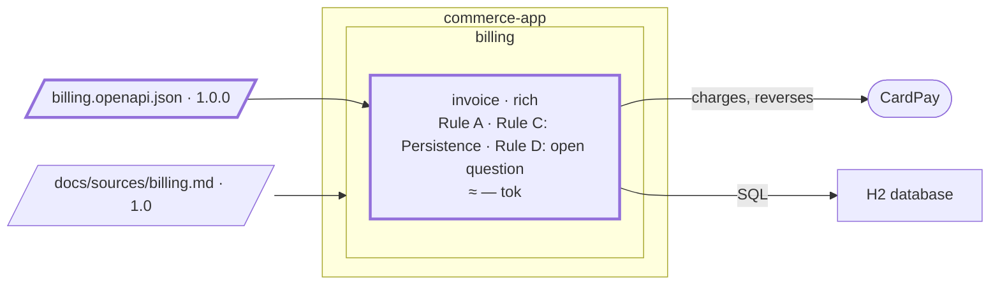

# Step 04 — The first feature → code, a contract; Rule C in the spec

## The situation

The accountant must issue the invoice of a confirmed order, and anyone must be able to read it back. There is no Java under `com.commerce.invoice` yet, and no contract.

## What you bring

- [PO] The feature: _the accountant issues the invoice of a confirmed order, and anyone can read it back._
- [architect] The contract of `invoice`, billing 1.0.0, [`docs/contracts/billing.openapi.json`](04-provided/docs/contracts/billing.openapi.json), in [`04-provided/`](04-provided/): `issueInvoice` and `getInvoice`, and a `Money` that already carries `amountMinor` and `currency`.
- [TL] The generator of the API interfaces, ArchUnit, chosen at step 03, and `JdbcClient` for the database.
- [architect] Rule C, decided while designing: _every amount is stored in minor units, with its currency_, a `BIGINT` and a three-letter ISO 4217 code, never a decimal.
- [TL, architect] Three conventions of the code, none of them a business rule: an amount column is named `<what>_minor`, its currency `<what>_currency`; the Spring configuration is YAML, tests included, never a `.properties` file; only identifiers are logged.
- [architect] A sequence diagram of the issue, drawn from the C4 model.

The attack and the plan raise many questions (a second issue for the same order: refused, 409, under BR-1). You answer them as the role would.

## What you ask

In a fresh session, so that the attack starts from the spec alone:

> Attack the spec of `invoice` before we plan the feature: the accountant issues the invoice of a confirmed order, and anyone can read it back.

Then:

> Plan this feature.

When the design asks for the API, you hand over the contract and the rest of what you bring. Commit the contract alone before the prompt that reads it: its sha is what the next delta starts from. Once the plan is validated:

> Carry out the plan up to the migration and the domain, then stop.

You commit, clear the session and open a fresh one, on purpose, to see the work resume from the plan alone:

> Resume.

If the closing did not start with the last tick:

> We are done, close the plan.

## What partition does

1. **The attack writes into the spec.** `partition-attack` reads the spec, the area file and the register (neither exists yet), and the contracts the spec names (none yet). Its findings go under `Open questions` and nowhere else: two confirmations of one order at once, the currency of a line. No implementation, no compliment.
2. **The design, from the model.** The rules carry no banner, so design may start. `partition-c4` adds a dynamic view of the issue to the model, checks it and prints it as Mermaid: every participant is an element of the model.
3. **A contract, not a second source.** `invoice` was decomposed from the PRD. The contract is what it shows its neighbours: it goes to `Contracts with neighbours`, and the decomposition keeps the PRD, its provenance unchanged.
4. **Rule C, by its object.** It is born in the plan's `## Decisions`, dated, with what lost: a decimal column. What it says is the form of `invoice`'s stored data, so the line itself goes to the spec's `Persistence`; the reason stays in the plan.
5. **The conventions, as rule-file lines.** Column names, YAML, logs: how code is shaped, not what `invoice` holds. `partition-rules` finds for each the file whose topic and scope fit (YAML in a file whose scope reaches the configuration files, main and test, or the rule never loads where a `.properties` file would be written). It shows each line with its file and scope, and writes after your validation.
6. **The code, deliberately small.** A migration, the domain, the use cases, the controller on the generated interface, the database adapter. The architecture test is written now, with the first classes, generated from the layer map: one rule per allowed dependency, a default that forbids the rest. The build runs it.
7. **The resume reads the plan, not the chat.** The fresh session reads only the header, the task index, the task named in `Resume at` and the blockers. It finds your commit for every `uncommitted` marker and writes its sha, announces where it restarts, then restarts there.
8. **The closing.** The gate takes the spec as its oracle and shows the real output of the build; with no coverage tool configured, coverage is "not verified" and the verdict cannot be a clean SHIP. Every statement is then checked for its level, Rule C included although already written: one area, one hexagon, so it fails the admission test, is reported as a rejected candidate, and stays in `Persistence`. The README gains the endpoints and how to run; the C4 diagrams are regenerated.

**Why it works this way.** What a bounded context holds, the form of its stored data included, belongs to its spec; how its code is shaped is a line of a rule file (BR-9). A statement lives at the lowest level that holds it all, and climbs only when the set of bounded contexts that need it grows: most plans admit nothing to the register (BR-12).

## The shape after

**New:** the contract, the first code, `V1__invoice.sql`; Rule C, decided in the plan, now a line of `Persistence` in the spec of `invoice`.

**Cost:** Rule C lives in one spec. The day a second bounded context needs it, it must climb (the ladder of Rule C).
