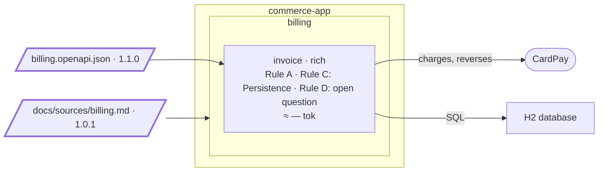

# Step 05 — Code and spec disagree: the spec moves first

> **Session:** 📌 open a **fresh session.** The rule "the spec moves first" comes from the instruction; a fresh session shows that the assistant applies it without being reminded.

## The problem

The accountant must cancel an invoice and issue its correction, for the same order. The database refuses a second invoice for one order, as BR-1 says, copied from REQ-1; REQ-2 of the same PRD asks for the correction. Step 04 left the contradiction as an open question; the feature now needs it answered, and only the PRD can.

## Before

Your `partition-commerce` project should be at the commit of step 04: `invoice` issues and reads invoices, Rule C under `Persistence` in its spec. The database refuses a second invoice for one order: `order_id` is unique, which is BR-1, "An invoice is issued once per order."

The PRD contradicts itself: REQ-2 says "A correction is made by cancelling the invoice and issuing a new one", for the same order. The spec of `invoice` holds it in `Open questions` since step 04: _How does "issued once per order" (REQ-1) hold when a correction issues a new invoice (REQ-2)?_ The contract, billing 1.0.0, has no cancel operation.

## Provided

`[PO]` gives you the feature: _the accountant cancels an invoice before any payment, and issues its correction._

The files of this step are in [`05-provided/`](05-provided/); each is copied when its prompt says.

`[architect]` gives you the contract billing 1.1.0, [`docs/contracts/billing.openapi.json`](05-provided/docs/contracts/billing.openapi.json). The version changes, the `409` of `issueInvoice` now reads "This order already has an invoice that is not cancelled", and one operation is added:

```json
"/invoices/{invoiceId}/cancel": {
  "post": {
    "operationId": "cancelInvoice",
    "tags": ["Invoice"],
    "parameters": [{ "name": "invoiceId", "in": "path", "required": true, "schema": { "type": "string" } }],
    "responses": {
      "200": {
        "description": "The cancelled invoice",
        "content": { "application/json": { "schema": { "$ref": "#/components/schemas/Invoice" } } }
      },
      "404": { "description": "No such invoice" },
      "409": { "description": "The invoice is paid or already cancelled" }
    }
  }
}
```

`[PO]` gives you, when the assistant asks which requirement holds, the amended PRD, version 1.0.1, [`docs/sources/billing.md`](05-provided/docs/sources/billing.md). Only the version and REQ-1 change:

```diff
 # Billing — product requirements

-Version 1.0
+Version 1.0.1

 ## Invoices

 ### REQ-1 — Issue an invoice

 When an order is confirmed, an invoice is issued to the customer of the order, with one line per ordered item.
-Rule: An invoice is issued once per order. Rule: The amount of an invoice is the sum of its lines.
+Rule: An order has at most one invoice that is not cancelled. Rule: The amount of an invoice is the sum of its
+lines.
```

`[BA]` gives you the confirmation of the rewritten BR-1, word for word from REQ-1, with its trigger and its expected effect: the effect of BR-1 stays, said of an invoice that is not cancelled.

`[PO]` and `[architect]` answer the questions the plan asks:

| Question | Answer |
| --- | --- |
| Is a change of status (cancelled) a modification (BR-3, REQ-2)? | `[PO]` No. Cancelling changes the status of the invoice, never its lines, its amount or its order: REQ-2 itself corrects by cancelling |
| Is the correction one action or two? | `[PO]` Two, as REQ-2 says: the accountant cancels the invoice, then issues a new one for the same order with `issueInvoice` |
| What does the correction carry? | `[PO]` What any issue carries: the order, the customer and the lines as given, which may differ from the cancelled invoice. It keeps no link to the cancelled invoice in this version |
| Which "Cancelled" is this feature? | `[PO]` BR-4's: voided before any payment, at no fee. BR-6, the cancellation of a paid invoice, comes with payment |
| Is the refusal of a paid invoice built now? | `[PO]` With payment (REQ-4): no invoice can be paid yet. A paid invoice reversed (REQ-5) is out of this feature |
| Who may cancel? | `[PO]` Anyone holding the identifier, as for issuing: there is no login in this version, accepted |
| What does a cancel record? | `[PO]` Only the status, in this version |
| How is BR-1 held in the database, now that a cancelled invoice frees its order? | `[architect]` Still by the database, for two issues at the same moment too: a V2 migration replaces the unique key on `order_id` with one on the order of the invoices not cancelled |
| The responses the contract leaves open? | `[architect]` As for reading and issuing: `404` for an identifier that is not a UUID; `409` without a body; of two cancels at the same moment, the second gets `409`; an issue that races the cancel of its order gets `409` until the cancel has committed |

The attack of the spec, at 05.d, finds what the answers above leave open. `[PO]` and `[architect]` answer:

| Finding | Answer |
| --- | --- |
| Anyone may cancel, then issue for the same order with another customer and lines | `[PO]` Accepted for this version, with the cancel: there is no login |
| Which "not cancelled" in BR-1, once a paid invoice can be reversed (BR-6)? | `[PO]` An open question, settled with payment |
| Is the customer also unchanged by a cancel (BR-3)? | `[PO]` Yes: a cancel changes the status only |
| What does "at no fee" (BR-4) mean? | `[PO]` A cancel charges nothing and calls no third party |
| The correction cannot be found from the cancelled invoice | `[PO]` Accepted in this version |
| "Issued" means "sent to the customer": is an issued invoice the status `ISSUED`? | `[PO]` Yes: an invoice neither paid nor cancelled |
| The wording the assistant wrote into the spec from these answers (rules, triggers, effects) | `[PO]` Confirmed |
| The design choices the plan records: the status move, two cancels at once, V2, the identifier | `[architect]` Confirmed, when they follow ruling P-1 and the answers above |

`[TL]` gives, when the gate asks to see the feature in the running application, the result of a look at it (`./mvnw spring-boot:run`): issue `201`; a second issue for the order `409`; cancel `200`, `CANCELLED`; cancel again `409`; cancel of `nope` `404`; the correction `201`; a third issue `409`; a read of the cancelled invoice `200`, `CANCELLED`.

## Prompt

**05.a** — copy the contract of [`05-provided/`](05-provided/), `docs/contracts/billing.openapi.json`, over the one of `partition-commerce`, and commit it alone:

```bash
git add docs/contracts/billing.openapi.json && git commit -m "docs(contracts): billing 1.1.0"
```

Then, 📌 in a fresh session, type:

> Plan and build this feature: the accountant cancels an invoice before any payment, and issues its correction.

Let the assistant run until it stops on its own.

**05.b** — copy the PRD 1.0.1 of [`05-provided/`](05-provided/), `docs/sources/billing.md`, over the source of `partition-commerce`, and commit it alone:

```bash
git add docs/sources/billing.md && git commit -m "docs(sources): billing 1.0 -> 1.0.1"
```

Then type:

> The billing PRD changed: REQ-1 now says which holds. Bring the specs in step with it.

Validate the writing plan the assistant shows:

> Validated, area `billing`. Write the two patches.

**05.c** — give the business analyst's instruction:

> Replace BR-1 with the new rule of REQ-1. I confirm it. Trigger: an issue for an order that already has an invoice that is not cancelled. Expected effect: refused, nothing is issued; of two issues of one order at the same moment, the second is refused.

**05.d** — by now the assistant has asked the questions of the plan. Give their answers from the first table of **Provided**, say yes to removing the open question BR-1 answers, and end the message with:

> Now plan and build the feature.

Answer the findings of the attack and confirm the wording and the design choices from the second table, then let the assistant carry the plan to its end, saying only "Go on." when it stops.

Then commit:

```bash
git add . && git commit -m "feat(invoice): cancel an invoice and issue its correction"
```

## Expected

### 05.a — It stops before any spec or code, and asks the product owner

The instruction applies (_Truth_: a rule copied from a source changes only through its source), whether or not `partition-spec` is loaded yet. A process skill may lead the session, with its own questions first; whichever leads, the contradiction comes before any design:

1. It finds the open question of step 04 and says **which side is wrong and why**. The code does what BR-1 says; BR-1 is copied word for word from REQ-1; REQ-2 of the same source asks for the opposite. The spec is not wrong against its source: **the source contradicts itself**. It cannot tell which requirement holds: it asks the owner of the PRD.
2. It does not drop the unique constraint "because the feature needs it", and it proposes no new wording for BR-1: a rule copied from a source changes only through its source.
3. It writes no spec and no code. A plan may open: it then holds the question as a blocker, owned by the product owner, and `Resume at` waits on it. Two replays showed both: one wrote nothing, one opened a `blocked` plan.

It reads the cancel operation in contract 1.1.0, and may say that its `409` of `issueInvoice` reads one side: a contract does not settle what its source contradicts. It may ask the other questions of **Provided** already.

### 05.b — The delta reports the copied rule, and does not rewrite it

You should see `partition-shape` find a sha in `bounded-contexts.md` and a source changed since: it runs the delta (`references/delta.md`), read for a document. `git diff <sha> -- docs/sources/billing.md` shows REQ-1 modified: the rule changed, the entity did not.

```text
Source             : docs/sources/billing.md
Version            : 1.0 -> 1.0.1
Base               : <sha of billing 1.0>
Current            : <sha of billing 1.0.1>
Scope              : whole source

Delta:
  Units modified         : 1   REQ-1
Classification:            the rule of REQ-1 changed
Decomposition:
  Unchanged              : yes — the normal case
Writing plan:
  ≈ docs/specs/billing/bounded-contexts.md      (patch: provenance, gaps, history)
  ≈ docs/specs/billing/invoice/spec.md          (patch: header lines, open question)
  = all the other files                         (intact)
Copied from the source (word for word, to confirm):
  - invoice: BR-1, copied from REQ-1, changed by the source — reported, not rewritten
```

A change that does not move the decomposition is the normal case, and the assistant tells you so. After your validation: the provenance of `bounded-contexts.md` and of the spec moves to the new sha and 1.0.1, and `History` gains a line. **BR-1 is untouched**: the report lists it as a copied rule whose source changed.

### 05.c — A person rewrites the rule

You should see `partition-spec` leave the new text to the business analyst, not to the assistant: the assistant writes it on that instruction, shows you the change and gets it validated.

| #    | Rule                                                    | Source             |
| ---- | ------------------------------------------------------- | ------------------ |
| BR-1 | An order has at most one invoice that is not cancelled. | from source: REQ-1 |

The open question of step 04 on REQ-1 and REQ-2 is answered; `Open questions` is hand-written, so the assistant asks before removing it, and removes it at 05.d once you say yes. The dated reason goes to `## Decisions` of the plan: the one 05.a opened, or, when none did, the one 05.d opens.

### 05.d — Only then the plan and the code

You should see the plan opened, or resumed when 05.a opened it, with the reason of the new BR-1 in its `## Decisions`, and the answers of **Provided** settled in the spec first: a change of status is not a modification (BR-3), and the open questions they answer leave `Open questions`. The code follows the spec:

```text
+ src/main/resources/db/migration/V2__….sql     the unique key on order_id moves to the order of the invoices not cancelled
+ the cancel use case and cancelInvoice         BR-4: only an issued invoice; 409 otherwise
≈ the use case of issuing                       refuses a second invoice that is not cancelled
+ the tests of cancelling and of the correction
```

A new Flyway file: V1 is never edited (the rule moved at step 01). Then the closing: the gate, which may ask for a look at the running application (the `[TL]` of **Provided** gives it), nothing new for the register, the README realigned for the cancel operation, `done`.

### The shape after



**New:** contract 1.1.0 and `cancelInvoice`; PRD 1.0.1; BR-1 rewritten by `[BA]`; a V2 migration. The bounded contexts are unchanged.

**Cost:** the work stopped on a question until `[PO]` said which requirement holds: the spec moves first.

## Verdict

- [x] 05.a — It finds the open question of step 04, and says which side is wrong and why: the source contradicts itself (REQ-1 against REQ-2)
- [x] 05.a — It asks the owner of the PRD which requirement holds, and proposes no new wording for BR-1
- [x] 05.a — The unique constraint is not dropped, and no spec or code is written; a plan, if one opens, holds the question as a blocker owned by the product owner
- [x] 05.b — `partition-shape` runs the delta: `git diff <sha> -- docs/sources/billing.md` shows REQ-1 modified
- [x] 05.b — The block above: `1.0 -> 1.0.1`, base and current sha, REQ-1 modified, decomposition unchanged, two patches in the writing plan
- [x] 05.b — It says a change that does not move the decomposition is the normal case
- [x] 05.b — After validation, the provenance of `bounded-contexts.md` and of the spec moves to the new sha and 1.0.1, and `History` gains a line
- [x] 05.b — BR-1 is untouched, reported as a copied rule whose source changed
- [x] 05.c — On the BA's instruction, BR-1 reads "An order has at most one invoice that is not cancelled.", from source REQ-1, shown; it asks before removing the answered open question
- [x] 05.d — The plan opens, or resumes, with the reason of the new BR-1 in its `## Decisions`, not in the spec
- [x] 05.d — The answers of **Provided** are settled in the spec before the code
- [x] 05.d — It asks the architect how BR-1 is held in the database, and does not choose alone
- [x] 05.d — A V2 migration moves the unique key on `order_id` to the order of the invoices not cancelled; V1 is not edited
- [x] 05.d — `cancelInvoice` cancels only an issued invoice; issuing refuses a second invoice not cancelled; tests of cancelling and of the correction are added
- [x] 05.d — The closing: the gate, nothing new for the register, the README realigned for the cancel operation, `done`
