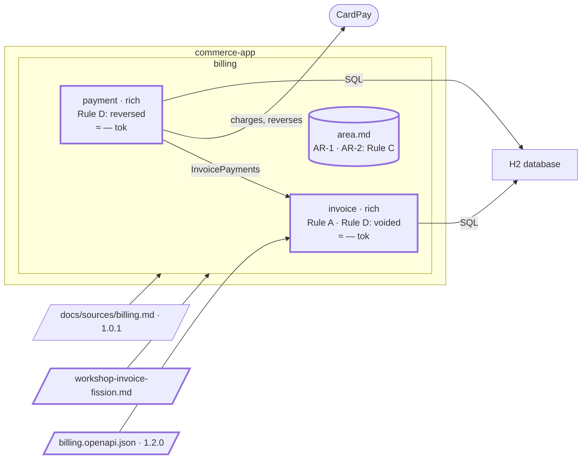

# Step 06 — "Cancelled" means two things in `invoice`: a workshop splits out `payment`; Rule C goes to the area file

> **Session:** a fresh session for 06.a, a new feature: the plan of step 05 is done. 📌 Open another **fresh session** at 06.b: the assistant must find `partition-reshape` from its description, in a session that did not build the code it is about to examine.

## The problem

The customer must now pay an issued invoice by card, and "Cancelled" has meant two things in `invoice` since step 02.

## Before

Your `partition-commerce` project should be at the commit of step 05: `invoice` issues, reads, cancels and corrects invoices. Its spec holds its business rules, Rule C under `Persistence`, the open question on "Cancelled" since step 02, and since step 05 the one on which "cancelled" BR-1 counts. Nothing pays yet.

## Provided

`[PO]` gives you a feature first: _the customer pays an issued invoice by card_ (REQ-4). CardPay is not reachable from the demo: its adapter is a fake that accepts every card, behind a port.

`[architect]` gives you the contract billing 1.2.0, [`docs/contracts/billing.openapi.json`](06-provided/docs/contracts/billing.openapi.json), in [`06-provided/`](06-provided/). Only the version, one operation and its request body are added:

```json
"/invoices/{invoiceId}/pay": {
  "post": {
    "operationId": "payInvoice",
    "tags": ["Payment"],
    "parameters": [{ "name": "invoiceId", "in": "path", "required": true, "schema": { "type": "string" } }],
    "requestBody": {
      "required": true,
      "content": { "application/json": { "schema": { "$ref": "#/components/schemas/PayInvoice" } } }
    },
    "responses": {
      "200": {
        "description": "The paid invoice",
        "content": { "application/json": { "schema": { "$ref": "#/components/schemas/Invoice" } } }
      },
      "402": { "description": "CardPay refused the charge; the invoice stays issued" },
      "404": { "description": "No such invoice" },
      "409": { "description": "The invoice is not issued: already paid or cancelled" }
    }
  }
}
```

`PayInvoice` carries one required string, `cardToken`. The tag `Payment` gives the operation an interface of its own in the generated code: the architect sees the payment coming.

`[PO]`, `[architect]` and `[TL]` answer the questions the plan of 06.a asks:

| Question | Answer |
| --- | --- |
| The scope of the feature? | `[PO]` REQ-4 only, and `cancelInvoice` now refuses a paid invoice with `409` (BR-4). A paid invoice cancelled by the customer (REQ-5) is a later feature |
| CardPay's API? | `[TL]` Not reachable from the demo: a port with one operation, a charge of a card token for an amount, which answers accepted with a charge reference, or refused. Its only adapter is a fake that accepts every card; a refusal is tested with a test double. No URL, no credentials |
| Is an invoice paid in full by one call? | `[PO]` Yes: one call charges the whole amount, once. No partial payment in this version |
| What does a payment record? | `[PO]` The status, the time of the payment and CardPay's charge reference; never the card token. Paying changes the status, it is not a modification (BR-3) |
| Is a payment then an entity of its own? | `[architect]` Not in this feature: it is held on the invoice. The question stays open: a yes reopens the `invoice` / `payment` split |
| Who may pay? | `[PO]` Anyone holding the identifier, as for cancelling: there is no login in this version, accepted |
| CardPay does not answer? | `[architect]` An open question until CardPay is reachable: the fake always answers |
| Two payments, or a payment and a cancel, at the same moment? | `[architect]` The payment is recorded by the same conditional update as a cancel, on an invoice still issued: the first to commit wins, the other gets `409`. A charge whose record loses is reversed with REQ-5: an open question until then |
| The card token? | `[TL]` A token CardPay makes on the customer's side, never a card number: non-blank, at most 255 characters; otherwise `400` without a body, as for issuing |

The attack of the spec, at 06.a, finds what those answers leave open:

| Finding | Answer |
| --- | --- |
| Does a refused pay (`400`, `404`, `409`) call CardPay? | `[architect]` No: the refusals come first; CardPay is called only for an issued invoice |
| An invoice whose amount is zero? | `[PO]` Charged like any other amount: CardPay decides |
| Anyone may retry pays after `402`, testing card tokens | `[PO]` Accepted in this version: there is no login; an open question |
| Is a refused pay a payment? What does `PAID` mean? | `[PO]` A refused pay is no payment: the invoice stays issued and may be cancelled. `PAID` is an invoice whose charge is recorded |
| The identifier of a pay, and which refusal first? | `[architect]` As for reading and cancelling: `404` for an identifier that is not a UUID; the content of the request first (`400`), then the invoice (`404`, `409`) |
| A charge whose record loses leaves no trace | `[architect]` Not kept in this version: the loser gets `409`; an open question until REQ-5 |
| The fake accepts every card wherever the service runs | `[TL]` Accepted: the demo has no real customer; a real adapter comes with CardPay |
| A paid invoice cannot be corrected | `[PO]` Accepted until REQ-5 |
| When is "the time of the payment"? | `[architect]` When the record commits; the contract does not return it |
| CardPay returns a charge reference out of bounds | `[architect]` A defect, `500`: under the open question on CardPay errors |
| "Refused" names our refusals and CardPay's | `[PO]` CardPay declines a card; a refusal is ours |
| What is a payment? | `[PO]` A charge recorded on the invoice; a declined charge is no payment |
| "Non-blank, at most 255 characters" is written several times | `[architect]` Once, in BR-14; the others point to it |
| May the card token appear in a log, an error or a trace? | `[TL]` Never |
| What CardPay sends back? | `[TL]` A charge reference, non-blank text of at most 255 characters; the `402` carries no body |
| The wording written into the spec from these answers | `[PO]` Confirmed. BR-21 points to the form BR-14 already gives, rather than repeating it |

`[architect, PO, BA]` give you the result of the workshop, once the material is in hand. You paste it in the chat as it is, once you have written the names in `Decided by`: the assistant asks for them otherwise. It saves the result as `docs/sources/workshop-invoice-fission.md`:

| Item | Decision |
| --- | --- |
| Move | Fission: `invoice` becomes `invoice` and `payment`, both in area `billing` |
| Why | "Cancelled" is, of an unpaid invoice, "voided before any payment, at no fee", and of a paid invoice, "reversed within 24 hours of being paid" (the PRD's glossary): two meanings, two contexts |
| Units | REQ-4 and REQ-5 go to `payment`; REQ-1 to REQ-3 stay in `invoice` |
| Integration | `payment` calls `invoice` in process, through `InvoicePayments`: read an invoice as `getInvoice` shows it; record a payment, refused when the invoice is no longer issued; record a payment cancelled |
| API | `payment` serves `payInvoice`, the tag `Payment` of the contract |
| Contract | `InvoicePayments`, an interface of `invoice`'s application layer, frozen for the move |
| Rules | The rules copied from REQ-4 and REQ-5 (BR-5, BR-6), the rules written for paying and DEC-1, CardPay, go to `payment`; the others stay in `invoice`. Paying refuses before calling CardPay (`payment`); `invoice` records a payment only on an invoice still issued, so of a pay and a cancel at the same moment the first to commit holds (`invoice`). Needed by both, so in the area file: the `Persistence` line "every amount is stored in minor units, with its currency" (Rule C), the bound "non-blank, at most 255 characters" (BR-14), and the shared words (amount, minor units, currency, refused). The time and the charge reference of a payment go to `payment` |
| Code of `payment` | `src/main/java/com/commerce/payment/**`, rich: a payment moves from made to cancelled within 24 hours |
| Decided by | <the names of the architect, the product owner and the business analyst> |

`[architect]` gives you the answer to the challenge: _keep the fission as it is: "Cancelled" carries two meanings, and the PRD will name the payment._

`[PO]` and `[architect]` answer the other findings of the challenge:

| Finding | Answer |
| --- | --- |
| The result makes a payment an entity of its own | `[architect]` Yes: kept against C2, the answer above |
| `invoice`'s "cancelled" is voided only: an invoice whose payment is cancelled is not cancelled for BR-1 | `[PO]` Yes |
| Is recording a cancelled payment a modification (BR-3)? | `[PO]` No: it changes the status. `[architect]` Its home is `invoice`, where the status changes |
| Once a payment is cancelled, can the invoice be paid again, or cancelled by the accountant? | `[PO]` Paid again, yes: "unpaid again" is issued again. Cancelled by the accountant, no: REQ-3 holds, "only before any payment" |
| Does `payment` store an amount? | `[architect]` Yes, the amount charged: Rule C binds it |
| Which wording of Rule C goes to the area file? | `[architect]` The spec's, as written |
| `InvoicePayments` is frozen but not written | `[architect]` Written and frozen first: a precondition, with its own plan |
| When does "the time of a payment" count, once there are two records? | `[architect]` When the record of `payment` commits |
| `payInvoice` is generated into `invoice`'s interface: the generator has no setting per tag | `[TL]` Generate one interface per tag, in the precondition plan |
| "Blank" moves with the bound to the area file? | `[architect]` Yes |
| The wording proposed for a shared word (refused) | `[PO]` Confirmed |
| Where does the frozen text of `InvoicePayments` live? | `[architect]` In the Java interface, in `invoice`'s application layer; the record quotes its signatures |
| "Record a payment cancelled" has no caller until REQ-5 | `[architect]` Frozen in the interface; built with REQ-5 |
| The open points of the proposal of `InvoicePayments` (what a record carries, the type of the identifier, the refusals) | `[architect]` The proposals as made; the refusal of recording a cancelled payment is decided with REQ-5, until then a `default` method that throws |
| Are the rules renumbered in each spec? | `[architect]` No: a rule keeps its number when it moves |
| "Payment" is used by both specs | `[BA]` A shared word: in the area file, with the BA's meaning |
| The specs written for the move: rules, triggers, effects, the objective of each | `[PO]` and `[BA]` Confirmed; the banner of `payment` goes |
| The dated attack on paying, in `invoice`'s spec | `[architect]` It moves to `payment` with the rules it attacked |
| Where do the time and the charge reference of a payment go, now that `recordPayment` carries the invoice only? | `[architect]` In `payment`'s own table, a V4 migration, written in the same transaction as `recordPayment`: the first to commit holds both; the columns of the invoice row go with the move |
| The design of a precondition task: the key of a table, a foreign key across contexts, the data already stored, the transaction | `[architect]` A key of its own; no foreign key across contexts; the data already stored is copied by the migration; two writes in one transaction, held by a separate `@Transactional` bean (not a project rule) |
| The design overturns a pattern ruling of the grid | `[architect]` Re-rule it with `partition-patterns`; a ruling whose reopening condition is met is reopened |
| The gate of the precondition plan: the paying code still imports types of `invoice` | `[architect]` They move with `payment`, or are written again on its side for AR-1 and AR-2, in the move plan |
| The gate: a time taken in the transaction, just before its commit | `[architect]` Accepted as the time of that commit |
| The gate: a version older than a migration that moves or drops data must not run after it (V4, V5) | `[TL]` Acknowledged: no instance of it runs after the migration, no rollback to it |
| The design of the move: `payment`'s side of the call, its own generated interface, its own copies of shared helpers | `[architect]` and `[TL]` The proposals as made: a port of `payment` with its own types, an outbound adapter that calls `InvoicePayments`; one generator run per tag; own copies |
| How far does the ArchUnit exception reach, and where is it declared? | `[architect]` `InvoicePayments` and the types of its signature, from `payment`'s outbound adapter only; declared in the test, from `Contracts with neighbours` of both specs: `docs/partition.yml` declares no dependency between contexts |
| The decision the budget record asks for | `[architect]` Nothing to do: each context is far under the threshold |
| The layer map and its ArchUnit test forbid `payment` to call `invoice` | `[architect]` The map gives way for `InvoicePayments` only: `payment`'s outbound adapter uses it, nothing else of `invoice`; the test says so |

`[BA]` gives you the language of `payment`: _Payment_ — a card charge CardPay accepted, against one invoice; a declined charge is no payment. _Cancelled_ — reversed within 24 hours of the payment.

`[TL]` accepts, when the gate of 06.a asks, that a rollback is one-way once an invoice is paid: the project fixes forward. `[TL]` gives, when the gate asks to see the feature in the running application, the result of a look at it (`./mvnw spring-boot:run`): issue `201`; pay `200`, `PAID`; pay again `409`; cancel the paid invoice `409`; pay `nope` `404`; pay with a blank token `400`; pay a cancelled invoice `409`; the log holds no card token.

## Prompt

**06.a** — copy the contract of [`06-provided/`](06-provided/) over the one of `partition-commerce`, and commit it alone:

```bash
git add docs/contracts/billing.openapi.json && git commit -m "docs(contracts): billing 1.2.0"
```

Then, in a fresh session, type:

> Plan and build this feature: the customer pays an issued invoice by card, through CardPay.

Answer its questions from **Provided**, let it carry the plan to its end, saying only "Go on." when it stops, then commit:

```bash
git add . && git commit -m "feat(invoice): pay an invoice by card"
```

**06.b** — 📌 in a fresh session, type:

> Prepare a boundary workshop on `invoice`: "Cancelled" means two things in it.

**06.c** — after the workshop, write the names in `Decided by`, then paste the result of **Provided** in the chat. Name the file `workshop-invoice-fission` when the assistant asks, and validate it. Answer the findings of the challenge from **Provided**: the architect's answer keeps the fission. Then type:

> Carry out the fission of `invoice`: `payment` comes out. I validate the fission by name.

**06.d** — the assistant opens the plan of the preconditions. Answer its questions from **Provided**, saying only "Go on." when it stops. Once that plan is `done`, commit:

```bash
git add . && git commit -m "refactor(invoice): the preconditions of the fission of payment"
```

Then type:

> Resume the fission.

Answer the questions of the move plan from **Provided** the same way and, once it is `done`, commit:

```bash
git add . && git commit -m "refactor(payment): payment split out of invoice"
```

## Expected

### 06.a — The payment is built inside `invoice`

You should see an ordinary plan. The use case of paying lives in `com.commerce.invoice.application`, calls a port for CardPay (fake adapter in `outbound`), and changes the invoice directly through the repository of `invoice`. It implements `payInvoice` of contract 1.2.0, which it does not edit. A V3 migration records the payment (V1 and V2 are not edited). Closing as at step 05: the gate may ask for a look at the running application, which the `[TL]` gives.

### 06.b — The material, not a boundary

You should see `partition-reshape` (_Before the decision_) gather, from the spec, the contract and the last budget record:

1. The domain events, in the spec's words: an invoice issued, cancelled, paid; a payment made, cancelled.
2. The word with two meanings, quoted with where each is found: "Cancelled" in REQ-3 and REQ-5, in the PRD's glossary, in the spec's `Open questions`.
3. What the coming features need to load against what they will load (from `docs/budget/`). The last record, of step 01, predates `invoice`: it says so, gives what it can and offers a measure.
4. The dependencies that do **not** go through an interface, each with `file:line`: paying and cancelling are methods of one `Invoice` aggregate, behind one port `Invoices`, by conditional updates of one row. They are the price of the move.
5. The business rules and the `Persistence` lines both sides would need, each with its side: BR-5, BR-6 `payment`; a pay and a cancel at the same moment "both"; Rule C "both".
6. Not a merge: no contract to list.

Your request names a workshop: the assistant does not ask you the way. It hands the material over as it is and stops. **It proposes no boundary**: you asked for a workshop.

### 06.c — The result saved and challenged, the record, then the preconditions

You should see the assistant save the result as `docs/sources/workshop-invoice-fission.md`, show it, and wait for you to validate it: it never challenges from the chat. Then the challenge (`partition-shape`, `references/boundary-decision.md`, _The challenge_), point by point:

- **The source**: REQ-1 to REQ-5 each belong to one bounded context. No finding.
- **The criteria**: `payment` has its own language (C3) and its own external dependency, CardPay (C5), but no root aggregate of its own in the source. REQ-4 "pays an issued invoice" and REQ-5 "cancel a paid invoice" both act on the invoice: **C2 fails, and R1 is not met.** Improvement proposed: keep one bounded context, until the PRD names the payment.
- **The register, the area file, the specs**: no finding.
- **The material**: what the result leaves open or settles without saying so. The answers are in **Provided**.

It offers to take the result as it is, and the decision is yours. With the architect's answer, the fission is **kept against C2**.

You should get a record under `docs/architecture/reshapes/`, dated, from `assets/reshape-record.md`: decided on, by whom (the names given), from the workshop `docs/sources/workshop-invoice-fission.md`, from `invoice` to `invoice` and `payment`, raised by a workshop. `Challenge` holds the finding on C2 and "kept as is", with the architect's reason. `Why here` holds the two meanings of "Cancelled"; `Integration` the in-process call through `InvoicePayments`; `Rules` one line per rule and its home.

Then the preconditions, all of them or stop (_Preconditions_). None is met:

- [ ] Every caller reaches the part to move through an interface — **no**: paying calls `Invoice` and the port `Invoices` directly (`file:line`).
- [ ] One adapter implements that interface — no interface yet.
- [ ] The contract is written and frozen — not yet.
- [ ] `payment` has its own spec and language — not yet.
- [ ] Every rule has a home — the findings settle it.

A missing precondition is its own piece of work, with its own plan, before the move: once you validate the fission by name, the assistant opens that plan itself.

### 06.d — The precondition plan, then the move plan

**The precondition plan** asks its questions as it goes (**Provided** answers them) and, task by task:

- **`docs/specs/billing/area.md`**, created from `assets/area.md` with `partition-spec`, after you validate its draft. **Rule C climbs to the area**, word for word from the spec, with the bound both sides share; the shared words go to its `Language` (amount, minor units, currency, blank, refused, payment):

  | # | Rule |
  | --- | --- |
  | AR-1 | A bounded text is non-blank and at most 255 characters. |
  | AR-2 | An amount is stored as a whole number of minor units, a `BIGINT`, with its currency, three letters; never as a decimal. |

  Each spec lists AR-1 and AR-2 under `Applicable area rules and invariants`, and points to them without repeating them.

- **`InvoicePayments`**, written and frozen in `invoice`'s application layer, its signatures quoted in the record.
- **`docs/specs/billing/payment/spec.md`**, created from the template of `partition-spec`, its header pointing to `docs/sources/billing.md`: `Source parts owned` REQ-4, REQ-5; `Language` its own "Cancelled", _reversed within 24 hours of being paid_; the rules of paying moved from `invoice` with their anchors and **their numbers** (BR-5 `from source: REQ-4`, BR-6 `from source: REQ-5`); DEC-1, CardPay; `Contracts with neighbours` `invoice`, consumed, `InvoicePayments`. **`invoice/spec.md`** loses them in the same change, and keeps "Cancelled", _voided before any payment, at no fee_: the word twice, each with its meaning, marks the boundary.
- **One interface per tag** from the generator; **a V4 migration**, `payment`'s own table, filled from the invoice row; **paying through `InvoicePayments`**; the pattern rulings the change overturns, ruled again.
- The gate; its conditions met; `done`.

**The move plan** (`references/specs.md`, _Fission_), one step per task:

- **The design**: `payment`'s port with its own types, an outbound adapter that calls `InvoicePayments`; its own copies of the helpers both sides use; its own generated interface. A pattern ruling for the port.
- **`docs/specs/billing/bounded-contexts.md`**: `payment` in `Bounded contexts retained` with the criteria it meets (C3, C5); `Kept against the criteria`: `payment`, C2 (R1), the names, the date, the architect's reason; REQ-4 and REQ-5 pass to `payment` in `Coverage`; the `Decided` line names the workshop file; the decisions not to split that the fission overturns move to `History`, with a `fission` line.
- **The code**: paying, its port to CardPay and the fake adapter move to `com.commerce.payment.{domain,application,inbound,outbound}`; `InvoicePayments` and its implementation stay in `invoice`. A V5 migration takes the payment off the invoice row.
- **The proof that it was a move**: the expected result written first, outside the moved code only the wiring changes, then the real output of the command that lists the files changed outside `src/main/java/com/commerce/payment/`. A caller of `invoice` that had to change means a dependency did not go through the interface: the assistant stops and says so.
- The gate; its conditions met; `done`.

### Afterwards

The last tasks of the move plan:

- `partition-c4`: a component `payment` in `commerce-app`, `context: payment`; `payment -> invoice` through `InvoicePayments`, in `Contracts with neighbours` of both specs; CardPay called from `payment`. Regenerated.
- `docs/partition.yml` declares `payment`, area `billing`, its code path, its rich hexagon with its reason and map. The ArchUnit test forbade any dependency between hexagons: it now lets `payment`'s outbound adapter use `InvoicePayments` and the types of its signature, and nothing else of `invoice`; `docs/partition.yml` says so in a comment.
- `partition-budget`: measured again, the record of the day. `invoice` and `payment` each load the instruction, the descriptions, `billing/area.md` and their own spec, each far under the threshold.
- From now on, a task in `payment` reads `invoice` through `InvoicePayments` only (the instruction, _Truth_).

### Watch

`Decisions not to split` of `bounded-contexts.md` said REQ-4 and REQ-5 were kept with `invoice`, C2 failing. The procedure of a fission now moves such a line to `History`: if it stays, the record contradicts itself.

### The shape after



**New:** `payment`, split out by the workshop; `billing/area.md`, where Rule C now lives as AR-2; the call `InvoicePayments`; CardPay is called from `payment`; a V3 migration that records the payment.

**Cost:** `invoice` and `payment` now meet only through `InvoicePayments`, and both load the area file.

## Verdict

- [x] 06.a — An ordinary plan; the paying use case lives in `com.commerce.invoice.application`
- [x] 06.a — It calls a CardPay port (fake adapter in `outbound`) and changes the invoice through `invoice`'s repository
- [x] 06.a — It implements `payInvoice` of contract 1.2.0 without editing it; a V3 migration; closing as at step 05
- [x] 06.b — The fresh session finds `partition-reshape` (_Before the decision_); it works from the spec, the contract and the last budget record
- [x] 06.b — The domain events in the spec's words: invoice issued, cancelled, paid; payment made, cancelled
- [x] 06.b — "Cancelled" quoted with where each meaning is found: REQ-3, REQ-5, the PRD's glossary, the spec's `Open questions`
- [x] 06.b — What the coming features need to load against what they will load, from `docs/budget/`; the record of step 01 predates `invoice`, and it says so
- [x] 06.b — The dependencies outside an interface, with `file:line`: paying and cancelling on one `Invoice` aggregate, one port `Invoices`, one row
- [x] 06.b — The rules and `Persistence` lines both sides need, each with its side: BR-5, BR-6 `payment`; Rule C both
- [x] 06.b — Not a merge: no contract listed
- [x] 06.b — The way is not asked: your request names a workshop; the material is handed over as it is and no boundary is proposed
- [x] 06.c — The result is saved as `docs/sources/workshop-invoice-fission.md`, shown and validated before the challenge; a name it lacks is asked, never guessed
- [x] 06.c — The challenge checks `payment` against R1 from the source: REQ-4 and REQ-5 act on the invoice, C2 fails; it proposes an improvement and offers to take the result as it is; the decision is yours
- [x] 06.c — It finds what the result leaves open (rules without a home, the glossary misquoted, a copied rule contradicted by an answer) and asks; it proposes no wording for a copied rule
- [x] 06.c — A dated record under `docs/architecture/reshapes/`, from `assets/reshape-record.md`: the date, the names given, the workshop file, from `invoice` to `invoice` and `payment`, raised by a workshop; `Challenge` holds the C2 finding, "kept as is", and the reason
- [x] 06.c — `Why here` holds the two meanings of "Cancelled"; `Integration` the in-process call through `InvoicePayments`; `Rules` one line per rule and its home
- [x] 06.c — The preconditions checked; none is met, the first because paying calls `Invoice` directly (`file:line`)
- [x] 06.c — The move waits: the missing preconditions are their own plan, opened once the fission is validated by name
- [x] 06.d — The precondition plan: the area file with AR-1 (the bound) and AR-2 (Rule C, word for word), validated before it is written; each spec points to them without repeating them
- [x] 06.d — `InvoicePayments` written and frozen in `invoice`'s application layer
- [x] 06.d — `payment/spec.md` from the template of `partition-spec`, its header pointing to `docs/sources/billing.md`: REQ-4, REQ-5; the rules of paying with their anchors and numbers; DEC-1; `InvoicePayments` consumed
- [x] 06.d — `invoice/spec.md` loses them in the same change; "Cancelled" in both `Language` tables, each with its own meaning
- [x] 06.d — One interface per tag; V4, `payment`'s table; paying through `InvoicePayments`; the rulings it overturns ruled again; the gate; `done`
- [x] 06.d — The move plan: the design put to the architect; one step per task
- [x] 06.d — `bounded-contexts.md`: `payment` retained (C3, C5); `Kept against the criteria`: `payment`, C2 (R1), the names, the date, the reason; REQ-4, REQ-5 to `payment` in `Coverage`; a `fission` line in `History`
- [x] 06.d — Paying, its CardPay port and the fake adapter move to `com.commerce.payment.{domain,application,inbound,outbound}`; `InvoicePayments` and its implementation stay in `invoice`; V5 takes the payment off the invoice row
- [x] 06.d — The proof of the move: the expected result written first, then the real output of the command listing the files changed outside `src/main/java/com/commerce/payment/`; no caller of `invoice` had to change
- [x] Afterwards — `partition-c4`: component `payment`, `context: payment`; `payment -> invoice` through `InvoicePayments`; regenerated
- [x] Afterwards — `docs/partition.yml` declares `payment`: area `billing`, its code path, its rich hexagon with its reason and map
- [x] Afterwards — The ArchUnit test lets `payment`'s outbound adapter use `InvoicePayments` and the types of its signature, and nothing else of `invoice`
- [x] Afterwards — The budget record of the day: `invoice` and `payment` each load the instruction, the descriptions, `billing/area.md` and their own spec
- [x] Watch — The line of `Decisions not to split` keeping REQ-4 and REQ-5 with `invoice` moves to `History`
