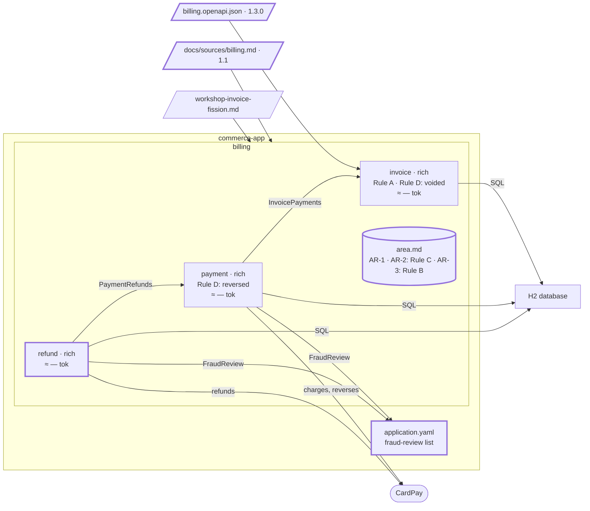

# Step 07 — PRD 1.1 → `refund`; Rule B an area rule

## The situation

Area `billing` holds `invoice` and `payment`; `billing/area.md` carries AR-1 and AR-2 (Rule C). The product owner brings PRD 1.1: refunds, and a fraud rule added to paying. The risk team runs the fraud review outside billing, and nothing in the PRD says how billing learns of it.

## What you bring

- [PO] The PRD 1.1, [`docs/sources/billing.md`](07-provided/docs/sources/billing.md), in [`07-provided/`](07-provided/): REQ-6, a refund of a paid invoice, settled by CardPay days later; and in REQ-4 and REQ-6 Rule B: _a customer under fraud review can neither pay nor be refunded._
- [PO] How billing knows, when asked: _until the risk team has a system, the customers under review are listed in `application.yaml`._
- [architect] The contract billing 1.3.0, [`docs/contracts/billing.openapi.json`](07-provided/docs/contracts/billing.openapi.json): `refundInvoice`, and a `403` on `payInvoice`. `refund` is rich and reads `payment` through `PaymentRefunds`.
- [TL] What a refund may log: _its identifiers and its status only, never the charge reference nor the amount._

The assistant asks many other questions along the way (what counts against the amount paid, two refunds at once). You answer them as the role would: that's your part.

## What you ask

Commit the PRD, then the contract, each alone before the prompt that reads it: its sha is what the next delta starts from.

In a fresh session (a changed source is a new piece of work):

> The billing PRD changed to 1.1. Bring the specs in step with it.

When the assistant asks how to decide on `refund`:

> A proposal.

Whatever option it recommends:

> The option with `refund`. [architect] A refund lives on CardPay's schedule, days after the charge, and the accountant's operation stays apart from the customer's. I validate the new bounded context `refund` by name.

When it asks for confirmation of what it copied:

> I confirm the rule of `refund` and the area rule on fraud review, as written. [architect] AR-1 and AR-2 bind `refund` too: it stores an amount and bounded texts.

Then, in a fresh session (a new feature):

> Plan and build the refund of a paid invoice, and the fraud review on payments and refunds.

## What partition does

1. **The delta.** `partition-shape` diffs the PRD from the sha recorded in `bounded-contexts.md`: REQ-6 added; REQ-4 tightened by a rule, so **breaking**, reported loudly, and the code searched: `payInvoice` does not apply it yet.
2. **A new bounded context, not a reopened one.** REQ-6 acts on an entity of its own, with its own words and life: `refund` is proposed. The pair `invoice` / `payment`, kept against a criterion at step 06, is not proposed for a merge again: REQ-4 changed by a rule, not by its entity.
3. **It asks how you decide.** Against `payment`, the criteria pull both ways (its own entity; the same fraud rule, the same CardPay), and a boundary is yours. With _a proposal_, it shows numbered options side by side, what each satisfies, breaks, costs and brings, and recommends one. You choose `refund` by name, with your reason; the other option goes to `Alternatives rejected`.
4. **Rule B goes once to the area file.** The source states it for two bounded contexts of one area, and neither owns it: it becomes AR-3 of `billing/area.md`, binding `payment` and `refund`, copied word for word under "TO VALIDATE". Each spec names it, neither copies it.
5. **The new spec.** `refund/spec.md` gets REQ-6 and its rule under "TO VALIDATE", and an empty `Contracts with neighbours`: a person writes that. That AR-1 and AR-2 also bind `refund` is proposed, not written. On the business analyst's word, `partition-spec` removes the banners.
6. **The feature asks before it invents.** Planning finds no source for "under review": it asks rather than inventing a table or an API. The change reaches several bounded contexts: one plan per bounded context, and a caller relies on a neighbour's contract only once that contract is written in the neighbour's spec (`InvoicePayments` gains the customer; `payment` gains `PaymentRefunds` and its fraud check; `refund` calls it). Each applies AR-3 itself, through its own port `FraudReview`.
7. **The logging answers are rule-file lines.** What a refund may log is how code is written, neither a business rule nor an area rule. `partition-rules` shows each line with its file (the security rule) and its scope, and writes it once you validate it.
8. **Closing.** Each contract is already in its provider's spec, written before a consumer's plan relied on it; `docs/partition.yml` and the C4 model gain `refund`; the gate reads AR-3 as an oracle; nothing for the register.

**Why it works this way.** A rule several bounded contexts of one area apply, with no owner among them, lives once, in the area file: nothing to drift apart. And each statement goes to the level of its object: what a bounded context holds or does to a spec or an area file, how code is written to a rule file, each shown before it is written.

## The shape after

**New:** `refund`; Rule B, an area rule, AR-3; contract 1.3.0; `PaymentRefunds`; a `FraudReview` port in `payment` and one in `refund`; a V6 migration.

**Cost:** Rule B has no owner in `billing`: two ports ask the same question of one list in `application.yaml`.
