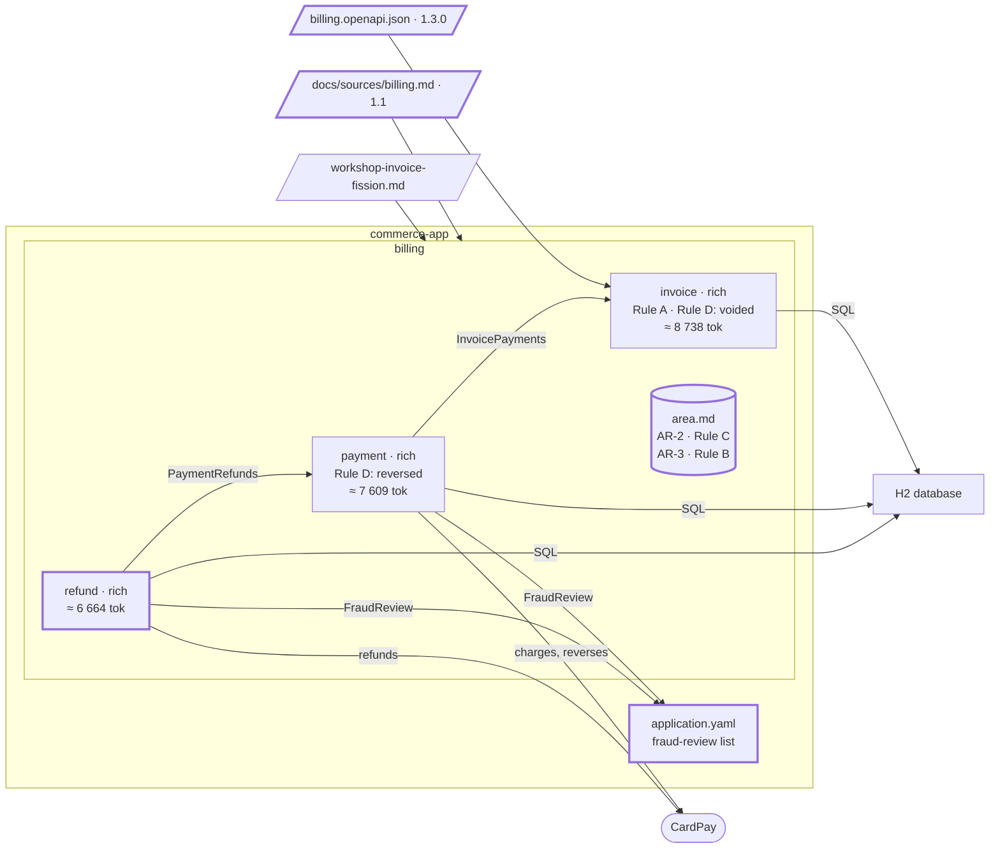

# Step 07 — PRD v1.1: `refund` is added; Rule B is an area rule

> **Session:** 📌 open a **fresh session.** A changed source is a new piece of work; the assistant must find the delta from the description of `partition-shape`.

## The problem

`[PO]` brings PRD 1.1: refunds, and a fraud rule added to paying. Nothing in the PRD says how billing learns that a customer is under review.

## Before

Your `partition-commerce` project should be at the commit of step 06: area `billing` with `invoice` and `payment`, `billing/area.md` with AR-1 (the bound of a text) and AR-2 (Rule C), `bounded-contexts.md` at version 1.0.1, the contract at 1.2.0.

## Provided

`[PO]` gives you the PRD, version 1.1, [`docs/sources/billing.md`](07-provided/docs/sources/billing.md). Two changes: a new requirement, and one rule added to REQ-4:

```diff
@@ -1,6 +1,6 @@
 # Billing — product requirements

-Version 1.0.1
+Version 1.1

 ## Invoices

@@ -24,13 +24,20 @@
 ### REQ-4 — Pay an invoice

 The customer pays an issued invoice by card. The card is charged through CardPay. Rule: An invoice is paid
-once its amount is paid in full.
+once its amount is paid in full. Rule: A customer under fraud review can neither pay nor be refunded.

 ### REQ-5 — Cancel a paid invoice

 The customer can cancel a paid invoice. CardPay reverses the charge. Rule: A paid invoice is cancelled only
 within 24 hours of being paid; the invoice is then unpaid again.

+## Refunds
+
+### REQ-6 — Refund a paid invoice
+
+The accountant requests a refund of all or part of a paid invoice. A refund is sent to the card through CardPay,
+then settled by CardPay, days later, on its own schedule. Rule: The refunds of an invoice never exceed its amount
+paid. Rule: A customer under fraud review can neither pay nor be refunded.
+
 ## Decisions

 ### DEC-1 — CardPay
```

The fraud review itself is run by the risk team, outside billing: nothing in the PRD says how billing learns that a customer is under review.

`[PO]` gives you the answer, when the assistant asks how billing knows: _until the risk team has a system, the customers under review are listed in `application.yaml`, under `commerce.fraud-review.customers`._

`[PO]` gives you, when the assistant asks who "the customer" of the fraud rule is: _the customer of the invoice, its `customerId`._

`[architect]` gives you the reason to retain `refund`, should the proposal recommend otherwise: _a refund lives on CardPay's schedule, days after the charge, and the accountant's operation stays apart from the customer's._

`[TL]` gives you the code path of `refund`: `src/main/java/com/commerce/refund/**`.

`[architect]` gives you, for 07.c, the contract billing 1.3.0, [`docs/contracts/billing.openapi.json`](07-provided/docs/contracts/billing.openapi.json): `payInvoice` gains `403`, its customer under fraud review; `refundInvoice` is added under the tag `Refund`:

```json
"/invoices/{invoiceId}/refunds": {
  "post": {
    "operationId": "refundInvoice",
    "tags": ["Refund"],
    "requestBody": { "required": true, "content": { "application/json": { "schema": { "$ref": "#/components/schemas/RefundInvoice" } } } },
    "responses": {
      "201": { "description": "The refund, sent to the card" },
      "403": { "description": "The customer of the invoice is under fraud review" },
      "404": { "description": "No such invoice" },
      "409": { "description": "The invoice is not paid, or the refund exceeds what remains of the amount paid" }
    }
  }
}
```

`RefundInvoice` carries the `amount`, a `Money`; `Refund` answers its `refundId`, `invoiceId`, `amount` and `status`, `REQUESTED`, `SENT` or `SETTLED`.

`[architect]` gives you the hexagon of `refund`, rich (a refund is bounded by what was paid, and it moves from requested to sent to settled); its contract with `payment`: `PaymentRefunds`, the payment of a paid invoice (its charge reference, the amount charged, the customer of the invoice).

`[PO]`, `[architect]` and `[TL]` answer the questions the plan of 07.c asks:

| Question | Answer |
| --- | --- |
| Who puts a customer under fraud review, who lifts it, where is it recorded? | `[PO]` The risk team, by editing the list in `application.yaml`; no API in this version |
| Which customer, and how does `payment` see it? | `[PO]` The customer of the invoice, its `customerId`. `[architect]` `InvoicePayments` gains it, agreed by `invoice` and `payment` |
| What is "its amount paid", and what counts against it? | `[PO]` The amount charged, held by `payment`; every refund not refused counts, requested, sent or settled |
| The invoice after a refund? | `[PO]` It stays `PAID`. A refunded invoice is not cancelled (REQ-5); a cancelled payment is not refunded |
| What moves a refund, and how is its settlement known? | `[TL]` A CardPay port sends it (the charge reference, the amount): `SENT`; its only adapter is a fake that accepts every refund. The settlement comes with CardPay's notifications: an open question. `[PO]` DEC-1 covers refunds |
| A refund of zero, or in another currency? | `[PO]` Refused: `400` without a body, as for issuing |
| The texts `refund` stores? | `[architect]` The charge reference, bounded as AR-1 |

The attack of the specs, at 07.c, finds what those answers leave open. `[PO]`, `[BA]`, `[architect]` and `[TL]` answer:

| Finding | Answer |
| --- | --- |
| What the assistant inferred and wrote (a refusal records nothing, `REQUESTED` before sending…) | `[PO]` Confirmed |
| Two refunds of one invoice at the same moment | `[architect]` Recorded by one conditional check of the sum against the amount paid: the first to commit wins, the other gets `409` |
| Anyone holding the identifier may refund | `[PO]` Accepted in this version: there is no login |
| CardPay does not send the refund | `[architect]` The refund is recorded `REQUESTED` before CardPay is called and counts; what follows a failure is an open question until CardPay is reachable: the fake always sends |
| A negative amount | `[PO]` Refused: `400` without a body |
| The order of the answers | `[architect]` The content of the request (`400`), the invoice (`404`, a non-UUID included), the fraud review (`403`), then the payment: its currency (`400`), its state and what remains (`409`) |
| May a log name a customer under fraud review? | `[TL]` Never |
| What a refund may write to a log or an error | `[TL]` Its identifiers and its status only: never the charge reference, nor the amount |
| A request sent again, its answer lost | `[PO]` Two requests are two refunds in this version: there is no idempotency key; the cap bounds them |
| `403` tells anyone holding an identifier that the customer is under review | `[PO]` Accepted in this version: contract 1.3.0 answers `403` |
| A cancel by a customer under fraud review | `[PO]` Allowed, not blocked: the rule names paying and being refunded only; a cancel stays as REQ-5 says |
| The list of customers under review: when an edit counts, how an entry matches, who reads it | `[TL]` Read at start-up: an edit counts at the next restart, accepted. Matched exactly against `customerId`; a blank or overlong entry stops the start. `payment` and `refund` each read it, as an area rule asks |
| No operation reads a refund; `SETTLED` is never shown | `[PO]` Accepted in this version |
| "Amount paid" and "amount charged" | `[BA]` One term: amount paid. `[architect]` Its currency is the one of the amount charged; the payments copied by V4 are found |
| The proposals for the area file (what "under fraud review" means, DEC-1 covering refunds) | `[architect]` Approved |
| How does each context read the list: a plain class, or a port? | `[architect]` A port `FraudReview` in each, with its adapter reading the list: the source changes once the risk team has a system. A missing list stops the start |
| The other design choices and pattern rulings of the plan (what `PaymentRefunds` answers, how the cap holds, a rename) | `[architect]` The recommended option of each; a rename outside the feature waits |

## Prompt

**07.a** — copy the PRD 1.1 of [`07-provided/`](07-provided/), `docs/sources/billing.md`, over the source, at the root of `partition-commerce`, and commit it alone:

```bash
git add docs/sources/billing.md && git commit -m "docs(sources): billing 1.0.1 -> 1.1"
```

📌 In a fresh session, type:

> The billing PRD changed to 1.1. Bring the specs in step with it.

When the assistant asks how to decide on `refund`, answer:

> A proposal.

Choose the new bounded context `refund`, whatever the option it recommends, with the architect's reason of **Provided**, then validate it by name:

> The option with `refund`. [architect] A refund lives on CardPay's schedule, days after the charge, and the accountant's operation stays apart from the customer's. I validate the new bounded context `refund` by name.

Give the code path when the assistant asks.

**07.b** — give the business analyst's confirmation, with the architect's answer on the area rules already there:

> I confirm the rule of `refund` and the area rule on fraud review, as written. [architect] AR-1 and AR-2 bind `refund` too: it stores an amount and bounded texts.

Give the code path when the assistant asks, then commit:

```bash
git add docs && git commit -m "docs(billing): PRD 1.1 in the specs; refund retained"
```

**07.c** — copy the contract of [`07-provided/`](07-provided/) over the one of `partition-commerce`, and commit it alone:

```bash
git add docs/contracts/billing.openapi.json && git commit -m "docs(contracts): billing 1.3.0"
```

Then, in a fresh session (a new feature), type:

> Plan and build the refund of a paid invoice, and the fraud review on payments and refunds.

Answer its questions from **Provided**, saying only "Go on." when it stops, and commit once the plan is `done`:

```bash
git add . && git commit -m "feat(refund): refund a paid invoice; fraud review on payments and refunds"
```

## Expected

### 07.a — The delta proposes a new bounded context

You should see `partition-shape` run the delta (`references/delta.md`): the base is the sha recorded in `bounded-contexts.md`; `git diff` lists REQ-6 **added**, additive, and REQ-4 **modified**: its rule takes paying away from a customer under fraud review, so it tightens what was asked: **breaking**, reported loudly, and the code searched for it (`payInvoice` does not apply it).

Routing (_Step 4_): REQ-6 acts on "a refund", an entity no other unit acts on (C2), with words of its own (C3: requested, sent, settled) and a life of its own, settled on CardPay's schedule (C4); CardPay is already named by `payment` (C5 fails against it); it shares the amount paid with `payment` (C6, discussed under R4). R1 holds against `invoice` and against `payment`: **new bounded context `refund`**, proposed, to be validated **by name**.

The re-check of R1 meets `invoice` / `payment`: the pair fails R1 on C2, and `payment` is listed under `Kept against the criteria`, C2, since step 06. REQ-4 changes by a rule, not by the entity it acts on, so C2 does not change for the units of `payment`: the merge is **not proposed again**.

Against `invoice`, R1 holds. Against `payment`, the criteria do not settle it: C2 and C3 call for a split, R4 (the same fraud rule, the same CardPay, the amount paid) for grouping. `refund` would move a boundary, so the assistant asks you the way (`references/boundary-decision.md`). With _a proposal_, one line first says how many splits the criteria leave (its text to confirm at the replay). Then the options, numbered, side by side; the run of this guide showed two:

| Option | Bounded contexts and their units | Criteria satisfied | Criterion broken | What it costs | What it brings |
| --- | --- | --- | --- | --- | --- |
| 1. `refund` | `payment`: REQ-4, REQ-5; `refund`: REQ-6 | C2, C3, C4 | to confirm at the replay | the fraud rule to the area file; CardPay used by two; a contract to read the amount paid | a refund's own life, on CardPay's schedule; the accountant's operation apart |
| 2. attachment | `payment`: REQ-4, REQ-5, REQ-6 | to confirm at the replay | to confirm at the replay | a second life cycle in `payment`; its language widened | the rule, the data and CardPay in one place (R4) |

Each `Criterion broken` names a criterion of C1–C6 or a rule of R1–R6, or reads "None"; the option it recommends reads "None", with why. The run of this guide, before BR-33, recommended the attachment. The decision is the architect's: you choose `refund`, with the reason of **Provided**. The attachment goes to `Alternatives rejected`, with that reason.

The rule on fraud review is stated in REQ-4 (`payment`) and REQ-6 (`refund`): a rule the source states for units of several bounded contexts of one area, with no owner among them. It goes **once** to the area file, never into each spec (6.c, `partition-spec`).

```text
Source             : docs/sources/billing.md
Version            : 1.0.1 -> 1.1
Delta:
  Units added            : 1   REQ-6
  Units modified         : 1   REQ-4
Classification:
  Breaking               : 1   REQ-4 (a customer under fraud review can no longer pay)
  Additive               : 1   REQ-6
Decomposition:
  Unchanged              : no
  Pairs re-evaluated     : invoice / payment — unchanged, payment kept against C2
  Kept, not proposed     : payment (C2), kept on <date of step 06>
  Proposals              : new bounded context refund (REQ-6)
  Decided by             : proposal, option 1; refund chosen by you, as [architect], with your reason
Writing plan:
  ≈ docs/specs/billing/bounded-contexts.md      (patch: retained, coverage, history, provenance)
  ≈ docs/specs/billing/payment/spec.md          (patch: derived sections)
  + docs/specs/billing/refund/spec.md           (creation: new bounded context)
  ≈ docs/specs/billing/area.md                  (patch: rules the source newly states for several)
  ≈ docs/partition.yml                          (declares refund: area billing, code paths to ask)
  = all the other files                         (intact)
Copied from the source (word for word, to confirm):
  - refund : "The refunds of an invoice never exceed its amount paid." (REQ-6)
  - billing: "A customer under fraud review can neither pay nor be refunded." (REQ-4, REQ-6) — binds payment, refund
```

After your validation:

`docs/specs/billing/area.md` gains, under the banner of copied rules — **Rule B is an area rule**:

| # | Rule | Trigger | Expected effect | Binds | Source |
| --- | --- | --- | --- | --- | --- |
| AR-3 | A customer under fraud review can neither pay nor be refunded. | A payment or a refund is asked for | It is refused | payment, refund | from source: REQ-4, REQ-6 |

`docs/specs/billing/refund/spec.md`: the header at 1.1; `Source parts owned`: REQ-6; `Business rules`: BR-1 "The refunds of an invoice never exceed its amount paid." under "TO VALIDATE"; `External dependencies`: CardPay; `Contracts with neighbours`: empty, a person writes it; `Applicable area rules and invariants`: AR-3, named, not repeated; `Open questions`: how billing learns that a customer is under review, unless you answered it when asked (**Provided**).

`docs/specs/billing/payment/spec.md`: REQ-4's rule on fraud review is **not** copied into it; AR-3 is listed under `Applicable area rules and invariants`.

AR-1 and AR-2 bind `invoice` and `payment`; `refund` stores amounts and bounded texts too. That they should also bind `refund` is proposed to you, not written.

`bounded-contexts.md`: `refund` in `Bounded contexts retained`; REQ-6 in `Coverage`; `History`: version 1.1, the new bounded context. The closing report names `refund` and `billing/area.md` as **not usable** until their copied rules are confirmed, and the open question on how billing learns of a review.

### 07.b — Confirmed

You should see `partition-spec` remove the banners on the BA's confirmation. The `Binds` of AR-1 and AR-2 gains `refund` once you agree.

### 07.c — The feature asks before it invents

You should see the plan of the refund reach AR-3 and find no source for "under review": it **asks** you rather than inventing a table or an API, here or already at 07.a. With the PO's answer, each bounded context applies AR-3 itself, as an area rule asks: a port `FraudReview` in `payment` and one in `refund`, each with an adapter reading `commerce.fraud-review.customers` from `application.yaml`. `refund` reads `payment` only through `PaymentRefunds`. The `[TL]`'s answers on what a log may name are project rules, not rules of a spec: they go to `.apm/instructions/backend-security.instructions.md`, deployed, through `partition-rules`.

```text
+ src/main/java/com/commerce/refund/…           domain, application, inbound, outbound
+ src/main/resources/db/migration/V6__….sql      the refund (V3 to V5 came with the payment at step 06)
≈ payment: PaymentRefunds and its implementation; InvoicePayments gains the customer
≈ payment: the FraudReview port, its adapter, a test refusing a customer under review
```

`[architect]` writes `Contracts with neighbours` of `refund` (`payment`, consumed, `PaymentRefunds`) and of `payment`. `docs/partition.yml` declares `refund` with its hexagon. The C4 model gains the component `refund`; regenerated. Closing: the gate reads AR-3 as an oracle; zero entries for the register.

### Watch

`billing/area.md` held AR-1 and AR-2, written by a person, without a banner. AR-3 is copied from a source. The template keeps "TO VALIDATE" while the section holds **only** copied rules: with one of each, which banner stands, or none, is not said. The run of this guide put one "TO VALIDATE" banner over the whole section, naming the rules marked "from source", and removed it on the BA's confirmation: AR-1 and AR-2, already confirmed, stayed as they were.

### The shape after



**New:** `refund`; Rule B, an area rule, AR-3; contract 1.3.0; `PaymentRefunds`; a `FraudReview` port in `payment` and one in `refund`; a V6 migration.

**Cost:** Rule B has no owner in `billing`: two ports ask the same question of one list in `application.yaml`.

## Verdict

- [x] 07.a — The fresh session runs the delta of `partition-shape` (`references/delta.md`), based on the sha recorded in `bounded-contexts.md`
- [x] 07.a — `git diff` lists REQ-6 added (additive) and REQ-4 modified, a rule that tightens it: breaking
- [x] 07.a — Routing: REQ-6 meets C2 and C3, fails C5 against `payment`, C6 discussed under R4; R1 holds against `invoice` and `payment`
- [x] 07.a — The re-check does not propose the merge of `invoice` and `payment` again: `payment` is kept against C2, and REQ-4 changes by a rule, not by its entity
- [ ] 07.a — It asks the way for `refund`; with a proposal, numbered options side by side, with `Criteria satisfied` and `Criterion broken` (a criterion of C1–C6, a rule of R1–R6, or "None"); the recommended option reads "None", with why
- [ ] 07.a — With a proposal, one line first says how many splits the criteria leave
- [x] 07.a — `refund` is retained on your choice, validated by name, whichever option it recommended; the option not chosen goes to `Alternatives rejected` with your reason
- [ ] 07.a — The plan matches the block shown: 1 added, 1 modified, the pair `invoice` / `payment` unchanged and `payment` kept against C2, the `Decided by` line, the files to write, the two rules copied word for word
- [x] 07.a — The fraud-review rule goes once to the area file, never into the spec of `payment` or `refund`
- [x] 07.a — `billing/area.md` gains AR-3 under the banner of copied rules: binds `payment`, `refund`; `from source: REQ-4, REQ-6`
- [x] 07.a — `refund/spec.md`: header at 1.1; `Source parts owned` REQ-6; BR-1 under "TO VALIDATE"; `External dependencies` CardPay
- [x] 07.a — `refund/spec.md`: `Contracts with neighbours` empty; AR-3 named, not repeated; `Open questions`, or a question to you: how billing learns that a customer is under review
- [x] 07.a — `payment/spec.md`: REQ-4's fraud-review rule not copied; AR-3 under `Applicable area rules and invariants`
- [x] 07.a — AR-1 and AR-2 binding `refund` is proposed to you, with the reason, not written
- [x] 07.a — `bounded-contexts.md`: `refund` retained; REQ-6 in `Coverage`; `History` version 1.1, the new bounded context
- [x] 07.a — The closing report names `refund` and `billing/area.md` not usable until their copied rules are confirmed, and the open question on fraud review
- [x] 07.b — `partition-spec` removes the banners on the BA's confirmation
- [x] 07.b — The `Binds` of AR-1 and AR-2 gains `refund` once you agree
- [x] 07.c — The source of "under review" is asked, at 07.a or here; no table or API invented
- [x] 07.c — A `FraudReview` port in `payment` and one in `refund`, each with an adapter reading `commerce.fraud-review.customers` from `application.yaml`
- [x] 07.c — `refund` imports nothing of `payment` but `PaymentRefunds`, from its outbound adapter; `payment` nothing of `refund`
- [x] 07.c — The tree shown: `refund` code, a V6 migration, `refundInvoice` of contract 1.3.0 implemented, not edited, `PaymentRefunds` and its implementation in `payment`
- [x] 07.c — `payment` holds a test refusing a customer under review
- [ ] 07.c — The `[TL]`'s answers on logs go to `backend-security.instructions.md`, deployed, not to a spec
- [x] 07.c — `Contracts with neighbours` written for `refund` (`payment`, consumed, `PaymentRefunds`) and `payment`
- [x] 07.c — `docs/partition.yml` declares `refund` with its hexagon; the C4 model gains `refund`, regenerated
- [x] 07.c — Closing: the gate reads AR-3 as an oracle; zero entries for the register
- [x] Watch — The banner the run leaves on `billing/area.md`, holding AR-1 and AR-2 (by a person) and AR-3 (copied), is recorded
