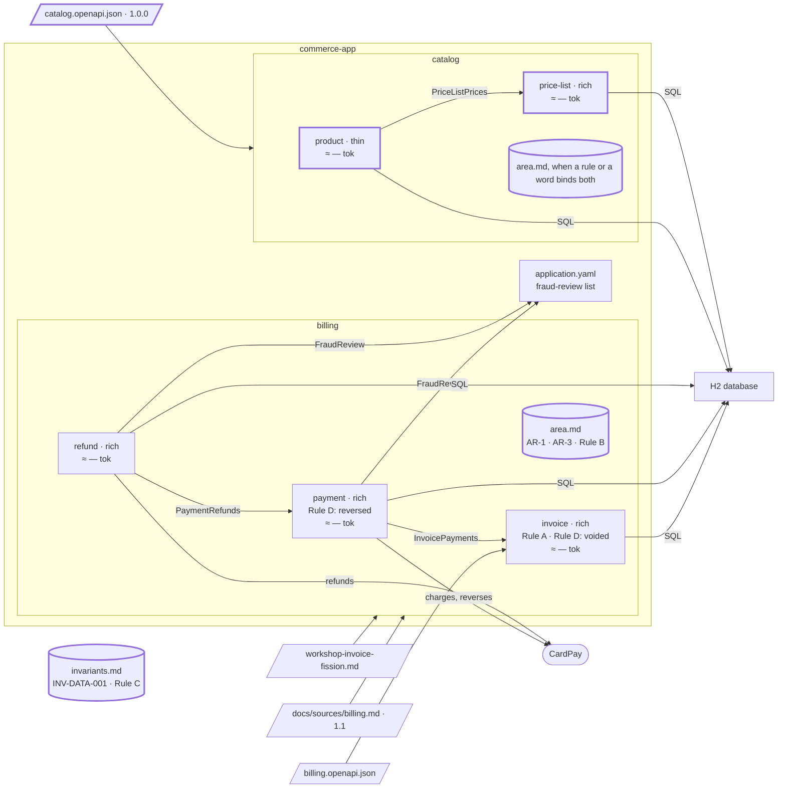

# Step 08 — The catalog contract: `product` (thin) and `price-list`; Rule C goes to the register

> **Session:** 📌 open a **fresh session.** A new source, a new area: the assistant must find `partition-shape` from its description, with nothing of billing in the conversation.

## The problem

A second source arrives, the catalog contract, and its description states one rule for every amount it carries. There is no catalog and no invariant register yet.

## Before

Your `partition-commerce` project should be at the commit of step 07: area `billing` with `invoice`, `payment`, `refund`; `billing/area.md` with AR-1 (the bound of a text), AR-2 (Rule C) and AR-3 (Rule B). There is no catalog and no invariant register yet.

## Provided

`[architect]` gives you the catalog contract, [`docs/contracts/catalog.openapi.json`](08-provided/docs/contracts/catalog.openapi.json), version 1.0.0. Its description states one rule for every amount it carries. Three tags; only two are in scope for now. It is written as many real contracts are: the same headers and the same error body repeated on every operation, the bodies mostly inline, nested several levels. Its paths, its tags and `Money`:

```json
{
  "openapi": "3.1.0",
  "info": {
    "title": "Catalog API",
    "version": "1.0.0",
    "description": "Every amount is stored in minor units, with its currency."
  },
  "paths": {
    "/products": {
      "get": { "operationId": "listProducts", "tags": ["Product"] },
      "post": { "operationId": "createProduct", "tags": ["Product"] }
    },
    "/products/{productId}": { "get": { "operationId": "getProduct", "tags": ["Product"] } },
    "/products/{productId}/price": { "get": { "operationId": "getProductPrice", "tags": ["Product"] } },
    "/price-lists": { "post": { "operationId": "createPriceList", "tags": ["PriceList"] } },
    "/price-lists/{priceListId}": { "get": { "operationId": "getPriceList", "tags": ["PriceList"] } },
    "/price-lists/{priceListId}/prices/{productId}": { "put": { "operationId": "setPrice", "tags": ["PriceList"] } },
    "/discounts": { "post": { "operationId": "createDiscount", "tags": ["Discount"] } },
    "/discounts/{discountId}": { "get": { "operationId": "getDiscount", "tags": ["Discount"] } }
  },
  "components": {
    "schemas": {
      "Money": {
        "type": "object",
        "required": ["amountMinor", "currency"],
        "properties": {
          "amountMinor": { "type": "integer", "format": "int64", "example": 1999 },
          "currency": { "type": "string", "pattern": "^[A-Z]{3}$", "example": "EUR" }
        }
      }
    }
  }
}
```

The excerpt leaves out `servers`, `security`, the top-level `tags`, the headers, the parameters, the bodies, the responses and every schema but `Money`: the file has them. `Price` and `Discount` both use `Money`; every operation repeats the same error body inline. `getProductPrice` reads the price within the price list its required query parameter `priceListId` names; `setPrice` answers `404` for an unknown price list only.

`[BA]` gives you the answer on the contract's descriptions, when the assistant asks: _none of the contract's field or parameter descriptions is a business rule: they say what the API does when a value is absent, or what a parameter means._

`[BA]` gives you the business rules the contract does not state, when the assistant asks:

| Bounded context | Rule                                      |
| --------------- | ----------------------------------------- |
| `product`       | A product reference is unique.            |
| `price-list`    | A price list holds one price per product. |
| `price-list`    | A price is never negative.                |

`[TL]` gives you the project's rules on errors, three lines added to the end of `.apm/instructions/backend-api-contract.instructions.md`: the common error envelope, the error body the catalog contract repeats; the order of the refusals; a value the schema refuses. They hold for every API of the project, billing's as well:

```markdown
- An error response with a body carries the common error envelope: `{timestamp, path, errorId, detail, errors}`, each item of `errors` being `{field, code, message}`.
- A request is refused in this order: its content (`400`), then the identifiers of its path (`404`, one that is not a UUID included), then the rules on what is held; the first refusal stops the checks.
- A value the contract's schema refuses is refused with `400`, whether it is kept or not.
```

`[TL]` gives you the code paths: `src/main/java/com/commerce/product/**`, `src/main/java/com/commerce/pricelist/**`.

`[TL]` gives you the answer on `BIGINT`, when AR-2 leaves `billing/area.md` and the assistant asks: _`BIGINT` stays. It is how this project writes an amount column, so it belongs to the database rule, not to billing: in `.apm/instructions/backend-database.instructions.md`, the line on amount columns becomes "An amount column is a `BIGINT` named `<what>_minor`, its currency column `<what>_currency`."_

`[architect]` gives you the answer on the rest of AR-2, when the assistant asks: _"three letters" and "never a decimal" stay where billing's Language already holds them, the words Currency and Minor units._

`[TL]` gives you the answer on the code comments that cite AR-2, when the assistant asks: _`V4__payment.sql` and `V6__refund.sql` stay as they are: a migration already merged is never edited, and the note in `billing/area.md` still resolves AR-2. The comments of the two `MinorUnits.java` name `INV-DATA-001` instead, with the catalog work._

`[TL]` gives you the answer on authentication, when the assistant asks: _authentication is out of the demo: the `security` of the contract is kept as written, and nothing of it is built._

`[architect]` gives you the dependency between the two, when the assistant asks: _`price-list` does not read `product`: a price is set for the product id given, whether `product` holds it or not._

The answers to the plan's questions on the catalog, when the assistant asks:

| Question | Answer |
| --- | --- |
| "A product reference is unique": a `createProduct` whose reference another product holds | `[BA]` Refused: `409`, nothing created. References are compared exactly as written |
| "A price list holds one price per product": a `setPrice` for a product already priced in that list | `[BA]` The new price replaces the old one: `200`, the price set. A price list keeps no history |
| "A price is never negative": a negative price; zero | `[BA]` A negative amount is refused: `400`, nothing set. Zero is a price |
| "A price is never negative" has the words of `invoice`'s rule on the price of a line (step 04) | `[BA]` Two meanings: the price a price list sells at, and the price on an invoice line. Each rule stays in its own spec |
| The currency of a price list and billing's Currency | `[BA]` One meaning: a three-letter ISO 4217 code |
| "A currency is a three-letter ISO 4217 code" for the register | `[architect]` No: a word both areas share is not an invariant. Each area keeps its meaning in its Language, and each spec its own check (`invoice` its rule on a currency, from step 04; `price-list` its own) |
| A price in a currency other than its list's | `[BA]` Refused: `400`, nothing set |
| `getProductPrice`: `at` (a day) against `effectiveFrom` (a date-time) | `[BA]` The product's price in that list applies when its `effectiveFrom` is on or before the end of day `at`, in UTC; otherwise `404`. `effectiveFrom` may be in the past |
| An unknown product id or an unknown price list | `[architect]` `404`, as the contract says |
| The validity and the channel of a price list | `[BA]` They govern no price in this version. The channel is kept and returned; the validity is accepted, not kept |
| `description`, `ean`, `attributes` (translations included): kept? | `[BA]` Accepted, not kept: no operation returns them |
| `localized` and `Accept-Language` | `[BA]` They change nothing in this version: the label is the one given at creation, on every operation |
| The order of a `listProducts` page | `[BA]` By reference, ascending |
| What else makes `createProduct` or `createPriceList` answer `409` | `[BA]` Nothing: `createProduct` conflicts on a reference already held only; `createPriceList` never answers `409` in this version |
| The contract through which `product` reads prices | `[architect]` `PriceListPrices`, an interface of `price-list`'s application layer: the price of a product in a price list on a day, or none. Only `product`'s outbound adapter calls it, and it uses nothing else of `price-list` |
| What the envelope's `detail`, `errors[]` and `errorId` carry | `[TL]` Every catalog error answer carries the envelope. `detail`: one sentence naming the refusal. `errors`: for a `400`, one item per field at fault (`field` its JSON pointer, `code` `VALIDATION_FAILED`); for a `409`, one item with `code` `CONFLICT`; for a `404`, one item with the contract's code (`PRODUCT_NOT_FOUND`, `PRICE_LIST_NOT_FOUND`, `PRICE_NOT_FOUND`), no `field`; the codes are the contract's examples. `errorId`: a new UUID per error, logged once with the `X-Request-Id`, the path and the status |

The attack of the specs, at 08.c, finds what those answers leave open. `[BA]`, `[architect]` and `[TL]` answer:

| Question | Answer |
| --- | --- |
| Two `createProduct` with one reference at the same moment | `[architect]` A unique constraint on the reference in the store holds "A product reference is unique", as for `invoice` BR-1: the first to commit holds, the other gets `409`. `product` stays thin |
| Two `setPrice` for one product and list at the same moment | `[architect]` One price per product and list, held by the store's key; the last to commit replaces the other |
| A future price hides the current one | `[BA]` Intended: the last price set replaces the price, whatever its `effectiveFrom`; until then the product has no price in that list (`404`). A change with no gap is set with `effectiveFrom` absent or past |
| The order of the refusals | `[architect]` The project's API rule sets it: a negative amount is content (`400`), a non-UUID an identifier (`404`), a currency other than the list's a rule on what is held (`400`). `getProductPrice`: the product, the price list, then the day. The first refusal stops the checks: a negative amount in another currency gives one `errors` item |
| "Today" when `at` is absent | `[BA]` The day in UTC, as for `at` |
| An unknown currency code (`XYZ`) | `[BA]` Refused, `400`, on `createPriceList` and `setPrice`: a currency is a known ISO 4217 code, as `invoice`'s rule on a currency says |
| Fields accepted but not kept | `[TL]` The project's API rule: a value the contract's schema refuses gets `400`, whether kept or not. `[BA]` A validity ending before it starts is accepted: it governs nothing |
| `listProducts`: the filter, the paging | `[BA]` `references` is compared exactly, as a reference is. An unknown reference matches nothing, and a reference given twice counts once. A page past the last gets `200`, no item, the totals true |
| Words | `[BA]` **Product**: what the shop sells. **Reference**: the code a product is known by, unique. **Label**: its name as given at creation. **Price list**: the prices of products in one currency, for one channel. **Channel**: `SHOP`, `MARKETPLACE` or `B2B`, kept and returned, governs no price. **Price**: an amount in `Money` and its `effectiveFrom`; its amount is "the amount". **Day**: a calendar date in UTC |
| No authentication; `401` and `403` never answered | `[TL]` Already answered: authentication is out of the demo, the `security` of the contract is kept as written and nothing of it is built. Accepted in this version, as in billing |
| `errors[].message`; the log without `X-Request-Id` | `[TL]` `message`: one sentence saying what is wrong with that field, without its value. Without `X-Request-Id`: `400`, and the log carries the `errorId`, the path and the status |
| The base path | `[TL]` The contract's `servers`: `/commerce/v1/catalog`. `Location` and the envelope's `path` carry it. Billing is unchanged |
| "Now" for `effectiveFrom` | `[TL]` The server's clock in UTC, returned as kept |
| May `price-list` log a price? | `[TL]` No: its identifiers only, as `invoice` and `refund`. An error names the field, never the amount |
| A past `at` | `[BA]` It is answered against the price the list holds now: the price applies if its `effectiveFrom` is on or before the end of that day; otherwise `404`. With no history, an earlier price is not answered |
| A blank `name` or `label` | `[BA]` Refused: `400`, nothing created |
| What `PriceListPrices` returns | `[architect]` The amount, the currency and the `effectiveFrom` of the price that applies, or none |
| An unknown price list against a list with no price that day, through `PriceListPrices` | `[architect]` One `404`, one `detail`: the contract says "No such product, or no price for it in that price list"; `PriceListPrices` need not tell them apart |
| `405`, `406`, `415`, answered by the framework without the envelope | `[architect]` AR-1 covers the error answers the contract declares; these three it does not declare, and they stay as the framework answers them |
| `field` for a header, a query or a path parameter | `[TL]` Its name (`X-Request-Id`, `at`, `priceListId`); a JSON pointer only for a body field |
| Values in `detail` | `[TL]` None: `detail` names the refusal without a value sent, as `message` does |
| `priceListId=abc` in the query of `getProductPrice` | `[TL]` `400`: a query parameter the schema refuses is content; only an identifier of the path that is not a UUID gets `404` |
| The `Location` of `createProduct` | `[TL]` A path, with the base path: `/commerce/v1/catalog/products/{productId}` |
| The end of a day; an `effectiveFrom` with an offset | `[BA]` A day ends before 00:00 UTC of the next day; an `effectiveFrom` with an offset is read in UTC |
| `createdAt` of a product | `[BA]` Kept and returned, as the contract's `Product` says; the server's clock in UTC |
| No authentication: anyone creates products and sets prices | `[PO]` Accepted for this version: the demo runs without a login |
| "Amount" in catalog and in billing, and `INV-DATA-001` | `[architect]` `INV-DATA-001` speaks of how any amount is stored, in either area; what an amount is stays in each area's Language |
| The words and AR-1 proposed for `catalog/area.md` | `[BA]` The words are validated as written. `[TL]` AR-1 is validated, with the contract's codes |

`[architect]` gives you the forms: `product` thin (its only rule checks an input: there is no state to protect); `price-list` rich (one price per product holds at every write).

## Prompt

**08.a** — add the `[TL]`'s lines on errors to `.apm/instructions/backend-api-contract.instructions.md`, deploy it, and commit it alone; then copy the contract of [`08-provided/`](08-provided/) into `partition-commerce`, at its root, and commit it alone:

```bash
apm install
git add .apm/instructions/backend-api-contract.instructions.md .claude/rules/backend-api-contract.md apm.lock.yaml
git commit -m "docs(rules): the common error envelope, the order of refusals"
git add docs/contracts/catalog.openapi.json && git commit -m "docs(contracts): catalog 1.0.0"
```

📌 In a fresh session, type:

> Find the bounded contexts of `docs/contracts/catalog.openapi.json`, area `catalog`, scope `tag:Product; tag:PriceList`.

When the assistant asks how to decide the boundary, answer:

> A proposal.

Choose the option with `product` and `price-list` apart and `getProductPrice` in `product`, by its number, with the reason of the architect: _`getProductPrice` is read under `/products`, its root aggregate (C2, R3); one bounded context would hold two root aggregates_. Then validate `product` and `price-list` by name. Give the code paths when the assistant asks.

**08.b** — when the assistant proposes the invariant, validate the line. When it reports the same statement in `billing/area.md`, answer: _remove AR-2; the billing specs name the invariant instead._

Give the `[TL]`'s answers on `BIGINT` and on the comments citing AR-2 when the assistant asks; deploy the rule (`apm install`), then commit:

```bash
git add docs .apm/instructions .claude/rules apm.lock.yaml && git commit -m "docs(catalog): the catalog contract in the specs; INV-DATA-001"
```

**08.c** — give the rules of the business analyst and the forms of the architect, from **Provided**, then type:

> Plan and build the catalog API for products and price lists.

Once the plan is `done`, deploy the rule its answers changed and commit:

```bash
apm install
git add -A && git commit -m "feat(catalog): products and price lists"
```

**08.d** — type:

> Measure the budget.

Then commit the record of the day:

```bash
git add docs/budget && git commit -m "docs(budget): the record of the day"
```

## Expected

### 08.a — The script reads the contract, the assistant decides nothing it shows

You should see `partition-shape` use the reader of an API contract (`references/sources/openapi.md`). `source`, `area` and `scope` are given: no question. The script does the mechanical work:

```bash
node .claude/skills/partition-shape/scripts/contract.mjs provenance docs/contracts/catalog.openapi.json
node .claude/skills/partition-shape/scripts/contract.mjs inventory docs/contracts/catalog.openapi.json --scope "tag:Product; tag:PriceList"
```

`provenance`: version 1.0.0, the sha of the commit, no uncommitted change. `inventory`: `7 in scope / 9 in the contract`; out of scope: `createDiscount`, `getDiscount`; the terminal resources: `products`, `price` (sub-resource of `products`), `price-lists`, `prices` (sub-resource of `price-lists`); the coupling matrix: `Money` shared by `Price` (in scope) and `Discount` (out of scope) — a **coupling outside the scope**.

`inventory` also lists two inline structures repeated in all nine operations, the error body and its items, each marked "coupling outside the scope". They are the project's common error envelope, which its API rule defines and the coupling analysis excludes (`references/sources/openapi.md`, C6): they argue neither for nor against a split, and the hard stop does not raise them as a gap.

Two root aggregates (C2): `products` and `price-lists`. `getProductPrice` belongs to `products`: its terminal resource `price` follows `{productId}`, and `products` is the terminal resource of another operation in scope. R1 holds between them with C2 and their own vocabulary; `Money` shared argues against the split (R4) and is discussed. **Two bounded contexts.**

Before it shows them, the assistant asks you the way (`references/boundary-decision.md`). With _a proposal_, two or three options, numbered (BR-33). Recommended: `product` and `price-list` apart, `getProductPrice` in `product` (C2, R3, their own vocabulary; the cost, `Money` read across the line). One bounded context for the catalog is among the others (`Money` in one place, R4; the cost, two root aggregates in one spec, C2 given up). An option that keeps a unit against a criterion names that criterion, and is not the one recommended. You choose the split; the others go to `Alternatives rejected` with your reason. The hard stop carries `Decided : proposal, option <n> · you, as [architect]`, `<n>` the number of the split.

The hard stop shows you `product` (listProducts, createProduct, getProduct, getProductPrice), `price-list` (createPriceList, getPriceList, setPrice), the out-of-scope operations, and the gaps: the coupling through `Money`, with the question "extend the scope or not"; the statement of `info.description`, found also in `billing/area.md` as AR-2.

After your validation: `docs/specs/catalog/bounded-contexts.md` (scope `tag:Product; tag:PriceList`, `7 / 9`, the two Discount operations "out of scope" in `Coverage`); `docs/specs/catalog/product/spec.md` and `price-list/spec.md` with `Business rules` under **"TO FILL"**: an OpenAPI contract states no business rule, "unless the contract's descriptions state a rule word for word" (`openapi.md`, _What is pointed to_). The hard stop may list field and parameter descriptions under "Copied from the source", to confirm (BR-13), or none; on the BA's answer that none is a business rule, none is copied. A deprecation without a reason is not written to `Decisions` (BR-11): it may be a gap or an open question. **No `catalog/area.md` at 08.a**: the one statement the two share also holds in another area, so its level is the register (BR-29), not an area file. `docs/partition.yml` declares both, area `catalog`.

### 08.b — Rule C reaches the register

The description of the contract states an invariant: it is a **candidate**, quoted with its anchor, under `Applicable area rules and invariants` of the two specs, and it goes through the admission test (`partition-spec`, `references/invariants.md`):

| Condition                          | Rule C                                                  |
| ---------------------------------- | ------------------------------------------------------- |
| True for every feature             | yes                                                     |
| Spans at least two areas or layers | yes: `billing` (AR-2) and `catalog` (this contract)     |
| A defect when violated             | yes: an amount read in the wrong unit is a wrong amount |

All three hold. The assistant shows you the line with its category and its identifier, the next free number of `DATA`, and writes nothing, the register included, until you validate that line (BR-13); the register is then created from `assets/invariants.md`. Its anchor is the contract and the JSON Pointer of the description that states it, `/info/description` (`openapi.md`), written whole, the same in the register and in both specs:

```markdown
<!-- docs/specs/invariants.md, DATA -->

INV-DATA-001 — Every amount is stored in minor units, with its currency. (from source: <the contract>, /info/description)
```

**Rule C is in the register.** The same statement at two levels is a gap the skill reports, never settles: on your word AR-2 leaves `billing/area.md` — its identifier is never reused — and `invoice`, `payment` and `refund` name `INV-DATA-001` under `Applicable area rules and invariants` instead of AR-2; AR-1 and AR-3 stay. What AR-2 said and no other file holds, its `BIGINT`, is reported, and the code that cites AR-2 is listed and left unchanged: the `[TL]`'s answers settle them. The database rule gains `BIGINT` in `.apm/instructions/backend-database.instructions.md`.

### 08.c — The rules, the forms, the code

You should see `partition-spec` write the BA's three rules and remove the banners, and `partition-hexagon` make `product` **thin** with its reason — and still with all its ports; `price-list` rich. The ArchUnit test gains the one dependency allowed across the line, `product`'s outbound adapter on `PriceListPrices`, as step 07 allowed `PaymentRefunds`. The generator gets one execution per bounded context of `catalog.openapi.json`, as billing has one per bounded context. Code under `product` and `pricelist`, the schema of `product` and `pricelist` in new migrations at the next free numbers (from `V7`), as the project's database rule says, no merged migration edited. `product` answers `getProductPrice` by calling `price-list` through an interface of its application layer, `PriceListPrices`, written in `Contracts with neighbours` of both specs; `price-list` reads nothing of `product`; the C4 model gains the components `product` and `price-list` (`context:` each). The contract declares a bearer `security`: the plan builds nothing for it, or asks you, and the `[TL]` answer settles it. The plan stops on what the specs leave open and asks, and the attack, before building, raises findings; the two tables of **Provided** answer them, and the same words in `price-list`'s "A price is never negative" and `invoice`'s rule on the price of a line are reported before the answer that they mean two things. A rule a person gives in the answers that binds both, or a word of the BA both use, with no owner and held by no other area, opens `catalog/area.md`, numbered within that file from AR-1, as the template and the glossary define them, nothing written about `billing/area.md`'s numbering, written only after you validate it (BR-13): the error envelope's content, pointing to the API rule, and the base path the answers carry, or the base path left pointed to the contract's `servers`. The order of refusals and the schema's `400` are the project's API rule: the specs follow it and point to it, without restating it, and nothing goes to the register or to the area file for them. The `[TL]`'s answer on what `price-list` logs goes to `.apm/instructions/backend-security.instructions.md`, deployed. Closing as before.

### 08.d — Who pays for what

You should see `partition-budget` show that the invariant register now loads in every session, for every bounded context:

| Bounded context | Every session (with the register) | Area file | Its spec |
| --- | --- | --- | --- |
| `invoice`, `payment`, `refund` | yes | `billing/area.md` | yes |
| `product`, `price-list` | yes | `catalog/area.md` when it exists, otherwise none | yes |

**AR-3 (Rule B) costs `catalog` nothing**: neither `product` nor `price-list` loads `billing/area.md`. The record of the day compares with the previous one: every gauge grew by the register; billing's area file holds AR-2 no more (its size moves with every change since the previous record).

### The checkpoint

This is the state of [where a rule lives](../where-a-rule-lives.md), with two differences of numbering only: Rule B is `AR-3` here (AR-2 was Rule C, before it climbed; AR-1 is the bound of a text), and `INV-DATA-001` carries its source anchor.

| Rule   | Lives in                                                            |
| ------ | ------------------------------------------------------------------- |
| Rule A | `billing/invoice/spec.md`, BR-3                                     |
| Rule B | `billing/area.md`, AR-3                                             |
| Rule C | `invariants.md`, INV-DATA-001                                       |
| Rule D | `billing/invoice/spec.md` and `billing/payment/spec.md`, `Language` |

### Watch

The candidate comes from a source, so its entry keeps the source's words and anchor and is never rewritten. The same rule was decided in billing first (step 04): the register now names the catalog contract as its only source. Record whether the run says so.

### The shape after



**New:** the area `catalog`, `product` (thin) and `price-list`; the invariant register, where Rule C now lives; AR-2 removed; the catalog's migrations, from `V7`.

**Cost:** the register loads in every session, for every bounded context: every gauge grew by it; the billing ones hold AR-2 no more.

## Verdict

- [x] 08.a — The fresh session uses `partition-shape` with the OpenAPI reader (`references/sources/openapi.md`); no question on source, area or scope
- [x] 08.a — The script runs `provenance`, then `inventory` with `--scope "tag:Product; tag:PriceList"`
- [x] 08.a — `provenance`: version 1.0.0, the sha of the commit, no uncommitted change
- [x] 08.a — `inventory`: `7 in scope / 9 in the contract`; out of scope `createDiscount`, `getDiscount`
- [x] 08.a — Terminal resources: `products`, `price` (under `products`), `price-lists`, `prices` (under `price-lists`)
- [x] 08.a — The coupling matrix: `Money` shared by `Price` and `Discount`, a coupling outside the scope
- [x] 08.a — The error body repeated inline in all nine operations is taken as the common error envelope: excluded from the coupling, not raised as a gap
- [x] 08.a — Two root aggregates, `products` and `price-lists`; `getProductPrice` belongs to `products`
- [x] 08.a — R1 holds with C2 and their own vocabulary; `Money` shared discussed under R4; two bounded contexts
- [x] 08.a — It asks the way; with a proposal, two or three options, the split with `getProductPrice` in `product` recommended with why, none kept against a criterion recommended; the others, one bounded context among them, in `Alternatives rejected`; the hard stop carries the `Decided` line
- [x] 08.a — The hard stop shows `product` (listProducts, createProduct, getProduct, getProductPrice), `price-list` (createPriceList, getPriceList, setPrice) and the out-of-scope operations
- [x] 08.a — Its gaps: the `Money` coupling, asking "extend the scope or not"; `info.description` also in `billing/area.md` as AR-2
- [x] 08.a — `catalog/bounded-contexts.md`: scope `tag:Product; tag:PriceList`, `7 / 9`, the two Discount operations "out of scope" in `Coverage`
- [x] 08.a — `product/spec.md` and `price-list/spec.md` with `Business rules` under "TO FILL"; no field description copied after the BA's answer; no decision without its reason
- [x] 08.a — No `catalog/area.md` at 08.a
- [x] 08.a — `docs/partition.yml` declares `product` and `price-list`, area `catalog`
- [x] 08.b — The invariant is a candidate, quoted with its anchor under `Applicable area rules and invariants` of both specs
- [x] 08.b — The admission test: true for every feature, spans `billing` and `catalog`, a defect when violated
- [x] 08.b — The line is shown to you with its category `DATA` and the next free identifier
- [x] 08.b — `docs/specs/invariants.md` created from `assets/invariants.md`, once the line is validated, with `INV-DATA-001` anchored by the contract and `/info/description`, written whole and the same in both specs
- [x] 08.b — The same statement at two levels is reported as a gap, not settled
- [x] 08.b — On your word AR-2 leaves `billing/area.md`; its identifier is not reused
- [x] 08.b — `invoice`, `payment`, `refund` name `INV-DATA-001` under `Applicable area rules and invariants` instead of AR-2
- [x] 08.b — The part of AR-2 no other file holds (`BIGINT`) reported; the code citing AR-2 listed, left unchanged; on the `[TL]`'s answer, the database rule gains `BIGINT`
- [x] 08.c — The BA's three rules written, the banners removed
- [x] 08.c — `product` thin with its reason, still with all its ports; `price-list` rich
- [x] 08.c — The ArchUnit test allows only `product` → `PriceListPrices` across the line; one generator execution per bounded context of `catalog.openapi.json`
- [x] 08.c — Code under `product` and `pricelist`; the schema of `product` and `pricelist` in new migrations at the next free numbers (from `V7`), as the project's database rule says, no merged migration edited; the two `MinorUnits.java` name `INV-DATA-001`, `V4` and `V6` unchanged
- [x] 08.c — `product` answers `getProductPrice` through `PriceListPrices`, written in `Contracts with neighbours` of both specs; `price-list` reads nothing of `product`
- [x] 08.c — A rule or a word only the two hold opens `catalog/area.md`, numbered from AR-1, after your validation; the order of refusals and the schema's `400` left to the project's API rule, not restated; the logging answer, when asked, in the security rule
- [x] 08.c — The C4 model gains `product` and `price-list` (`context:` each); closing as before
- [x] 08.d — `partition-budget`: the invariant register loads in every session, for every bounded context
- [x] 08.d — `invoice`, `payment`, `refund` load `billing/area.md`; `product`, `price-list` `catalog/area.md` when it exists; each its own spec
- [x] 08.d — The record compares with the previous one: every gauge grew by the register; billing's area file holds AR-2 no more
- [x] Checkpoint — Rule A `invoice/spec.md` BR-3; Rule B `billing/area.md` AR-3; Rule C `invariants.md` INV-DATA-001; Rule D `Language` of `invoice` and `payment`
- [x] Watch — `INV-DATA-001` keeps the contract's words and anchor; whether the run says billing decided the rule first (step 04) is recorded
