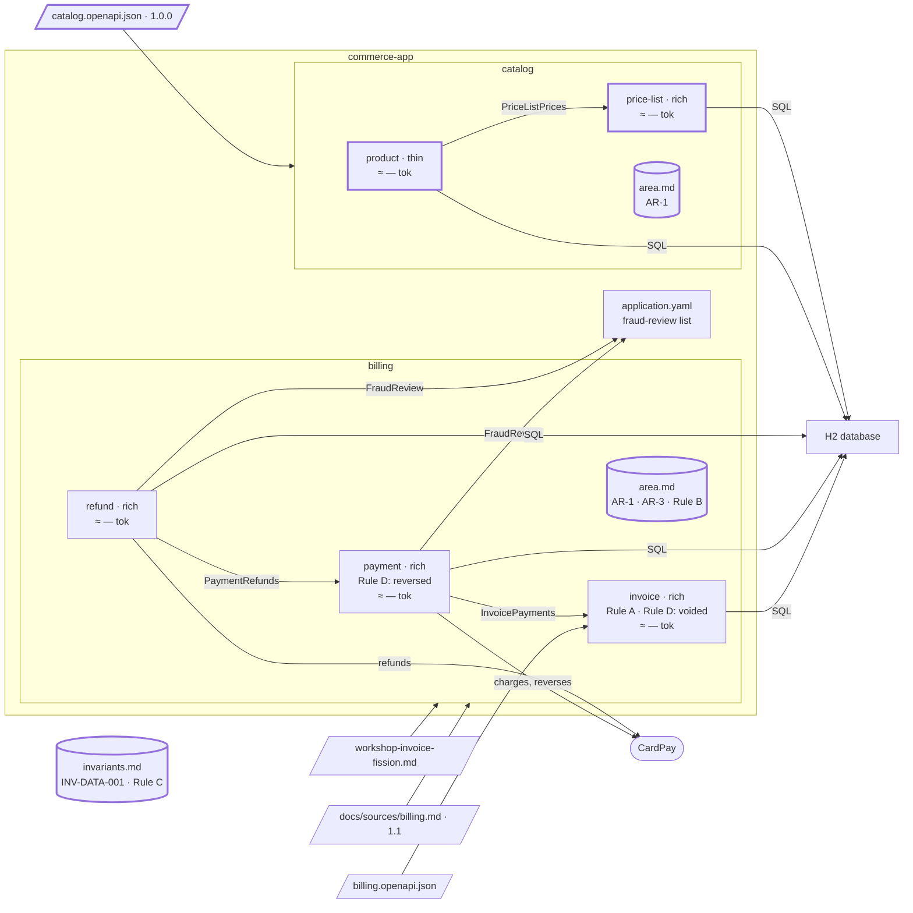

# Step 08 — The catalog contract → a second area; Rule C to the register

## The situation

Area `billing` holds `invoice`, `payment` and `refund`; `billing/area.md` carries AR-1, AR-2 (Rule C) and AR-3 (Rule B). A second source arrives, the catalog contract, and its description states Rule C word for word. There is no catalog and no invariant register yet.

## What you bring

- [architect] The catalog contract 1.0.0, [`docs/contracts/catalog.openapi.json`](08-provided/docs/contracts/catalog.openapi.json), in [`08-provided/`](08-provided/): three tags, two in scope (`Product`, `PriceList`); the same error body inline on every operation; and `/info/description`: _"Every amount is stored in minor units, with its currency."_
- [TL] Three lines added to the project's API rule before the step. The first: _"An error response the contract declares, when it has a body, carries the common error envelope."_ The others set the order of the refusals and the `400` of a value the schema refuses.
- [BA] On the contract's descriptions, when asked: _no field or parameter description is a business rule._ That ruling does not reach `/info/description`, which states a rule of the contract.
- [BA] The rules the contract does not state, such as _a product reference is unique_; [architect] the forms: `product` thin (its only rule checks an input), `price-list` rich.
- [TL] When AR-2 leaves billing: the migrations that cite AR-2 stay as they are, and the two classes of `payment` and `refund` that cite AR-2 name the invariant instead.

The assistant asks many other questions along the way (which price applies on a day, what the envelope carries). You answer them as the role would: that's your part.

## What you ask

Commit the contract alone before the prompt that reads it: its sha is what the next delta starts from.

In a fresh session, with nothing of billing in the conversation:

> Find the bounded contexts of `docs/contracts/catalog.openapi.json`, area `catalog`, scope `tag:Product; tag:PriceList`.

When the assistant asks how to decide the boundary:

> A proposal.

You choose, by its number, `product` and `price-list` apart with `getProductPrice` in `product`, because it is read under `/products`, its root aggregate; then you validate both by name. When it proposes the invariant, you validate the line; when it reports the same statement in `billing/area.md`, you answer: _remove AR-2; the billing specs name the invariant instead._

After giving the business analyst's rules and the architect's forms:

> Plan and build the catalog API for products and price lists.

Once the plan is `done`:

> Measure the budget.

## What partition does

1. **A script reads the contract.** `partition-shape` runs its OpenAPI reader: provenance, then an inventory of the scope, 7 operations of 9. The repeated error body is the project's envelope, left out of the coupling analysis; `Money`, shared with the out-of-scope `Discount`, is put to you as "extend the scope or not".
2. **Two root aggregates, and you decide.** `products` and `price-lists`, each with its own words. It asks how you decide; with _a proposal_, it shows numbered options and recommends the split. You choose; the others go to `Alternatives rejected`.
3. **Specs with no rules yet.** `Business rules` stay "TO FILL": a contract states none unless a description states one word for word, and your ruling keeps the field descriptions out.
4. **The register, not an area file.** The one statement both share, `/info/description`, already lives in another area as AR-2: its level is the invariant register. `partition-spec` runs the admission test (true for every feature, spans two areas, a defect when violated), shows you `INV-DATA-001`, anchored to the contract and `/info/description`, and writes nothing until you validate it.
5. **The same statement at two levels.** It reports AR-2 as a duplicate and settles nothing. On your word AR-2 leaves `billing/area.md`, a note there keeps AR-2 resolving (an identifier is permanent), and the billing specs name `INV-DATA-001`. The code citing AR-2 is listed for the tech lead to rule on.
6. **The catalog built.** The business analyst's rules are written; `partition-hexagon` makes `product` thin, still with all its ports, and `price-list` rich. `product` reads prices through `PriceListPrices`, the one dependency allowed across the line. A rule only the two share, what the envelope carries, opens `catalog/area.md` at AR-1, after your validation.
7. **Rule-file lines.** The order of refusals stays in the API rule; the specs point to it. What `price-list` may log is how code is written: `partition-rules` shows the line of the security rule, with its scope, and writes it once you validate it.
8. **The budget.** `partition-budget` measures and writes the record of the day; the people of the assessment answer the assistant: who takes part, the signs, the decision.

**Why it works this way.** A rule climbs only as far as the bounded contexts that need it: spanning two areas, it passes the admission test and lives once, in the register. A rule from a source keeps that source's words and anchor: the assistant quotes and tests it, a person validates it.

## Worth noticing

- **AR-3 (Rule B) costs `catalog` nothing**: neither `product` nor `price-list` loads `billing/area.md`.

## The shape after

**New:** the area `catalog`, `product` (thin) and `price-list`; the invariant register, where Rule C now lives; AR-2 removed from `billing/area.md`; the catalog's migrations, from `V7`.

**Cost:** the register loads in every session, for every bounded context: every gauge grew by it; billing's area file holds AR-2 no more.
