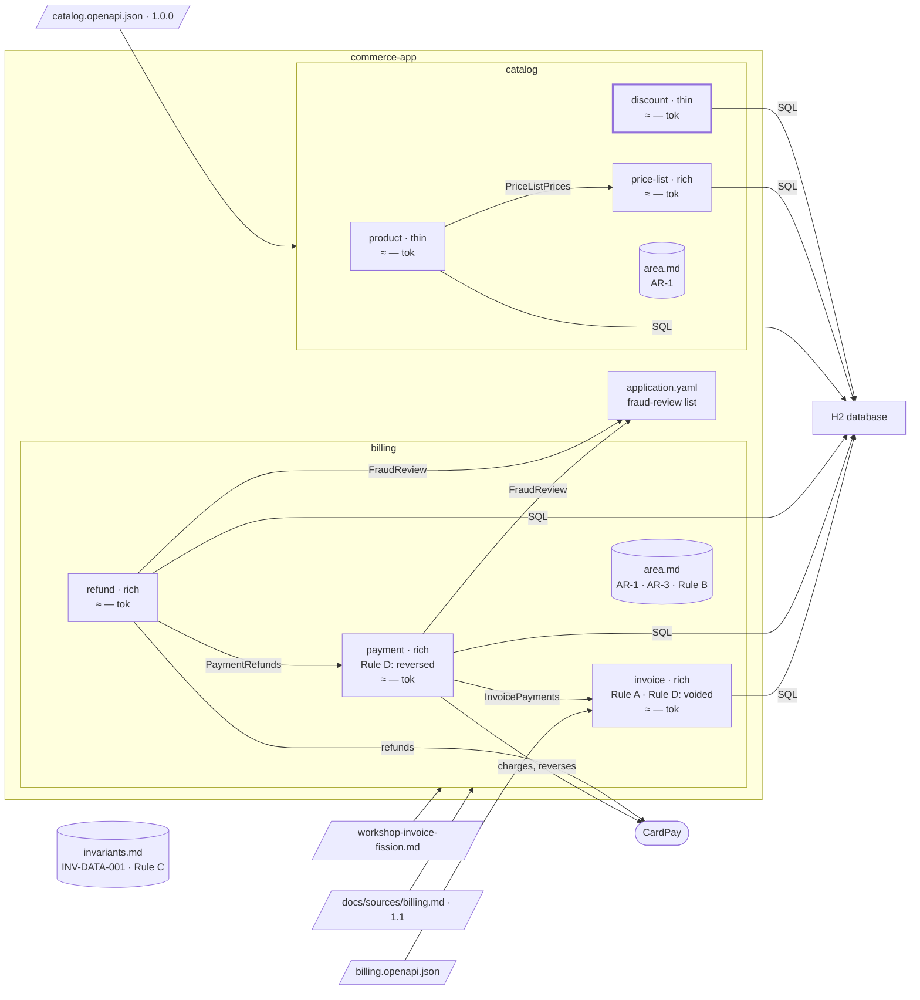

# Step 10 — The discounts → `discount`

## The situation

At step 08 the decomposition of the catalog contract kept the scope `tag:Product; tag:PriceList`: `createDiscount` and `getDiscount` were left "out of scope" in its `Coverage`, and the coupling through `Money` was reported as outside it. Now the scope extends to them. You phrase the request as a newcomer would, as if no decomposition existed.

## What you bring

- [BA] The rule of `discount`: _a discount is between 1 and 90 percent._
- [architect] The form, thin: its only rule checks an input, and a discount has no state that changes.
- [architect] The reason to retain `discount`, should the proposal recommend otherwise: _a discount is its own aggregate, created and read by its own operations; no price list holds it._
- [architect] AR-1 of `catalog/area.md` binds `discount` too: its errors carry the same envelope.
- [TL] The code path, `src/main/java/com/commerce/discount/**`, and how a member the contract does not mark nullable is written without a value: left out, never `null`.

The assistant asks other questions along the way (the bounds of a percent, what `minimumOrder` accepts, two discounts that overlap). You answer them as the role would.

## What you ask

In a fresh session, so that the skill has to notice the decomposition that exists:

> Find the bounded contexts of `docs/contracts/catalog.openapi.json`, area `catalog`, scope `tag:Product; tag:PriceList; tag:Discount`.

When the assistant asks what to do with the recorded scope:

> Extend the recorded scope with `tag:Discount`.

When it asks the way for `discount`:

> A proposal.

You validate the extension and the new bounded context `discount`, each by name. Then:

> Plan and build the discounts of the catalog API.

Once the plan is `done`, `apm install` deploys the rule file its answers changed.

## What partition does

1. **It stops instead of overwriting.** `partition-shape` finds `bounded-contexts.md` with a sha and a recorded scope different from the one asked. It asks you: extend the recorded scope through the delta, or choose another target folder. A decomposition validated on another scope is never overwritten nor merged.
2. **A delta that is only an extension.** The contract has not changed since the recorded sha, so the contract delta is empty and only the two operations brought by the extension are classified. They act on `discounts`, a root aggregate of their own, with their own words: R1 holds against `product` and `price-list`. The `Money` coupling of step 08 is now inside the scope, marked resolved.
3. **A new bounded context is a boundary: it asks the way.** With a proposal, it numbers two options, one recommended with why: `discount` on its own, or attached to `price-list`, which would then hold two root aggregates. You choose `discount`; the option not chosen goes to `Alternatives rejected` with your reason.
4. **Validated by name.** The writing plan shows the scope, coverage and history patched, `discount/spec.md` created and `docs/partition.yml` declaring it. A general "go ahead" carries neither the extension nor the new bounded context.
5. **The levels above, named.** `discount/spec.md` opens with `Business rules` "to fill"; it names INV-DATA-001, since a discount holds a minimum order amount, without repeating it. AR-1 binding `discount` is proposed to you, and `catalog/area.md` gains `discount` once the architect agrees.
6. **The rule from a person.** `partition-spec` writes the BA's rule and removes the banner.
7. **A side channel goes to a rule file.** That a member without a value is left out is how code is written: `partition-rules` shows you the line, its file `backend-api-contract.instructions.md` and its scope, and writes it once you validate.
8. **Thin, still with its ports.** `partition-hexagon` makes `discount` thin, with its reason: inbound, application and outbound layers, no domain layer. The use case calls the database through a port, never directly. Then the code, the next free migration, the C4 component, the closing.

**Why it works this way.** A scope is a decision the owner validated; the skill extends it on your word, never by inference, and a delta leaves the rest of the decomposition intact. Thin is not permission to skip the ports: a use case that calls the database directly, because "there is no domain anyway", is the shortcut that destroys the architecture.

## The shape after

**New:** `discount`, thin, with its migration `V9__discount.sql`; the scope of `catalog` is the whole contract, 9 / 9.

**Cost:** one more bounded context that loads the register.
