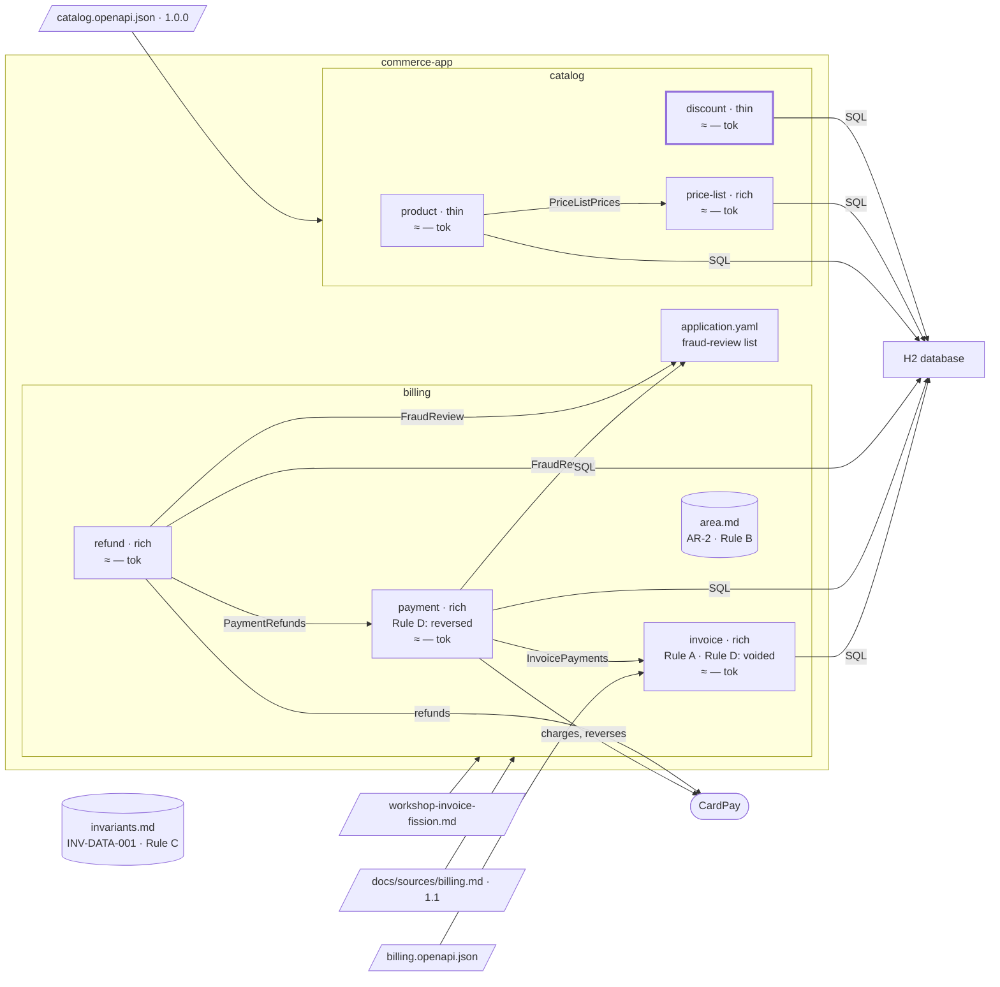

# Step 10 — The scope extends: `discount` joins `catalog`

> **Session:** 📌 open a **fresh session.** You phrase the request as a new decomposition, as a newcomer would: the skill must notice the decomposition that exists.

## The problem

`createDiscount` and `getDiscount` were left out of scope at step 08. The scope now extends to them.

## Before

Your `partition-commerce` project should be at the commit of step 08 (step 09 changed no file). `catalog/bounded-contexts.md` records the scope `tag:Product; tag:PriceList` at the sha of catalog 1.0.0; `createDiscount` and `getDiscount` are "out of scope" in its `Coverage`.

## Provided

`[BA]` gives you the rule of `discount`, when the assistant asks: _A discount is between 1 and 90 percent._

`[TL]` gives you the code path `src/main/java/com/commerce/discount/**`.

`[architect]` gives you the form, thin: its only rule checks an input, and a discount has no state that changes.

## Prompt

**10.a** — 📌 in a fresh session, type:

> Find the bounded contexts of `docs/contracts/catalog.openapi.json`, area `catalog`, scope `tag:Product; tag:PriceList; tag:Discount`.

**10.b** — when the assistant asks, answer:

> Extend the recorded scope with `tag:Discount`.

Validate the extension and the new bounded context `discount`, each by name.

**10.c** — type:

> Plan and build the discounts of the catalog API.

## Expected

### 10.a — It stops instead of overwriting

You should see `partition-shape` (_Which procedure_) find `bounded-contexts.md` with a sha, and a scope asked that differs from the scope recorded. It **stops and asks** you: extend the recorded scope through the delta, or choose another target folder. It never overwrites nor merges a decomposition validated on another scope.

### 10.b — A delta that is only an extension

You should see the delta run with `extend = tag:Discount`. The contract has not changed since the recorded sha: the base equals the current sha, so the contract delta is empty and only the extension is handled (`delta.md`, _Step 1_).

```text
Contract           : docs/contracts/catalog.openapi.json
Version            : 1.0.0 -> 1.0.0
Scope              : tag:Product; tag:PriceList  [+ extension: tag:Discount]
Delta:
  Brought by extension   : 2   createDiscount, getDiscount
Decomposition:
  Unchanged              : no
  Proposals              : new bounded context discount
Writing plan:
  ≈ docs/specs/catalog/bounded-contexts.md      (patch: scope, coverage, retained, history)
  + docs/specs/catalog/discount/spec.md         (creation: new bounded context)
  ≈ docs/partition.yml                          (declares discount: area catalog, code paths to ask)
  = all the other files                         (intact)
```

`createDiscount` and `getDiscount` act on `discounts`, a root aggregate of their own (C2), with their own words (C3): R1 holds against `product` and `price-list`. The coupling through `Money`, reported at step 08 as outside the scope, is now inside it: the gap is marked resolved. You validate the extension and the new bounded context **by name**; a general "go ahead" does not carry them.

After writing: the `Scope` line reads `tag:Product; tag:PriceList; tag:Discount`, `9 / 9`; `discount/spec.md` with `Business rules` under "TO FILL"; `Applicable area rules and invariants`: INV-DATA-001 — a discount holds a minimum order amount, so the invariant binds it, and it is named there, not repeated.

### 10.c — A thin hexagon, still with its ports

You should see the BA's rule written and the banner removed; `partition-hexagon` makes it thin, with its reason, inbound, application and outbound layers and no domain layer. The use case calls the database through a port, never directly. The code, a migration `V9__discount.sql`, the next free number after step 08's, the C4 component `discount`, the closing.

### The shape after



**New:** `discount`, thin, with its migration `V9__discount.sql`; the scope of `catalog` is the whole contract, 9 / 9.

**Cost:** one more bounded context that loads the register.

## Verdict

- [ ] 10.a — `partition-shape` finds `bounded-contexts.md` with a sha and a recorded scope different from the one asked
- [ ] 10.a — It stops and asks: extend the recorded scope through the delta, or choose another target folder
- [ ] 10.a — It neither overwrites nor merges the decomposition validated on the other scope
- [ ] 10.b — The delta runs with `extend = tag:Discount`; the base equals the current sha, the contract delta is empty
- [ ] 10.b — The plan matches the block shown: `1.0.0 -> 1.0.0`, 2 brought by extension, new bounded context `discount`, the three files to write
- [ ] 10.b — `discounts` is a root aggregate of its own (C2), with its own words (C3); R1 holds against `product` and `price-list`
- [ ] 10.b — The `Money` coupling reported at step 08 is marked resolved
- [ ] 10.b — The extension and `discount` are each validated by name; a general "go ahead" does not carry them
- [ ] 10.b — The `Scope` line reads `tag:Product; tag:PriceList; tag:Discount`, `9 / 9`
- [ ] 10.b — `discount/spec.md`: `Business rules` under "TO FILL"; INV-DATA-001 named under `Applicable area rules and invariants`, not repeated
- [ ] 10.c — The BA's rule written, the banner removed
- [ ] 10.c — `discount` thin with its reason: inbound, application and outbound layers, no domain layer
- [ ] 10.c — The use case calls the database through a port, never directly
- [ ] 10.c — The code, a migration `V9__discount.sql`, the next free number after step 08's, the C4 component `discount`, the closing
