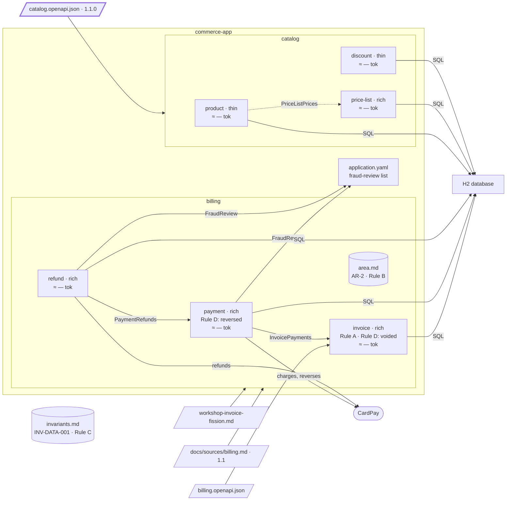

# Step 11 — Catalog contract v1.1: a unit moves between bounded contexts

> **Session:** 📌 open a **fresh session** at 11.a for the delta; stay in that session for the move that follows.

## The problem

Catalog 1.1.0 reads the price of a product within a price list: the path is rewritten, the `operationId` is kept.

## Before

Your `partition-commerce` project should be at the commit of step 10: `catalog` with `product`, `price-list`, `discount`. `getProductPrice` (`GET /products/{productId}/price`) belongs to `product`, which answers it by calling `price-list` through its contract `PriceListPrices`.

## Provided

`[architect]` gives you catalog 1.1.0, [`docs/contracts/catalog.openapi.json`](11-provided/docs/contracts/catalog.openapi.json): the price of a product is now read **within a price list**. The path is rewritten; the `operationId` is unchanged. In the excerpt of step 08:

```diff
-    "/products/{productId}/price": { "get": { "operationId": "getProductPrice", "tags": ["Product"] } },
+    "/price-lists/{priceListId}/product-prices/{productId}": {
+      "get": { "operationId": "getProductPrice", "tags": ["PriceList"] }
+    },
```

`info.version` becomes `1.1.0`, and `priceListId` moves from the query to the path. Nothing else changes.

`[architect]` gives you the integration after the move: none. `price-list` answers from its own data; `product` no longer calls `PriceListPrices`.

## Prompt

**11.a** — copy the contract of [`11-provided/`](11-provided/) over the old one, at the root of `partition-commerce`, and commit it alone:

```bash
git add docs/contracts/catalog.openapi.json && git commit -m "docs(contracts): catalog 1.0.0 -> 1.1.0"
```

📌 In a fresh session, type:

> The catalog contract changed to 1.1.0. Bring the specs in step with it.

When the assistant asks how to decide on the move, answer:

> A proposal.

Validate the move of `getProductPrice` to `price-list` by name.

**11.b** — type:

> Carry out the move of `getProductPrice` from `product` to `price-list`.

## Expected

### 11.a — The delta proposes a move, and confronts the code

You should see `partition-shape` run the delta, with the script:

```bash
node .claude/skills/partition-shape/scripts/contract.mjs diff docs/contracts/catalog.openapi.json --base <sha of 1.0.0> --scope "tag:Product; tag:PriceList; tag:Discount"
```

`getProductPrice` is **modified**: path changed, `operationId` unchanged. The script also reports a required path parameter added, `priceListId`. A path rewritten is **breaking**: loud report, and step 5 confronts it with the code — the operation is implemented in `product` and does not answer the new path: a **code / spec divergence**, reported, read-only.

Its terminal resource is now `product-prices`, right after `{priceListId}`, and `price-lists` is the terminal resource of other operations in scope: a sub-resource of `price-lists`. Its root aggregate changed (C2): **move proposed**, from `product` to `price-list` (attached by R3: it shares the root aggregate). The tag moved too; the operation stays in scope either way.

A move shifts a boundary: the assistant asks you the way (`references/boundary-decision.md`). With _a proposal_, it says the criteria leave a **single option**: the operation now acts on `price-lists`, so R3 attaches it to `price-list`; staying in `product` fails C2, and a bounded context of its own fails C2 as well. It invents no other option.

The re-check of R1 on all pairs: `product` / `price-list` still hold. The plan shows the move with the marker `!`, and you validate the move **by name**. The closing lists it under _Proposals validated_: to carry out with `partition-reshape`.

### 11.b — The move

You should see `partition-reshape` write the record `docs/architecture/reshapes/YYYY-MM-DD-get-product-price.md`, raised by the delta of catalog 1.1.0. Preconditions: the operation is reached through the generated interface; one adapter; the contract frozen at 1.1.0. Then one plan:

- The specs (`references/specs.md`, _Move_): `getProductPrice` leaves `Source parts owned` of `product` and joins those of `price-list`; its `Coverage` line changes; no rule was carried by that operation alone, so no rule moves. `product` no longer lists `price-list` under `Contracts with neighbours`.
- The code: the controller method moves to `price-list`'s inbound layer, implementing the regenerated interface; `product` loses its call to `PriceListPrices`.
- The proof: outside `com.commerce.pricelist` and the generated sources, only the wiring and `product`'s removed call change; the real output of the command is shown.
- `bounded-contexts.md` gains the provenance of 1.1.0 and a `History` line, nature `move`: the unit, its bounded context of departure and of arrival.
- The C4 model: the relation `product -> price-list` goes; regenerated. The budget measured again.

### The shape after



**New:** `getProductPrice` moves from `product` to `price-list`, which answers from its own data; the call `PriceListPrices` is gone (drawn dashed).

**Cost:** callers follow the rewritten path.

## Verdict

- [ ] 11.a — `partition-shape` runs the delta with `contract.mjs diff`, `--base` the sha of 1.0.0, the recorded scope
- [ ] 11.a — `getProductPrice` is **modified**: path changed, `operationId` unchanged
- [ ] 11.a — The script also reports the required path parameter `priceListId` added
- [ ] 11.a — The rewritten path is **breaking** and loudly reported
- [ ] 11.a — Step 5 reports a code / spec divergence, read-only: implemented in `product`, not on the new path
- [ ] 11.a — `getProductPrice` stays in scope although its tag moved to `PriceList`
- [ ] 11.a — Root aggregate changed (C2): **move proposed** from `product` to `price-list`, attached by R3
- [ ] 11.a — It asks the way for the move; with a proposal, a single option, said so, with why the others fall (C2)
- [ ] 11.a — R1 re-checked on all pairs: `product` / `price-list` still hold
- [ ] 11.a — The plan shows the move with `!`, and the move is validated by name
- [ ] 11.a — The closing lists the move under _Proposals validated_, to carry out with `partition-reshape`
- [ ] 11.b — `partition-reshape` writes `docs/architecture/reshapes/YYYY-MM-DD-get-product-price.md`, raised by the delta of catalog 1.1.0
- [ ] 11.b — Preconditions checked: generated interface, one adapter, contract frozen at 1.1.0; then one plan
- [ ] 11.b — `getProductPrice` leaves `Source parts owned` of `product`, joins `price-list`'s; its `Coverage` line changes
- [ ] 11.b — No rule moves
- [ ] 11.b — `product` no longer lists `price-list` under `Contracts with neighbours`
- [ ] 11.b — The controller method moves to `price-list`'s inbound layer, implementing the regenerated interface
- [ ] 11.b — `product` loses its call to `PriceListPrices`
- [ ] 11.b — Proof, real output shown: outside `com.commerce.pricelist` and generated sources, only the wiring and `product`'s removed call change
- [ ] 11.b — `bounded-contexts.md` gains the provenance of 1.1.0 and a `History` line, nature `move`, with the unit, its departure and its arrival
- [ ] 11.b — The C4 model loses `product -> price-list` and is regenerated; the budget is measured again
