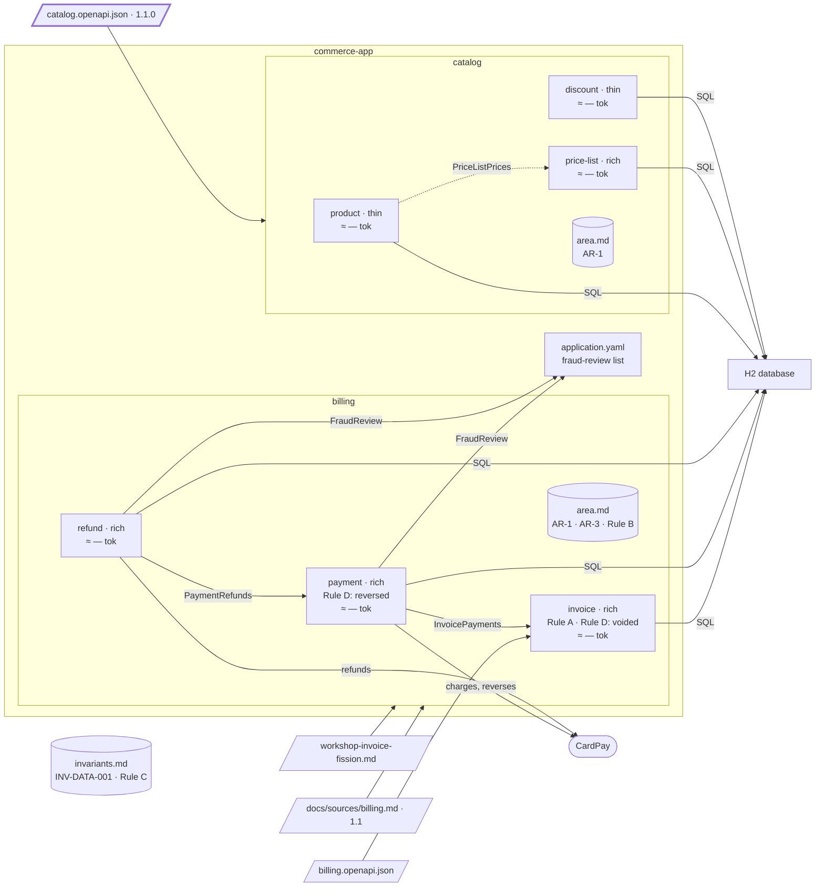

# Step 11 — Catalog 1.1.0 → a unit moves; a call disappears

## The situation

`getProductPrice` belongs to `product`, which answers it by calling `price-list` through `PriceListPrices`. Catalog 1.1.0 reads the price of a product within a price list: the path is rewritten, the `operationId` is kept. The operation now acts on the price list, not on the product.

## What you bring

- [architect] Catalog 1.1.0, [`docs/contracts/catalog.openapi.json`](11-provided/docs/contracts/catalog.openapi.json), in [`11-provided/`](11-provided/): `getProductPrice` moves to `/price-lists/{priceListId}/product-prices/{productId}`, under the tag `PriceList`; `priceListId` moves from the query to the path. Nothing else changes.
- [architect] The integration after the move: none. `price-list` answers from its own data; `PriceListPrices` goes once nothing calls it.

The assistant asks other questions along the way (an unknown product, now that `price-list` reads nothing of `product`; a client still calling the old path). You answer them as the role would.

## What you ask

Copy the contract over the old one and commit it alone before the prompt that reads it: its sha is what the next delta starts from. Then, in a fresh session:

> The catalog contract changed to 1.1.0. Bring the specs in step with it.

When the assistant asks how to decide on the move:

> A proposal.

Once the move is validated by name and the specs are committed, in the same session:

> Carry out the move of `getProductPrice` from `product` to `price-list`.

## What partition does

1. **The delta, from the recorded sha.** `partition-shape` diffs the contract from the sha of 1.0.0, on the recorded scope. `getProductPrice` is modified: path changed, `operationId` unchanged, a required path parameter added. The tag moved, but the operation stays in scope either way.
2. **Breaking, and confronted with the code.** A rewritten path is breaking: reported loudly, then searched in the code. The operation is implemented in `product` and does not answer the new path: a code / spec divergence, reported, nothing touched.
3. **A move proposed.** The operation's terminal resource is now a sub-resource of `price-lists`: its root aggregate changed. A move, from `product` to `price-list`, attached by R3.
4. **It asks the way, and says when there is no choice.** With a proposal, the criteria leave a single option: staying in `product` fails C2, and so does a bounded context of its own. It says so, with why the others fall, and invents no other option. R1 is re-checked on every pair: `product` and `price-list` still hold.
5. **The plan is still shown.** You choose the move by name; that choice carries the proposal, not the writing plan. The plan is shown, the move marked `!`, and you validate it before anything is written. The closing lists the move under _Proposals validated_, to carry out with `partition-reshape`.
6. **The record and the preconditions.** `partition-reshape` writes a dated record under `docs/architecture/reshapes/`, raised by the delta of 1.1.0. The preconditions hold: the operation is reached through the generated interface, one adapter, the contract frozen at 1.1.0. Then one plan.
7. **Specs and code move together.** `getProductPrice` leaves `Source parts owned` of `product` for `price-list`'s; no rule was carried by that operation alone, so none moves. The controller method moves to `price-list`'s inbound layer, implementing the regenerated interface; `product` loses its call to `PriceListPrices`, and no longer lists `price-list` among its neighbours.
8. **The proof.** Outside `price-list` and the generated sources, only the wiring and `product`'s removed call change: the real output of the command is shown.
9. **Afterwards.** `bounded-contexts.md` gains the provenance of 1.1.0 and a `History` line, nature `move`: the unit, where it left, where it arrived. `partition-c4` drops the relation `product -> price-list`; `partition-budget` measures again.

**Why it works this way.** A delta only proposes; `partition-reshape` carries out, behind interfaces, so the proof can show that nothing else moved. And a choice validated by name is the decision on the boundary, not a blank cheque on the files: what will be written is still shown to you first.

## Worth noticing

- The move removes a dependency instead of adding one: `price-list` answers from its own data, and `PriceListPrices` goes with its implementation.

## The shape after

**New:** `getProductPrice` moves from `product` to `price-list`, which answers from its own data; the call `PriceListPrices` is gone (drawn dashed).

**Cost:** callers follow the rewritten path.
