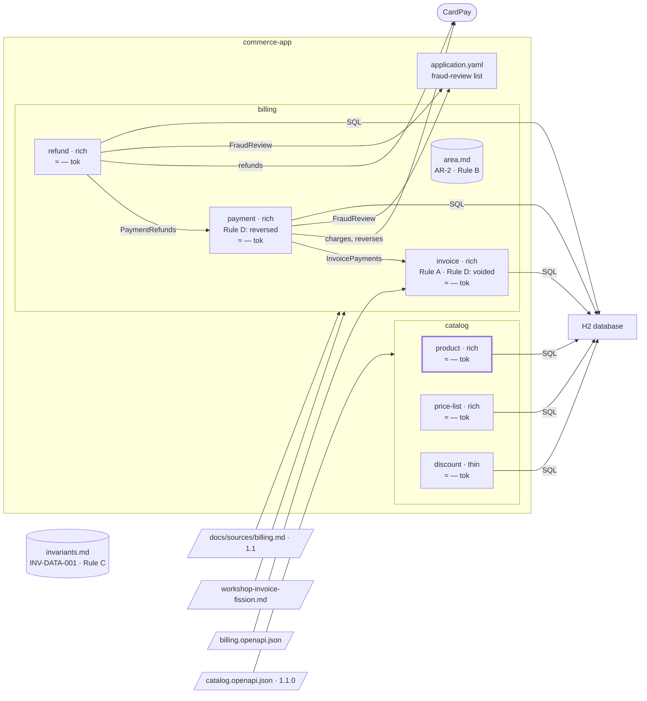

# Step 12 — `product` gains a status rule: thin becomes rich

> **Session:** stay in the session of step 11, or open a fresh one: nothing here tests a cold start.

## The problem

A product can now be retired, and never reactivated, while `product` is thin: its only rule checked an input.

## Before

Your `partition-commerce` project should be at the commit of step 11: `product` is thin (`hexagons:` in `docs/partition.yml`, reason: its only rule checks an input), with one business rule, "A product reference is unique."

## Provided

`[BA]` gives you a new business rule of `product`: _A product can be retired; a retired product is never reactivated._

`[PO]` gives you the feature that needs it: _the catalog manager retires a product._

`[architect]` gives you the bounds of the change: _the retirement is a use case of the domain; it adds no operation to the catalog contract, which stays at 1.1.0 until step 15._ A change of the form of a hexagon is a change of code only.

## Prompt

**12.a** — type:

> Add this business rule to `product`: a product can be retired; a retired product is never reactivated.

**12.b** — type:

> Plan and build the retirement of a product.

## Expected

### 12.a — The spec first

You should see `partition-spec` take the rule from a person, the BA: it writes it as BR-2 of `product` with its source (the BA, the date), shows it to you and gets it validated. No code changes in this step.

### 12.b — The form changes before the code grows

You should see `partition-hexagon` (_Change the form from thin to rich_) find that the rule is a status that moves under conditions, with a transition that is forbidden — a row of the table that says **rich**. The change of form is:

1. a decision, recorded in `## Decisions` of the plan, with its reason;
2. recorded in `docs/partition.yml`: the hexagon of `product` becomes `form: rich`, its reason rewritten, a `domain` layer added to its map with what may depend on it;
3. carried out by the first tasks of the plan of the retirement, not by a plan of its own: they bring `Product` into a domain layer that imports nothing from outside, and prove the move (no behaviour changed, the real output of the tests and of the layer-map check) before the retirement is built on it.

It does **not** add a "small check" in the use case of retiring, inside a thin hexagon: a domain layer is not grown by accretion.

The ArchUnit test needs no new rule: it was written from the map, so the new domain layer is checked by the generic rule. The pattern grid: if the plan reaches for P-1's question again (how a status is coded), it cites P-1 rather than reopening it. Closing as before.

### The shape after

**New:** `product` is rich: a `domain` layer. The bounded contexts are unchanged.

**Cost:** a domain layer to write and test, for one rule.

## Verdict

- [ ] 12.a — `partition-spec` writes the rule as BR-2 of `product`, its source the BA and the date
- [ ] 12.a — BR-2 is shown and validated
- [ ] 12.a — No code changes
- [ ] 12.b — `partition-hexagon` (_Change the form from thin to rich_) reads a status with a forbidden transition: **rich**
- [ ] 12.b — The change of form is a decision in `## Decisions` of the plan, with its reason
- [ ] 12.b — `docs/partition.yml`: `product` becomes `form: rich`, reason rewritten, a `domain` layer added to its map with what may depend on it
- [ ] 12.b — The first tasks of the plan bring `Product` into a domain layer importing nothing from outside, and prove the move, before the retirement is built
- [ ] 12.b — No "small check" in the use case of retiring inside a thin hexagon
- [ ] 12.b — The ArchUnit test gains no new rule; the generic rule checks the new domain layer
- [ ] 12.b — If the plan reaches for how a status is coded, it cites P-1 rather than reopening it
- [ ] 12.b — The closing is as at the previous steps
