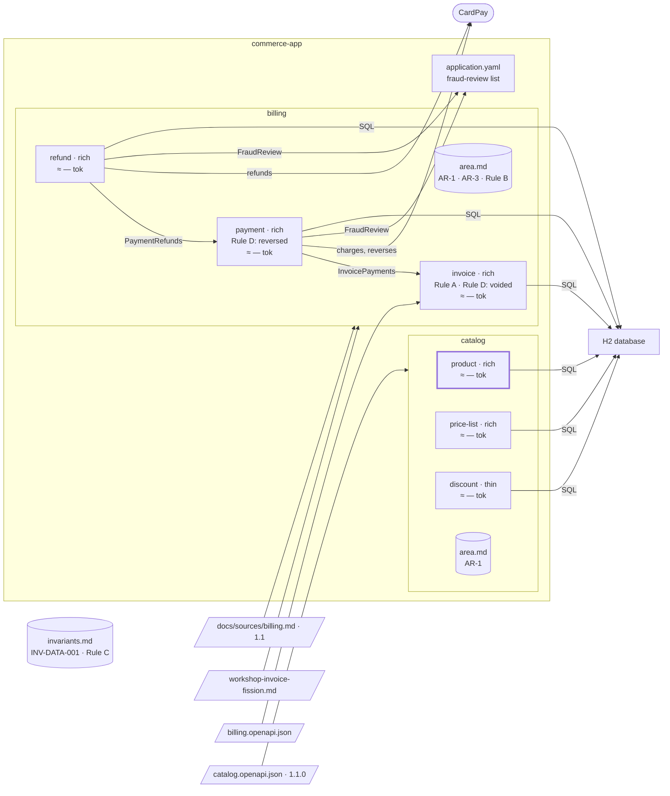

# Step 12 — A status rule → `product` becomes rich

## The situation

`product` is thin: `docs/partition.yml` gives the reason, its only rule checks an input, "A product reference is unique." Now a product can be retired, and never reactivated. That is a status with a forbidden transition, and a thin hexagon has no domain layer to hold it.

## What you bring

- [BA] The new business rule of `product`: _a product can be retired; a retired product is never reactivated._
- [PO] The feature that needs it: _the catalog manager retires a product._
- [architect] The bounds: _the retirement is a use case of the domain; it adds no operation to the catalog contract, which stays at 1.1.0._ A change of form is a change of code only.

The assistant asks other questions along the way. You answer them as the role would.

## What you ask

First the rule:

> Add this business rule to `product`: a product can be retired; a retired product is never reactivated.

Once it is written, the spec is committed alone, before the code. Then:

> Plan and build the retirement of a product.

## What partition does

1. **The spec first.** `partition-spec` takes the rule from a person, the BA: it writes it as BR-2 of `product`, with its source (the BA, the date), shows it to you and gets it validated. No code changes yet.
2. **The rule names the form.** `partition-hexagon` reads BR-2: a status that moves under conditions, with a transition that is forbidden. That is a row of its table that says rich.
3. **A decision, recorded.** The change of form is a decision with its reason, in `## Decisions` of the plan and in `docs/partition.yml`: `product` becomes `form: rich`, its reason rewritten, a `domain` layer added to its layer map with what may depend on it. It is a change of form, not a promotion.
4. **Carried out by the first tasks of the retirement's plan.** Not a plan of its own. These tasks move the code of `product` into a domain layer that imports nothing from outside it.
5. **The move proved before the behaviour.** The expected result is written first; no behaviour is added or changed; the real output of the tests and of the layer-map check is shown, finding no dependency of the domain layer on anything outside it. Only then is the retirement built on the domain layer.
6. **No new check to write.** The architecture test was generated from the layer map, so its generic rule already checks the new domain layer. If the plan reaches again for how a status is coded, it cites the pattern already decided, P-1, rather than reopening it.
7. **Closing as at the previous steps.**

**Why it works this way.** A domain layer is not grown by accretion, one "small check" at a time, inside a use case of a thin hexagon. The form is changed on purpose, on a recorded reason, and the move is proven alone, so that a failure afterwards can only come from the new behaviour.

## Worth noticing

- The bounded contexts do not change: the form of a hexagon is how its code is shaped inside its boundary, not where the boundary goes.

## The shape after

**New:** `product` is rich: a `domain` layer. The bounded contexts are unchanged.

**Cost:** a domain layer to write and test, for one rule.
