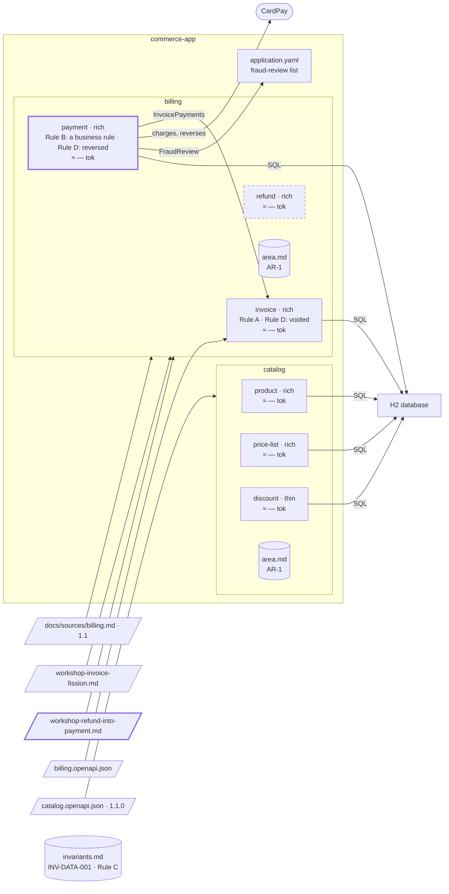

# Step 13 — `refund` merges into `payment`, in an area with an area file: Rule B comes down

> **Session:** 📌 open a **fresh session** at 13.a: the assistant must find the preparation of a merge from the description of `partition-reshape`.

## The problem

The workshop finds that a refund is always the reverse of a payment: the team changes both together, release after release.

## Before

Your `partition-commerce` project should be at the commit of step 12. Area `billing`: `invoice`, `payment`, `refund`. `billing/area.md` holds two area rules: AR-1, the bounded texts of all three, and AR-3 (Rule B), binding `payment` and `refund` only — AR-2 (Rule C) left at step 08. `refund` reads `payment` through `PaymentRefunds`; `payment` reaches `invoice` through `InvoicePayments`. The decomposition rejected this merge at step 07: R4 (the amount paid, Rule B) did not prevail over C3 and C4. `payment` and `refund` each have a `FraudReview` port and adapter.

## Provided

`[architect, PO, BA]` give you the result of the workshop. You paste it in the chat as it is; the assistant saves it as `docs/sources/workshop-refund-into-payment.md`:

| Item | Decision |
| --- | --- |
| Move | Merge: `payment` absorbs `refund` |
| Why | a refund is always the reverse of a payment; the team changes both together, release after release. They share the amount paid and AR-3, which binds only these two: under R4 this sharing now prevails over C3 and C4, and reverses the decision that rejected this merge when PRD 1.1 was decomposed |
| Integration | `PaymentRefunds`, the one contract between the two, goes with the merge; `InvoicePayments`, from `payment` to `invoice`, stays |
| Carry-over | the business analyst carries the hand-written sections of `refund` into `payment` |
| Decided by | the architect, the product owner, the business analyst |

## Prompt

**13.a** — 📌 in a fresh session, type:

> Prepare a workshop on merging `refund` into `payment`.

**13.b** — after the workshop, paste the result of **Provided** in the chat. Name the file `workshop-refund-into-payment.md` when the assistant asks, and validate it. Then type:

> Carry out the merge: `payment` absorbs `refund`. I validate the merge by name.

Once the plan is `done`, commit: the frozen spec of `refund` and its folder are in this commit, as the merge leaves them.

```bash
git add -A && git commit -m "refactor(payment): payment absorbs refund"
```

**13.c** — when the closing lists the carry-over, have the business analyst carry the hand-written sections of `refund/spec.md` into `payment/spec.md`, delete `docs/specs/billing/refund/`, then type:

> The carry-over is done and the folder of `refund` is deleted.

Then commit:

```bash
git add -A && git commit -m "docs(payment): the carry-over of refund; its folder deleted"
```

## Expected

### 13.a — The material of a merge

You should see `partition-reshape` (_Before the decision_) gather the events of both; the words, with their meaning on each side; the rules both share — AR-3, in the area file, binding exactly these two; for a merge, **the contract between the two and every other consumer of it**: `PaymentRefunds`, consumed by `refund` only; `payment` consumes `invoice` through `InvoicePayments`. It may recall that step 07 rejected this merge. Your request names a workshop: the way is not asked, and no boundary is proposed.

### 13.b — The challenge, the record, the preconditions, the merge

You should see the result saved as `docs/sources/workshop-refund-into-payment.md`, shown and validated, then challenged (`partition-shape`, `references/boundary-decision.md`). `refund` and `payment` still satisfy R1 against each other (C2: a refund; C3: its own words), but they share the amount paid and AR-3, which binds exactly these two: a strong sharing of data and of rules, which R4 lets prevail over the split. The result argues it, as R4 asks: the merge stays inside the criteria. The challenge may report **no finding**, or findings that do not question the merge (the reversal of step 07's choice, a word, the home of a shared rule); either way it offers to take the result as it is. Without the R4 argument in the result, a finding on R1 would be the expected outcome.

You should get the record `docs/architecture/reshapes/YYYY-MM-DD-refund-into-payment.md`; `Decided on` names the workshop file, `Challenge` lists each finding with its outcome, or says "No finding"; its `Rules` table holds AR-3, from `billing/area.md` to `payment/spec.md`.

Preconditions of a merge: every caller of either half reaches it through its contract or an interface; a person named for the carry-over — the BA. Then one plan, specs and code together (`references/specs.md`, _Merge_):

**`payment/spec.md`** — its derived sections regenerated on the union of the units: REQ-4, REQ-5, REQ-6. `Persistence` receives the lines of `refund` it does not carry (addition only). Its hand-written sections stay as they are: **no business rule of `refund` is transferred by the assistant.** A banner at its head:

```markdown
> **Status:** absorbed `refund` on YYYY-MM-DD. The hand-written sections of `../refund/spec.md` (objective, scope, language, business rules, dependencies, contracts with neighbours, invariants, questions) are to be carried over here by a human.
```

**Rule B comes down.** AR-3 bound only `payment` and `refund`; merged, a single bounded context needs it. It becomes a business rule of `payment`, at the next free number of `payment`'s rules, carried by a person, with its source anchor, and **leaves the area file**:

| # | Rule | Source |
| --- | --- | --- |
| BR-_n_, the next free number of `payment`'s rules | A customer under fraud review can neither pay nor be refunded. | from source: REQ-4, REQ-6 |

**`refund/spec.md`** — kept and frozen, its banner:

```markdown
> **Status:** merged into `payment` on YYYY-MM-DD. Frozen spec: its derived sections are no longer kept up to date. It remains the source of its hand-written sections until they are carried over into `../payment/spec.md`. See `../bounded-contexts.md#history`.
```

Its folder is **kept**: deleting it is a person's decision, after the carry-over.

**`bounded-contexts.md`** — `refund` leaves `Bounded contexts retained` and enters `Decisions not to split` ("merge of YYYY-MM-DD into `payment`", R4: the amount paid and AR-3 shared); the rejection of step 07 leaves `Alternatives rejected` for `History`; `Kept against the criteria` is untouched; REQ-6 passes to `payment` in `Coverage`; a `History` line, nature `merge`.

**The code** — `com.commerce.refund` comes behind the interfaces of `payment`: its use case, its adapter to CardPay and its `FraudReview` port fold into `payment`'s; the two ports become one. `PaymentRefunds`, its implementation and `refund`'s adapter go: a refund reads the invoice and its payment inside `payment`. `InvoicePayments` stays, unchanged. The proof: outside the merged code, only the wiring changes.

**Afterwards** — the C4 model loses the component `refund`; the budget is measured again. `docs/partition.yml` still declares `refund`: it is taken out **once its folder is gone**.

The closing report lists the merge carried out: the hand-written sections of `refund` to carry over, then its folder to delete by hand.

### 13.c — After the person

The `payment` banner is removed by the person once the carry-over is done. With the folder gone, `refund` leaves `docs/partition.yml`, and the budget no longer counts it.

`billing/area.md` keeps **one area rule**, AR-1, now binding `invoice` and `payment`: AR-2 climbed at step 08, AR-3 came down here. Its `Bounded contexts` loses `refund`, its `Language` the word Under fraud review, which goes with Rule B.

### Watch

An area file with one area rule left still stands: kept with AR-1, its `Language` and its `Bounded contexts`. Record what the run does or asks about it; a skill that empties or removes it is a finding.

### The shape after



**New:** `refund` merges into `payment`; Rule B comes down from the area file to a business rule of `payment`; one `FraudReview` port; `PaymentRefunds` gone. `billing/area.md` keeps AR-1 only.

**Cost:** `payment`'s spec carries what was `refund`'s: its gauge grows as `refund`'s disappears.

## Verdict

- [ ] 13.a — `partition-reshape` answers with its _Before the decision_ material
- [ ] 13.a — The events of both, and the words with their meaning on each side
- [ ] 13.a — The shared rules: AR-3, in the area file, binding exactly `payment` and `refund`
- [ ] 13.a — The contract between the two, `PaymentRefunds`, consumed by `refund` only; `payment` consumes `invoice` through `InvoicePayments`
- [ ] 13.a — It proposes no boundary: you asked for a workshop, so the way is not asked
- [ ] 13.b — The result is saved as `docs/sources/workshop-refund-into-payment.md` and validated before the challenge
- [ ] 13.b — The challenge holds the merge inside the criteria under R4, as the result argues it: no finding, or findings that do not question the merge; it offers to take the result as it is
- [ ] 13.b — The record's `Decided on` names the workshop file; `Challenge` lists each finding with its outcome, or says "No finding"
- [ ] 13.b — `docs/architecture/reshapes/YYYY-MM-DD-refund-into-payment.md`; its `Rules` table holds AR-3, from `billing/area.md` to `payment/spec.md`
- [ ] 13.b — Preconditions: every caller of either half goes through its contract or an interface; the BA named for the carry-over
- [ ] 13.b — One plan, specs and code together
- [ ] 13.b — `payment/spec.md`: derived sections regenerated on the union, REQ-4, REQ-5, REQ-6
- [ ] 13.b — `payment/spec.md`: `Persistence` receives the lines of `refund` it does not carry, addition only
- [ ] 13.b — `payment/spec.md`: hand-written sections unchanged, no business rule of `refund` transferred
- [ ] 13.b — `payment/spec.md` opens with the "absorbed `refund`" banner as written above
- [ ] 13.b — AR-3 becomes a business rule of `payment`, at the next free number of its rules, source `from source: REQ-4, REQ-6`, and leaves `billing/area.md`
- [ ] 13.b — `refund/spec.md` is kept and frozen, with the "merged into `payment`" banner as written above
- [ ] 13.b — The folder `docs/specs/billing/refund/` is kept
- [ ] 13.b — `bounded-contexts.md`: `refund` leaves `Bounded contexts retained`, enters `Decisions not to split` ("merge of YYYY-MM-DD into `payment`", R4); `Kept against the criteria` untouched
- [ ] 13.b — `bounded-contexts.md`: REQ-6 passes to `payment` in `Coverage`; a `History` line, nature `merge`
- [ ] 13.b — The use case, CardPay adapter and `FraudReview` port of `refund` fold into `payment`'s: one port left
- [ ] 13.b — `PaymentRefunds` and its adapters go; `InvoicePayments` stays, unchanged
- [ ] 13.b — The proof: outside the merged code, only the wiring changes
- [ ] 13.b — The C4 model loses the component `refund`; the budget is measured again
- [ ] 13.b — `docs/partition.yml` still declares `refund`
- [ ] 13.b — The closing lists the hand-written sections of `refund` to carry over, then its folder to delete by hand
- [ ] 13.c — The "absorbed" banner of `payment/spec.md` is removed by the person after the carry-over
- [ ] 13.c — `refund` leaves `docs/partition.yml`; the budget no longer counts it
- [ ] 13.c — `billing/area.md` keeps AR-1 only, binding `invoice` and `payment`
- [ ] Watch — What the run does or asks about `billing/area.md` is recorded; it is neither emptied nor removed
