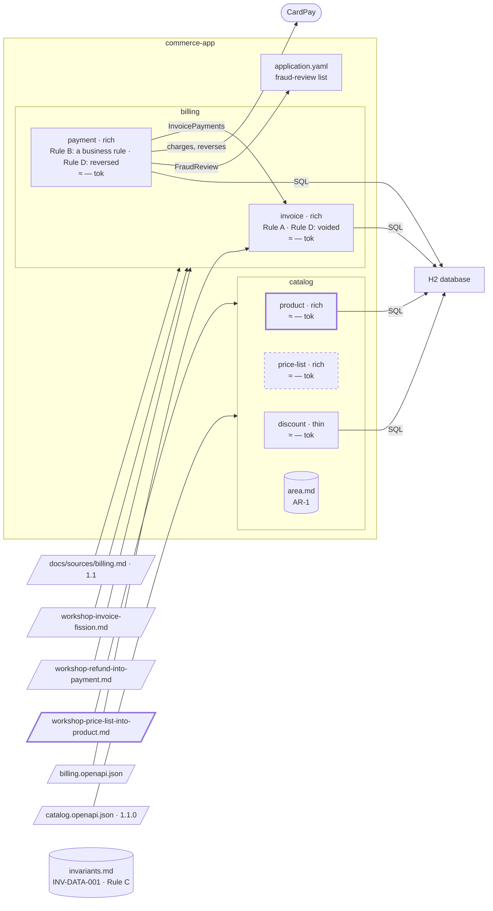

# Step 14 — A price belongs to its product → one bounded context

## The situation

Area `catalog` holds `product`, rich since step 12, `price-list` and `discount`. Since the move of `getProductPrice` at step 11, nothing crosses between `product` and `price-list` and nothing is shared; at step 08 the decomposition rejected a single bounded context for the two. Now the team sees that a price is never managed apart from its product: every change of one is a change of the other.

## What you bring

- [architect, PO, BA] The result of a merge workshop, with their names under `Decided by`: `product` absorbs `price-list`, because a price is never managed apart from its product; no integration is left between the two; the business analyst carries the hand-written sections over. You paste it in the chat; the assistant saves it as `docs/sources/workshop-price-list-into-product.md`.
- [architect] The answer to the challenge: _keep the merge as it is._
- [BA] The carry-over of `price-list`'s hand-written sections into `product/spec.md`, then the deletion of its folder.

The assistant asks other questions along the way (a word with two meanings, the workshop's reason against the contract). You answer them as the role would.

## What you ask

In a fresh session, as at step 13, so that the two merges start the same way:

> Prepare a workshop on merging `price-list` into `product`.

After the workshop, you paste its result, validate the file, then:

> Carry out the merge: `product` absorbs `price-list`. I validate the merge by name.

Once the business analyst has carried the sections over and deleted the folder:

> The carry-over is done and the folder of `price-list` is deleted.

## What partition does

1. **The material.** `partition-reshape` gathers the events, the words and the shared rules of both halves, and the contract between them: there is none since the move of `getProductPrice`, and nothing is shared. Your request names a workshop, so it hands the material over and stops, proposing no boundary.
2. **The result saved, then challenged.** The result is saved, shown and validated. Then `partition-shape` checks each bounded context against R1 from the contract alone: `product` and `price-list` still satisfy it against each other (C2: two root aggregates; C3: their own vocabulary; C4). That is **a finding on R1**, with the criteria, the units and the decision of step 08 it reverses. It offers to take the result as it is: the architect decides.
3. **Kept against the criteria.** You keep the merge. It goes to `Kept against the criteria`, with C2, C3 and C4, the names, the date and the workshop's reason; option 3 leaves `Alternatives rejected` for `History`.
4. **The record and the preconditions.** A dated record under `docs/architecture/reshapes/`, its `Challenge` listing each finding with its outcome. Every caller of either half goes through its contract or an interface, and a person is named for the carry-over: the merge may start. Your validation by name lets it start, and the plan carries it out.
5. **The specs.** `product/spec.md` gets its derived sections regenerated on the union of the operations and an "absorbed" banner; `price-list/spec.md` is frozen with a "merged into" banner, its folder kept. No business rule of `price-list` is transferred by the assistant: one price per product, never negative, and the others are the business analyst's to carry.
6. **No area rule comes down.** `catalog/area.md` holds one rule, AR-1, the error envelope of the Catalog API. It binds `discount` too, so it stays where it is. The record's `Rules` table says so, rather than staying empty.
7. **The code.** The code of `pricelist` moves behind the interfaces of `product`, with the proof that only the wiring changed. Then the C4 model and the budget follow.
8. **After the person.** Once the business analyst has carried the sections and deleted the folder, the assistant takes `price-list` out of `docs/partition.yml`, where it stayed as long as its spec folder existed.

**Why it works this way.** A workshop may overrule the criteria, but not silently: the finding is named, and the point kept against it is recorded with who decided and why, so the next reader sees an overruled finding, not a forgotten one. And a rule leaves the area file only when a single bounded context still needs it.

## Worth noticing

- Compare with step 13: there the result argued a sharing that prevails (R4) and the merge stayed inside the criteria; here there is nothing to argue, so the same procedure ends in `Kept against the criteria`.
- INV-DATA-001 does not move: it lives in the register, above the area, and binds `product` now as it bound `price-list`. A merge inside one area never moves a line of the register.

## The shape after

**New:** `price-list` merges into `product`, kept against the criteria; AR-1 binds `discount` too, so no area rule comes down; the register is unchanged.

**Cost:** `product`'s spec carries `price-list`'s rules.
