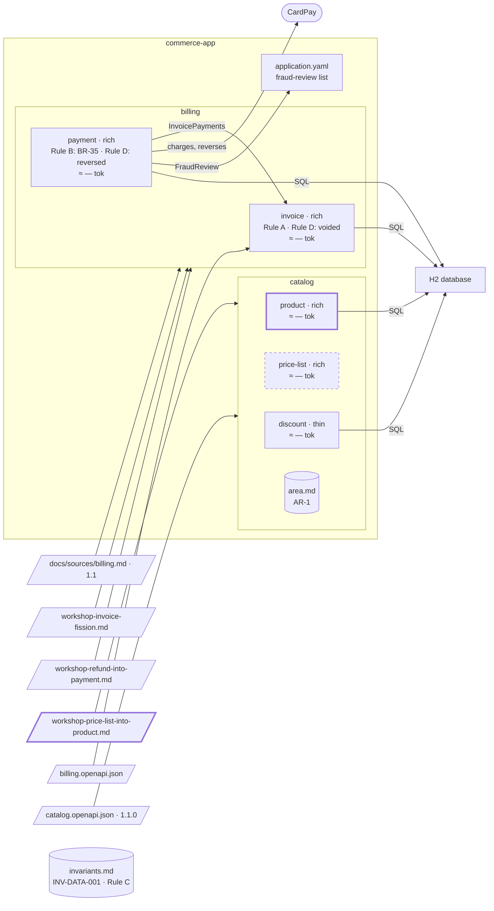

# Step 14 — `price-list` merges into `product`, against the criteria, with no area rule to bring down

> **Session:** 📌 open a **fresh session**, as at step 13: the two merges are compared, so each starts the same way.

## The problem

The workshop finds that a price is never managed apart from its product: every change of one is a change of the other.

## Before

Your `partition-commerce` project should be at the commit of step 13. Area `catalog`: `product` (rich since step 12), `price-list`, `discount`. `catalog/area.md` holds one area rule, AR-1, the error envelope of the Catalog API, binding all three; no rule binds `product` and `price-list` alone. INV-DATA-001 binds `price-list` and `discount`. Since the move of `getProductPrice` (step 11) nothing crosses between `product` and `price-list` and nothing is shared, not even `Money`; the decomposition rejected a single bounded context for the two (option 3, step 08).

## Provided

`[architect, PO, BA]` give you the result of the workshop. You paste it in the chat as it is; the assistant saves it as `docs/sources/workshop-price-list-into-product.md`:

| Item        | Decision                                                                                      |
| ----------- | --------------------------------------------------------------------------------------------- |
| Move        | Merge: `product` absorbs `price-list`                                                         |
| Why         | a price is never managed apart from its product; every change of one is a change of the other |
| Integration | none left between the two since the move of `getProductPrice`                                 |
| Carry-over  | the business analyst                                                                          |
| Decided by  | the architect, the product owner, the business analyst                                        |

## Prompt

**14.a** — 📌 in a fresh session, type:

> Prepare a workshop on merging `price-list` into `product`.

**14.b** — paste the result of **Provided** in the chat. Name the file `workshop-price-list-into-product.md` when the assistant asks, and validate it. Then type:

> Carry out the merge: `product` absorbs `price-list`. I validate the merge by name.

**14.c** — have the business analyst carry the hand-written sections over and delete `docs/specs/catalog/price-list/`, then type:

> The carry-over is done and the folder of `price-list` is deleted.

## Expected

You should see the same procedure as step 13, with one difference that is the point of this step.

**What is the same** — the way not asked, your request naming a workshop; the material (no contract between the two since the move of `getProductPrice`, nothing shared); the result saved, shown and validated before the challenge; the record; the preconditions; `product/spec.md` with its derived sections regenerated on the union of the operations and the "absorbed" banner; `price-list/spec.md` frozen with the "merged into" banner and its folder kept; `bounded-contexts.md` updated (retained, `Coverage`, `History`); the code of `pricelist` behind the interfaces of `product`; the proof of the move; the C4 model; the budget; `price-list` declared in `docs/partition.yml` until its folder is gone.

**What differs: the merge goes against the criteria.** At step 13 the result argued R4, a sharing that prevails. Here there is none to argue: `product` and `price-list` still satisfy R1 against each other on the contract alone (C2: two root aggregates; C3: their own vocabulary; C4), and the result reverses option 3. The challenge says so: **a finding on R1**, with the criteria and the units, and the earlier decision it reverses. The assistant offers to take the result as it is; you keep the merge. It goes to `Kept against the criteria` (C2, C3, C4, who decided, the date, the workshop's reason), and option 3 leaves `Alternatives rejected` for `History`. Other findings may come (the workshop's Why against "a price is set whether `product` holds it or not", a word with two meanings): you answer them as the roles would. `Challenge` in the record lists each finding with its outcome.

**What differs: no area rule comes down.** The only area rule of `catalog`, AR-1, binds `discount` too: it stays in `catalog/area.md`. The record's `Rules` table says so rather than staying empty. The business rules of `price-list` (one price per product, never negative, and the others) are carried by the BA, as hand-written sections always are. An area word only `product` uses now comes down with them; a word `discount` uses stays. INV-DATA-001 is untouched: it lives above the area and binds `product` now as it bound `price-list`; `product/spec.md` names it.

The register does not change: a merge inside one area never moves a line of the register.

### The shape after

**New:** `price-list` merges into `product`, kept against the criteria; AR-1 binds `discount` too, so no area rule comes down; the register unchanged.

**Cost:** `product`'s spec carries `price-list`'s two rules.

## Verdict

- [ ] The way is not asked; the material: no contract between `product` and `price-list`, nothing shared
- [ ] The result is saved as `docs/sources/workshop-price-list-into-product.md` and validated before the challenge
- [ ] The challenge reports a finding on R1 (C2, C3, C4 from the contract alone) and the reversal of option 3; it offers to take the result as it is
- [ ] The merge kept: `Kept against the criteria` holds it with the criteria, who decided, the date and the reason; option 3 leaves `Alternatives rejected`; the record's `Challenge` lists each finding with its outcome
- [ ] The record, and the preconditions of a merge
- [ ] `product/spec.md`: derived sections regenerated on the union of the operations, the "absorbed" banner
- [ ] `price-list/spec.md` frozen with the "merged into" banner; its folder kept
- [ ] `bounded-contexts.md`: retained, `Coverage` and `History` updated
- [ ] The code of `pricelist` behind the interfaces of `product`, with the proof of the move
- [ ] The C4 model updated; the budget measured again
- [ ] `price-list` stays declared in `docs/partition.yml` while its folder exists, and leaves it once the folder is gone
- [ ] The record's `Rules` table says no area rule comes down (AR-1 binds `discount` too), rather than staying empty
- [ ] The business rules of `price-list` (one price per product, never negative) are left to the BA
- [ ] INV-DATA-001 is untouched, and `product/spec.md` names it
- [ ] The register does not change
