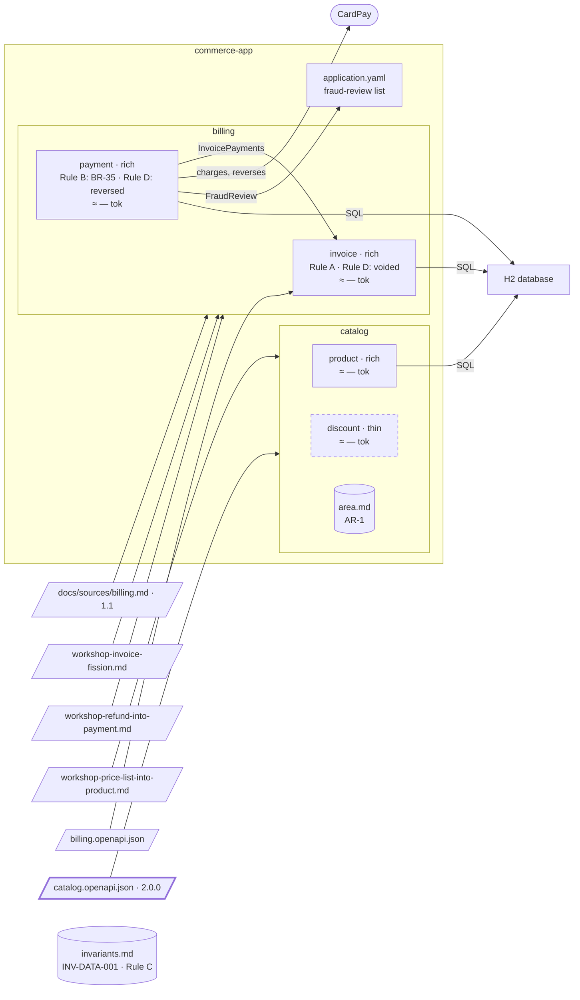

# Step 15 — Catalog contract v2: `discount` is removed

> **Session:** 📌 open a **fresh session** at 15.a for the delta; stay in that session for the removal.

## The problem

Catalog 2.0.0: the discounts move to another system, out of this project.

## Before

Your `partition-commerce` project should be at the commit of step 14. Area `catalog`: `product` (with the prices) and `discount`; `catalog/area.md` holds AR-1, binding both. The recorded scope of `catalog/bounded-contexts.md` is `tag:Product; tag:PriceList; tag:Discount`.

## Provided

`[architect]` gives you catalog 2.0.0, [`docs/contracts/catalog.openapi.json`](15-provided/docs/contracts/catalog.openapi.json): the discounts move to another system, out of this project. `createDiscount`, `getDiscount`, the tag `Discount` and the schema `Discount` are removed from the contract; `info.version` becomes `2.0.0`. In the excerpt of step 08, as it reads at 1.1.0 after step 11:

```diff
-    "version": "1.1.0",
+    "version": "2.0.0",
-    "/price-lists/{priceListId}/prices/{productId}": { "put": { "operationId": "setPrice", "tags": ["PriceList"] } },
-    "/discounts": { "post": { "operationId": "createDiscount", "tags": ["Discount"] } },
-    "/discounts/{discountId}": { "get": { "operationId": "getDiscount", "tags": ["Discount"] } }
+    "/price-lists/{priceListId}/prices/{productId}": { "put": { "operationId": "setPrice", "tags": ["PriceList"] } }
```

`[PO]` gives you the ruling on the code of `discount`, when the assistant asks: _delete it._

## Prompt

**15.a** — copy the contract of [`15-provided/`](15-provided/) over the old one, at the root of `partition-commerce`, and commit it alone. The build fails from this commit until the code of `discount` goes: its generator finds no `Discount` tag. The file is 1.1.0 of step 11 with the discounts removed: no step changes the contract in between (step 12 adds no operation). If a plan of yours has changed it all the same, remove the two operations, the tag and the schema by hand instead, as the diff shows.

```bash
git add docs/contracts/catalog.openapi.json && git commit -m "docs(contracts): catalog 1.1.0 -> 2.0.0"
```

📌 In a fresh session, type:

> The catalog contract changed to 2.0.0. Bring the specs in step with it.

When the assistant asks how to rewrite the scope, answer `tag:Product; tag:PriceList`. When it asks how to decide on the removal, answer:

> A proposal.

Validate the removal of `discount` by name.

**15.b** — type:

> Carry out the removal of `discount`.

When the assistant asks whether to delete the code, give the PO's ruling.

## Expected

### 15.a — A stale scope stops the delta first

You should see `partition-shape` run the delta. Before classifying anything (`delta.md`, _Restrict the delta to the scope_): `Discount`, a tag of the recorded scope, no longer exists in the contract. It **stops**, shows the operations that carried it (`createDiscount`, `getDiscount`), and asks you how to rewrite the scope.

With your answer: two operations removed, **breaking**, loudly reported; step 5 confronts them with the code — both are implemented in `discount`: a divergence, reported, read-only. `discount` loses **all** its operations: **removal proposed, never executed**. A removal moves a boundary: the assistant asks you the way. With _a proposal_, it says the criteria leave a **single option**: `discount` has no unit left, so no other split exists, and it invents none. The plan marks its spec as a removal proposed, deleting nothing. A proposal still unanswered when the delta writes gets the "removal proposed" banner; once you validate it by name, it goes to `partition-reshape` as it is, with no banner, and the closing hands it over.

### 15.b — Frozen first, deleted only on your word

You should see `partition-reshape` check the preconditions of a removal: **nothing calls `discount` any more**, shown by a search of its contract and of its code, with the command and its real output; its units were removed from the contract.

`references/specs.md`, _Removal_:

- `discount/spec.md` is **frozen first**: the "removal proposed" banner replaced by "removed on YYYY-MM-DD — no unit is attached to it any more", its hand-written sections intact, to be archived or reassigned by a person.
- Its folder is **kept**: deleting it is a person's decision.
- `bounded-contexts.md`: `discount` leaves `Bounded contexts retained`; it does **not** enter `Decisions not to split`, which speaks only of units kept together; the trace is the `History` line, nature `removal`.
- The code is deleted **only after you rule on it, in a step of its own**: it asks, you give the PO's answer "delete it", and that task deletes `com.commerce.discount`, its tests and its generated interface. A new migration drops its table; `V9__discount.sql` is never edited.
- The C4 model loses the component; the budget is measured again; `discount` leaves `docs/partition.yml` once its spec folder is gone.
- AR-1 now binds `product` alone: it comes down to `product/spec.md`, carried by a person, and leaves `catalog/area.md`.

The closing lists the removal carried out: the hand-written sections to archive or reassign, AR-1 to bring down, then the folder to delete by hand.

### Watch

The delta "never narrows a scope", yet the tag it names is gone and your answer narrows it. Which procedure writes the new `Scope` line, and whether the old one is kept in `History`, is for the run to show.

### The shape after



**New:** `discount` is removed: its spec frozen, its code deleted once `[PO]` rules.

**Cost:** none inside the project; what discounts do is now another system's.

## Verdict

- [ ] 15.a — `partition-shape` stops before classifying anything: the tag `Discount` is gone from the contract
- [ ] 15.a — It shows `createDiscount` and `getDiscount`, and asks how to rewrite the scope
- [ ] 15.a — Two operations removed, **breaking**, loudly reported
- [ ] 15.a — Step 5 reports a divergence, read-only: both operations are implemented in `discount`
- [ ] 15.a — It asks the way; with a proposal, a single option, said so: no unit is left, no other split exists
- [ ] 15.a — **Removal proposed, never executed**: the plan deletes nothing of `discount`
- [ ] 15.a — A banner "removal proposed" only while unanswered; validated by name, no banner
- [ ] 15.a — The closing hands the validated removal to `partition-reshape`
- [ ] 15.b — Precondition: a search of its contract and code shows nothing calls `discount`, command and real output
- [ ] 15.b — Precondition: the units of `discount` were removed from the contract
- [ ] 15.b — `discount/spec.md` frozen first: "removed on YYYY-MM-DD — no unit is attached to it any more" banner, hand-written sections intact
- [ ] 15.b — The folder of `discount` is kept
- [ ] 15.b — `bounded-contexts.md`: `discount` leaves `Bounded contexts retained`, not in `Decisions not to split`; a `History` line, nature `removal`
- [ ] 15.b — It asks before deleting the code, and deletes it only after the PO's "delete it", in a step of its own
- [ ] 15.b — That task deletes `com.commerce.discount`, its tests and its generated interface
- [ ] 15.b — A new migration drops its table; `V9__discount.sql` is not edited
- [ ] 15.b — The C4 model loses the component; the budget is measured again
- [ ] 15.b — `discount` leaves `docs/partition.yml` once its spec folder is gone
- [ ] 15.b — The closing lists the hand-written sections to archive or reassign, AR-1 to bring down to `product`, then the folder to delete by hand
- [ ] Watch — Which procedure writes the new `Scope` line, and whether the old one is kept in `History`, is recorded
