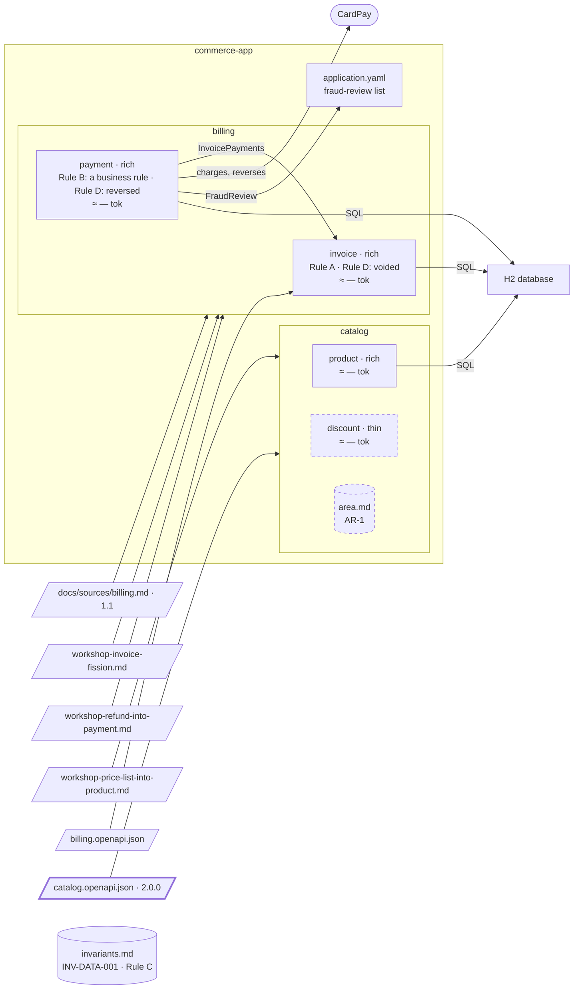

# Step 15 — Catalog 2.0.0 → `discount` removed

## The situation

Area `catalog` now holds `product`, with the prices, and `discount`; `catalog/area.md` holds AR-1, binding both. The decomposition of `catalog` records the scope `tag:Product; tag:PriceList; tag:Discount`. Catalog 2.0.0 moves the discounts to another system, out of this project.

## What you bring

- [architect] Catalog 2.0.0, [`docs/contracts/catalog.openapi.json`](15-provided/docs/contracts/catalog.openapi.json), in [`15-provided/`](15-provided/): `createDiscount`, `getDiscount`, the tag `Discount` and its schema are gone; the build fails until the code of `discount` goes.
- [architect] The new scope, when asked: `tag:Product; tag:PriceList`. And the way to decide the removal: _a proposal_.
- [PO] The ruling on the code of `discount`, when asked: _delete it._
- [BA] Once the removal is done: AR-1 and the words only `product` uses brought down to `product/spec.md`, `catalog/area.md`, left empty, deleted, and the folder of `discount` deleted.

The assistant asks other questions along the way. You answer them as the role would.

## What you ask

Copy the contract over the old one and commit it alone before the prompt that reads it: its sha is what the delta starts from. Then, in a fresh session:

> The catalog contract changed to 2.0.0. Bring the specs in step with it.

When it asks how to rewrite the scope, you give the new one; when it asks how to decide the removal:

> A proposal.

You validate the removal of `discount` by name, then, in the same session:

> Carry out the removal of `discount`.

Once the business analyst has done their part:

> AR-1 and the words are in `product`, `catalog/area.md` is deleted, and the folder of `discount` is deleted.

## What partition does

1. **A stale scope stops the delta.** `partition-shape` restricts the delta to the recorded scope before classifying anything, and finds that `Discount`, a tag of that scope, no longer exists. It **stops**, shows the operations that carried it, and asks how to rewrite the scope. A delta never narrows a scope on its own: only your answer does.
2. **The scope rewritten on your word.** Your answer names the new scope; the rewrite is a proposal like a scope extension, validated by name. Once validated, the `Scope` line changes in `bounded-contexts.md` and in every spec, and the `History` line of the delta quotes the former scope and names you.
3. **The change classified.** Two operations removed: **breaking**, reported loudly. They are searched in the code: both are implemented in `discount`, a divergence, reported and left as it is.
4. **A removal proposed, never executed.** `discount` loses every operation it owned. A removal moves a boundary, so the assistant asks the way. With _a proposal_, it says the criteria leave a single option: no unit is left, so no other split exists, and it invents none. You validate the removal by name; the closing hands it to `partition-reshape`.
5. **The preconditions.** `partition-reshape` shows, by a search of the contract and the code with its real output, that nothing calls `discount` any more, and that its units left the contract.
6. **Frozen first.** `discount/spec.md` gets a "removed on" banner, its hand-written sections intact; its folder is kept, since deleting it is a person's decision. `discount` leaves `Bounded contexts retained`, with a `History` line of nature `removal`.
7. **The code only on the product owner's word.** The assistant asks before deleting anything. On the answer "delete it", a task of its own deletes the package, its tests and its generated interface; a new migration drops its table, and no merged migration is edited.
8. **What the area file is left with.** AR-1 now binds `product` alone. Nothing moves yet: the closing lists the sections of `discount` to archive or reassign, and AR-1 and the words to bring down to `product`, each for a person.
9. **After the person.** The assistant takes `discount` out of `docs/partition.yml`, checks that `product/spec.md` holds AR-1 as a business rule rather than an applicable area rule, and measures again: `product` loads no area file.

**Why it works this way.** A recorded scope is a decision someone made; when the source makes it stale, the assistant cannot guess the new one, so it stops and the owner rewrites it, with the former scope kept in `History`. And a removal deletes in order of reversibility: the spec is frozen, the code goes only on the owner's word, and the hand-written text is left to a person.

## Worth noticing

- `discount` does not enter `Decisions not to split`: that table speaks of units kept together. A removal leaves its trace in `History`.

## The shape after

**New:** `discount` is removed: its spec frozen, its code deleted on the product owner's word; the scope rewritten, the former one kept in `History`; AR-1 comes down to `product`, and `catalog/area.md`, left empty, is deleted by a person.

**Cost:** none inside the project; what discounts do is now another system's.
