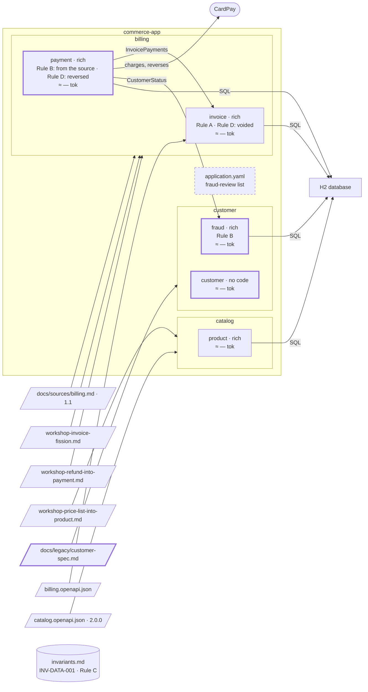

# Step 16 — The risk team's old spec, decomposed as a source: the area `customer`; `fraud` owns Rule B

> **Session:** 📌 open a **fresh session.** The assistant must find `partition-shape` from its description alone: a spec written before Partition is a source like any other, and nothing of billing is in the conversation.

## The problem

`payment` learns who is under fraud review from a list in `application.yaml`, while the risk team has had its own specification since before Partition. That specification cannot be used as is: it enters as a source, where it lives.

## Before

Your `partition-commerce` project should be at the commit of step 15. `payment` holds Rule B as a business rule since step 13, copied from REQ-4 and REQ-6 of `docs/sources/billing.md`, and learns who is under review from `commerce.fraud-review.customers` in `application.yaml`. No area `customer`.

## Provided

`[BA]` gives you the specification the risk team wrote before Partition, [`docs/legacy/customer-spec.md`](16-provided/docs/legacy/customer-spec.md): six numbered sections — overview, customer accounts, fraud review, data, conventions, ruling history. It identifies no requirement: each section is named by the slug of its heading. Its last section, which 16.b turns on:

```markdown
## 6. Ruling history

- 2024-03-12 — A customer under fraud review can neither pay nor be refunded. (risk committee)
- 2024-09-02 — Reviews older than one year are archived, not deleted. (risk committee)
```

`[BA]`, who speaks for the risk team, validates it as the source: _it still describes what the risk team's system must do._

Copy [`16-provided/`](16-provided/) into `partition-commerce`, at its root, and commit it alone: the decomposition reads it where it lives, under `docs/legacy/`, and records the sha of that commit.

```bash
git add docs/legacy && git commit -m "docs(legacy): the risk team's customer spec"
```

`[architect]` gives you the way to decide the boundary, when the assistant asks: _a proposal_. Then the choice among the options: _`customer` and `fraud` apart: an account and a review are two root aggregates (C2), each with its own words (C3). `customer` for the accounts, `fraud` for the review._ The decision stays the architect's; the assistant proposes. The names are the architect's choice: the assistant proposes its own from the naming rule (`references/criteria.md`), and the architect keeps them or chooses these.

`[TL]` gives you the code paths, when the assistant asks: `fraud`: `src/main/java/com/commerce/fraud/**`; `customer` has no code in this project yet.

`[TL]` gives you the word on section 5, when the assistant reports it as a candidate for a rule file: _yes: one line, in the rule file whose topic and scope fit, or in a new file if no file has that topic._

`[BA]` gives you the validation of the copied rules, before 16.c: _I confirm them as written; there is no other rule. Each spec keeps its own words, as the old spec uses them; no word and no rule goes to an area file._

`[architect]` gives you the contract `fraud` exposes: `CustomerStatus`, an interface of its application layer: _is this customer blocked: yes or no._ No API contract exists for the risk team in this version: placing, lifting and reading a review are use cases with no entry point, called by their tests only, as the retirement of a product at step 12; the HTTP operations come with a later contract. And the form of `fraud`: rich (a review moves from open to lifted, and only the risk team lifts it).

`[PO]` gives you the answer on the billing source, when the assistant asks whether REQ-4 and REQ-6 keep Rule B: _they stay as written; nothing to amend._

## Prompt

**16.a** — 📌 in a fresh session, type:

> Decompose `docs/legacy/customer-spec.md`, area `customer`.

When the assistant asks how to decide the boundary, answer:

> A proposal.

Choose the option with `customer` and `fraud` apart, by its number, with the architect's reason and names from **Provided**. Then validate by name: _"Create the bounded contexts `customer` and `fraud`."_ Give the code paths when the assistant asks. Once the specs are written, commit:

```bash
git add docs && git commit -m "docs(customer): decompose the risk team's customer spec"
```

**16.b** — when the assistant reports that Rule B is found both in `payment` and in the ruling of 2024-03-12, answer:

> `fraud` owns it. `payment` consumes `CustomerStatus`.

When you reach section 5, among the gaps of 16.a's hard stop, give the `[TL]`'s word from **Provided**. Deploy the rule and commit:

```bash
apm install
git add -A && git commit -m "docs(customer): fraud owns Rule B; the rule on identifiers"
```

**16.c** — give the `[BA]`'s validation from **Provided**, then type:

> Plan and build: `fraud` places and lifts reviews, and `payment` asks `fraud` whether a customer is blocked.

One commit per plan: once the plan of `fraud` is `done`, then once the plan of `payment` is:

```bash
git add -A && git commit -m "feat(fraud): fraud places and lifts reviews"
git add -A && git commit -m "feat(payment): payment asks CustomerStatus"
```

## Expected

### 16.a — The old spec is read where it lives

You should see `partition-shape` fire from its description (_an existing spec_): `docs/specs/customer/bounded-contexts.md` is absent, so the initial decomposition (`references/decompose.md`), read for a document (`references/sources/document.md`). `source` and `area` are given: no question. The source is a file of the repository, read where it lives: it is not moved, nor copied under `docs/sources/`. Committed alone before the prompt, it is recorded by the sha of that commit.

### The inventory and the decision

The spec identifies no requirement, so a unit is a section, named by the slug of its heading. A part that only gives context is not a unit, and the three kinds of part only an old spec holds are read as the reader says (_What is copied, and what is pointed to_):

| Section | Read as |
| --- | --- |
| 1. Overview | context: not a unit, pointed to |
| 2. Customer accounts | a unit, `#2-customer-accounts`; it acts on "an account" |
| 3. Fraud review | a unit, `#3-fraud-review`; it acts on "a review" |
| 4. Data | it only gives context: not a unit, pointed to |
| 5. Conventions | how code is written: not a unit and not a business rule. Reported as a candidate for a rule file, which `partition-rules` writes on the owner's word; never an area rule |
| 6. Ruling history | not a unit: ruling by ruling, each anchored by its heading and its date (`#6-ruling-history`, 2024-03-12; `#6-ruling-history`, 2024-09-02). Each states a rule and gives no reason: each is a business rule the source states, neither a decision. No annex is written |

`2 in scope / 2 in the source`. C2 holds: an account and a review are two entities the source names. R1 holds with C2 and the vocabulary of each (C3): an account, its email and its address; a review, the risk team, lifted, blocked. **Two bounded contexts.**

Section 4 names tables, yet `paths.schemas` is undeclared (step 01): `Persistence` of each spec reads "No schema documents are declared for this project".

Before it shows them, the assistant tells you what is at stake and that the decision is the architect's, and asks you the way (`references/boundary-decision.md`): the boundaries come from `[architect]`, not from an answer about the old file's sections. With _a proposal_, one line first says how many splits the criteria leave, and, when they leave one, names it and the criterion that makes each other split fall; then two or three options, numbered (BR-33), one recommended with why: the accounts and the reviews apart, under the names the assistant proposes from the naming rule (`references/criteria.md`). An option that keeps a point against a criterion names that criterion and is not the one recommended. You choose the split and its names, `customer` and `fraud` (`references/boundary-decision.md`); the others go to `Alternatives rejected` with your reason.

### The hard stop

```text
Source             : docs/legacy/customer-spec.md
Version            : <the date it was read>
Provenance         : <sha of "docs(legacy): the risk team's customer spec">
Scope              : whole source
Units read         : 2 in scope / 2 in the source
Out of scope       : none
Bounded contexts   : customer, fraud (2 retained)
Decided            : proposal, option <n> · you, as [architect]

Writing plan:
  + docs/specs/customer/bounded-contexts.md
  + docs/specs/customer/customer/spec.md
  + docs/specs/customer/fraud/spec.md
  ≈ docs/partition.yml                      (declares customer and fraud: area customer, code paths to ask)

Copied from the source (word for word, to confirm):
  customer  rules      : "The email of an account is unique." (#2-customer-accounts)
            invariants : none stated
            decisions  : none stated
  fraud     rules      : "A review is lifted only by a member of the risk team." (#3-fraud-review),
                         "Reviews older than one year are archived, not deleted." (#6-ruling-history, 2024-09-02)
            invariants : none stated
            decisions  : none stated
  customer  rules      : none shared

Gaps detected, to settle:
  - "A customer under fraud review can neither pay nor be refunded." (#6-ruling-history, 2024-03-12) is also
    held by docs/specs/billing/payment/spec.md (<its BR from step 13>): spans two areas, candidate for the
    admission test
  - #5-conventions: how code is written, a candidate for a rule file (partition-rules)
```

The ruling of 2024-03-12 is **Rule B**, word for word the rule `payment` holds. A spec of another area already holds it, so it goes to no area file and is not copied into `fraud`'s `Business rules`: it is quoted with its anchor, `#6-ruling-history`, 2024-03-12, under `Applicable area rules and invariants` of `fraud`, as a candidate for the admission test, and listed in the gaps with the file and the identifier that hold it (`references/decompose.md`, 6.c). **Nothing is written in `payment`**: `partition-shape` writes only in the area it decomposes. Section 5 is reported among the gaps, so it reaches `Gaps detected` and the closing report. No `area.md`. Nothing is written before you validate `customer` and `fraud` **by name**.

### What is written

You should get `docs/specs/customer/bounded-contexts.md`: the header lines (source `docs/legacy/customer-spec.md`, its version as the date it was read, provenance with the sha, `whole source`, `2 / 2`, `Decided` with the date, your name and `proposal: option <n>`); `Bounded contexts retained`: `customer` with `#2-customer-accounts`, `fraud` with `#3-fraud-review`; `Alternatives rejected`: the options not chosen, with your reason; `Kept against the criteria`: "None"; `Coverage`: two lines; `History`: empty; `Gaps detected`: Rule B, also held by `payment`; section 5, a candidate for a rule file.

`docs/specs/customer/customer/spec.md` and `docs/specs/customer/fraud/spec.md`, from the template:

- the five header lines kept: each spec is derived from a source;
- `Language`: **empty** — a person writes it;
- `Source parts owned`: `#2-customer-accounts` for `customer`, `#3-fraud-review` for `fraud`, each a link to its anchor in `docs/legacy/customer-spec.md`, no text copied; the parts that are not units pointed to;
- `Business rules`, word for word, marked "from source" with their anchor, under the **"TO VALIDATE"** banner: for `customer`, "The email of an account is unique." (`#2-customer-accounts`); for `fraud`, "A review is lifted only by a member of the risk team." (`#3-fraud-review`) and "Reviews older than one year are archived, not deleted." (`#6-ruling-history`, 2024-09-02);
- `Decisions`: empty: neither ruling gives a reason;
- `Persistence`: "No schema documents are declared for this project";
- `Contracts with neighbours`: empty, a person writes it;
- `Applicable area rules and invariants`: "None" for `customer`; for `fraud`, Rule B quoted as a candidate, with its anchor;
- `Open questions`: what the old spec leaves open, one per line.

`docs/partition.yml` declares `customer` and `fraud`, area `customer`; `fraud` with `src/main/java/com/commerce/fraud/**`, `customer` without code paths.

**The old file is unchanged**: no pointer line at its top, no annex. `git status` shows nothing under `docs/legacy/`.

The closing report tells you `customer` and `fraud` are **not usable**: their rules carry the "TO VALIDATE" banner. It lists Rule B and section 5 among the gaps, with the file and the identifier of `payment` that hold it, and puts it through the admission test: it **fails**, since a rule one bounded context owns is local to it, even when bounded contexts of other areas consume its result through its contract (`partition-spec`, `references/invariants.md`). A person names the owner.

### 16.b — One owner for Rule B, named by a person

The same rule is now held twice: the business rule of `payment`, from REQ-4 and REQ-6, and the ruling of 2024-03-12. It is **reported, not moved** by the assistant (BR-19). You name the owner: `fraud` (_Where a statement belongs_: owned by one bounded context and needed by others). Then `partition-spec` writes it:

- `fraud/spec.md`, `Business rules`: "A customer under fraud review can neither pay nor be refunded.", from source, anchored `#6-ruling-history`, 2024-03-12, with the validation that named `fraud` its owner, under the banner with the other copied rules until the BA confirms them;
- `fraud/spec.md`, `Contracts with neighbours`: `payment`, exposed, `CustomerStatus`;
- `payment/spec.md`: nothing at 16.b. Its Rule B **stays**, reported as a duplicate: it is copied from REQ-4 and REQ-6 of the billing source, and a rule copied from a source changes only through its source, so the copy stays until that source is amended; asked, the PO keeps the source as it is. Its `Contracts with neighbours` and its `Language` change in the plan of 16.c, through `partition-spec`.

This is the case [where a rule lives](../where-a-rule-lives.md#step-2--rule-b-shared-within-one-area-no-owner) announced: _"If later a `fraud` bounded context exposes 'customer blocked: yes or no', a person names it the owner: the rule goes to its spec, and `payment` and `refund` consume the answer through its contract, as Rule A does."_ There, Rule B came from a workshop and goes whole. Here it is also a sentence of the billing source, so `fraud` owns it and `payment` keeps its copy, reported as a duplicate until the billing source is amended, each from its own source, neither rewritten nor moved by the assistant. The rule spans two areas, `customer` and `billing`, yet it does not go to the register: it has an owner, and a rule with an owner lives in the owner's spec.

On the `[TL]`'s word, `partition-rules` (_Add or change one rule_) adds section 5, "Identifiers are UUIDs, generated by the service, never by the caller.", as one line of the rule file whose topic and scope fit, or of a new file for a new topic, after checking that no rule says it already; then `apm install`. It goes to no spec and to no area file.

### 16.c — The code follows, one bounded context at a time

The assistant plans nothing while `fraud`'s rules carry their banner: the BA confirms them first, then the attack of the spec raises what a build needs (two placings at once, how a lift names its review, what a read returns); you answer as the roles would. You should get `com.commerce.fraud` with its domain (a review, opened and lifted), its use cases (place, lift, read; no entry point in this version), its migration, and the implementation of `CustomerStatus`. `payment` switches in a plan of its own, after `fraud` closes. Its spec moves first, through `partition-spec`: `Contracts with neighbours` gains `fraud`, consumed, `CustomerStatus` — the answer "blocked: yes or no", and nothing else — and the list of `application.yaml` leaves its `Language`. Then the adapter of its `FraudReview` port calls `CustomerStatus`; `commerce.fraud-review.customers` leaves `application.yaml`; `ArchitectureTest` lets `payment` reach `CustomerStatus` and nothing else of `fraud`. The C4 model gains the component `fraud` and the relation `payment -> fraud`, a contract written in both specs. Closing as before, for each plan.

### Watch

"A customer changes their address at any time." may be copied as a rule of `customer` or pointed to, with a question in `Open questions`: record which. Whether section 4 is read as context or as a unit is recorded: as a unit, the count becomes `3 / 3`. The names the assistant proposes may differ from `customer` and `fraud`: the architect's names hold; record what the run proposes.

### The shape after



**New:** the area `customer`, decomposed from the risk team's old spec, read where it lives and left unchanged; `docs/specs/customer/bounded-contexts.md`; `fraud` owns Rule B, `payment` keeps its copy from the billing source, reported as a duplicate; `CustomerStatus`; one line of a rule file on identifiers.

**Cost:** `payment` now depends on another area, through `CustomerStatus`.

## Verdict

- [ ] 16.a — The fresh session uses `partition-shape` with the reader of a document; no question on source or area
- [ ] 16.a — The source is read where it lives, under `docs/legacy/`, not moved or copied under `docs/sources/`; it is recorded by the sha of its commit
- [ ] 16.a — The units are sections 2 and 3, by the slugs of their headings; `2 in scope / 2 in the source`
- [ ] 16.a — Sections 1 and 4 are pointed to; section 5 is reported as a candidate for a rule file, never an area rule; section 6 is read ruling by ruling, each anchored `#6-ruling-history` with its date, no annex
- [ ] 16.a — C2 and C3 hold: two bounded contexts
- [ ] 16.a — It says what is at stake and that the decision is the architect's, and asks the way; with a proposal, two or three numbered options, the accounts and the reviews apart recommended with why, under the names the assistant proposes; the others in `Alternatives rejected`; the hard stop carries the `Decided` line
- [ ] 16.a — With a proposal, one line first says how many splits the criteria leave
- [ ] 16.a — The hard stop shows the block above: the rules of sections 2 and 3 and the ruling of 2024-09-02 copied word for word; Rule B among the gaps, with the file and the identifier of `payment` that hold it; section 5 among the gaps, a candidate for a rule file
- [ ] 16.a — Nothing is written in `payment`, and nothing before you validate `customer` and `fraud` by name
- [ ] 16.a — `customer/bounded-contexts.md`: the header lines with the sha, `2 / 2` and `Decided`, the two bounded contexts with their units, `Alternatives rejected`, `Kept against the criteria` "None", two `Coverage` lines, an empty `History`, Rule B and section 5 in `Gaps detected`
- [ ] 16.a — Both specs: the five header lines kept, `Language` empty, `Source parts owned` as links, the copied rules under "TO VALIDATE", `Decisions` empty, `Persistence` "No schema documents are declared for this project", `Contracts with neighbours` empty
- [ ] 16.a — `fraud/spec.md` quotes Rule B under `Applicable area rules and invariants` as a candidate, anchored `#6-ruling-history`, 2024-03-12
- [ ] 16.a — `docs/partition.yml` declares `customer` and `fraud`, area `customer`; `fraud` with its code path, `customer` without
- [ ] 16.a — No `customer/area.md`
- [ ] 16.a — The old file is unchanged: no pointer line, no annex
- [ ] 16.a — The closing report says both are not usable, lists Rule B and section 5 among the gaps, and reports Rule B failing the admission test: it has an owner, a person names it
- [ ] 16.b — Rule B, in `payment` and in the ruling of 2024-03-12, is reported, not moved by the assistant
- [ ] 16.b — `partition-spec` writes Rule B into `fraud/spec.md`, `Business rules`, from source, anchored `#6-ruling-history`, 2024-03-12, with the validation that named its owner
- [ ] 16.b — `fraud/spec.md`, `Contracts with neighbours`: `payment`, exposed, `CustomerStatus`
- [ ] 16.b — `payment`'s Rule B stays, reported as a duplicate that changes only when its source is amended; the PO keeps the source; nothing is written in `payment` at 16.b
- [ ] 16.b — Rule B does not go to the register: it lives in the spec of its owner
- [ ] 16.b — On the `[TL]`'s word, section 5 becomes one line of the rule file whose topic and scope fit, or of a new file for a new topic, through `partition-rules`, deployed
- [ ] 16.c — No plan while the rules of `fraud` carry their banner
- [ ] 16.c — `com.commerce.fraud` has its domain (a review opened and lifted), its use cases without entry point, its migration and the implementation of `CustomerStatus`
- [ ] 16.c — `payment` switches in a plan of its own, after `fraud` closes; its spec moves first, through `partition-spec`: `Contracts with neighbours` gains `fraud`, consumed, `CustomerStatus`, "blocked: yes or no" and nothing else; the list of `application.yaml` leaves its `Language`
- [ ] 16.c — In `payment`, the adapter of the `FraudReview` port calls `CustomerStatus`; `commerce.fraud-review.customers` leaves `application.yaml`; `ArchitectureTest` lets `payment` reach `CustomerStatus` and nothing else of `fraud`
- [ ] 16.c — The C4 model gains the component `fraud` and the relation `payment -> fraud`, a contract written in both specs
- [ ] 16.c — Closing as before
- [ ] Watch — Whether "A customer changes their address at any time." is copied or pointed to, whether section 4 is read as context, and the names the assistant proposes, are recorded
