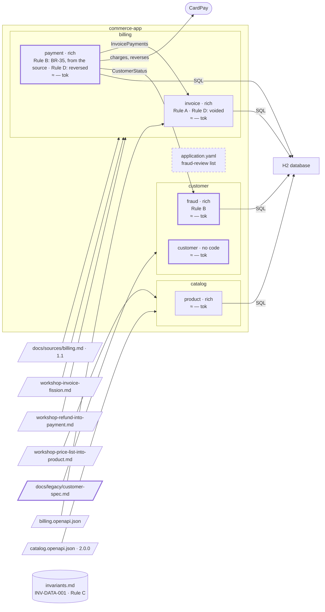

# Step 16 — A legacy `customer` spec is taken over; `fraud` owns Rule B

> **Session:** 📌 open a **fresh session.** You ask for a takeover by name; nothing of billing is in the conversation.

## The problem

`payment` learns who is under fraud review from a list in `application.yaml`, while the risk team has had its own specification since before Partition.

## Before

Your `partition-commerce` project should be at the commit of step 15. `payment` holds BR-35 (Rule B) since step 13, copied from REQ-4 and REQ-6 of `docs/sources/billing.md`, and learns who is under review from `commerce.fraud-review.customers` in `application.yaml`. No area `customer`.

## Provided

`[BA]` gives you the specification the risk team wrote before Partition, [`docs/legacy/customer-spec.md`](16-provided/docs/legacy/customer-spec.md): six numbered sections — overview, customer accounts, fraud review, data, conventions, ruling history. Its last section, which 16.b turns on:

```markdown
## 6. Ruling history

- 2024-03-12 — A customer under fraud review can neither pay nor be refunded. (risk committee)
- 2024-09-02 — Reviews older than one year are archived, not deleted. (risk committee)
```

Copy [`16-provided/`](16-provided/) into `partition-commerce`, at its root.

`[BA]` gives you the answers the takeover asks for: area `customer`, two bounded contexts, `customer` (sections 1, 2) and `fraud` (sections 1, 3); code path of `fraud`: `src/main/java/com/commerce/fraud/**`, rich (a review moves from open to lifted, and only the risk team lifts it); `customer` has no code in this project yet.

`[architect]` gives you the contract `fraud` exposes: `CustomerStatus`, an interface of its application layer: _is this customer blocked: yes or no._ No API contract exists for the risk team in this version: placing, lifting and reading a review are use cases with no entry point, called by their tests only, as the retirement of a product at step 12; the HTTP operations come with a later contract.

`[PO]` gives you the answer on the billing source, when the assistant asks whether REQ-4 and REQ-6 keep Rule B: _they stay as written; nothing to amend._

## Prompt

**16.a** — 📌 in a fresh session, type:

> Take over `docs/legacy/customer-spec.md`.

Answer the assistant's questions with **Provided**; validate its plan.

**16.b** — when the assistant reports that Rule B is found both in `payment` and in the legacy rulings, answer:

> `fraud` owns it. `payment` consumes `CustomerStatus`.

**16.c** — type:

> Plan and build: `fraud` places and lifts reviews, and `payment` asks `fraud` whether a customer is blocked.

## Expected

### 16.a — Map first, write after validation

You should see `partition-spec` follow `references/takeover.md`:

1. **Read and map, write nothing.** A table: each section of the legacy file and where it goes — 2 to the spec of `customer`; 3 to the spec of `fraud`; 4 to `Persistence` of each, or a question; 5 to a **rule file** (how code is written here, not a business rule); 6 to an annex, its rulings put through the levels. The template sections the file lacks (`Language`, `Business rules`, `Contracts with neighbours`, `Open questions`) are named. The number of bounded contexts is the BA's answer, not the assistant's split.
2. **Present the plan and stop.**
3. **Write**, after validation:
   - `docs/specs/customer/customer/spec.md` and `docs/specs/customer/fraud/spec.md`, from the template, **without the five source lines**: they are not derived from a source by `partition-shape`. The author's wording is moved, not rewritten.
   - The ruling history is **not copied** into a spec. It stays in the legacy file under `## Annex — decision history (frozen)`.
   - The rulings that state a durable truth are candidates, each run through the levels: the archive of old reviews belongs to `fraud`; the first ruling is Rule B — see 16.b. None is written without validation.
   - The legacy file stays in place, with one line at its top pointing to the two new specs. Removing it is your decision.
   - `docs/partition.yml` declares `customer` and `fraud`, area `customer`.
   - Section 5 becomes one line of a backend rule, scoped, through `partition-rules`.

### 16.b — One owner for Rule B, one copy from the source

The same rule is now in two places: BR-35 of `payment`, and a ruling of the legacy file. It is **reported, not moved** by the assistant. You rule: `fraud` owns it (_Where a statement belongs_: owned by one bounded context and needed by others). Then:

- `fraud/spec.md`, `Business rules`: "A customer under fraud review can neither pay nor be refunded." with its source (the risk committee ruling of 2024-03-12, and the validation that named `fraud` its owner);
- `fraud/spec.md`, `Contracts with neighbours`: `payment`, exposed, `CustomerStatus`;
- `payment/spec.md`: BR-35 **stays**. It is copied from REQ-4 and REQ-6 of the billing source, and a rule copied from a source changes only through its source: the assistant reports it and asks the PO, who keeps the source as it is. `Contracts with neighbours` gains `fraud`, consumed, `CustomerStatus` — the answer "blocked: yes or no", and nothing else — and the list of `application.yaml` leaves its `Language` and its contracts.

This is the case [where a rule lives](../where-a-rule-lives.md#step-2--rule-b-shared-within-one-area-no-owner) announced: _"If later a `fraud` bounded context exposes 'customer blocked: yes or no', the rule moves to its spec."_ There, Rule B came from a workshop and moves whole. Here it is also a sentence of the billing source, so `fraud` owns it and `payment` keeps its copy, each from its own source, neither rewritten. The rule spans two areas, `customer` and `billing`, yet it does not go to the register: it has an owner, and a rule with an owner lives in the owner's spec.

### 16.c — The code follows, one bounded context at a time

The assistant plans nothing while `fraud`'s rules carry their banner: the BA confirms them first, then the attack of the spec raises what a build needs (two placings at once, how a lift names its review, what a read returns); you answer as the roles would. You should get `com.commerce.fraud` with its domain (a review, opened and lifted), its use cases (place, lift, read; no entry point in this version), its migration, and the implementation of `CustomerStatus`. `payment` switches in a plan of its own, after `fraud` closes: the adapter of its `FraudReview` port now calls `CustomerStatus`; `commerce.fraud-review.customers` leaves `application.yaml`; `ArchitectureTest` lets `payment` reach `CustomerStatus` and nothing else of `fraud`. The C4 model gains the component `fraud` and the relation `payment -> fraud`, a contract written in both specs. Closing as before, for each plan.

### The shape after



**New:** the area `customer`, taken over from a legacy spec; `fraud` owns Rule B, `payment` keeps its copy from the billing source; `CustomerStatus`; the rule file `backend-identifiers`.

**Cost:** `payment` now depends on another area, through `CustomerStatus`.

## Verdict

- [ ] 16.a — `partition-spec` reads the legacy file and maps it in a table, writing nothing
- [ ] 16.a — The table sends section 2 to `customer`, 3 to `fraud`, 4 to `Persistence` of each or a question, 5 to a rule file, 6 to an annex
- [ ] 16.a — The missing template sections are named: `Language`, `Business rules`, `Contracts with neighbours`, `Open questions`
- [ ] 16.a — Two bounded contexts, as the BA answered, not a split chosen by the assistant
- [ ] 16.a — The plan is presented and the assistant stops
- [ ] 16.a — After validation, `docs/specs/customer/customer/spec.md` and `docs/specs/customer/fraud/spec.md` exist, from the template, without the five source lines
- [ ] 16.a — The author's wording is moved, not rewritten
- [ ] 16.a — No spec copies the ruling history; it stays in the legacy file under `## Annex — decision history (frozen)`
- [ ] 16.a — Each ruling that states a durable truth is run through the levels: the archive of old reviews to `fraud`, the first ruling is Rule B; none is written without validation
- [ ] 16.a — The legacy file stays in place, with one line at its top pointing to the two new specs
- [ ] 16.a — `docs/partition.yml` declares `customer` and `fraud`, area `customer`
- [ ] 16.a — Section 5 becomes one scoped line of a backend rule, through `partition-rules`
- [ ] 16.b — Rule B, in BR-35 of `payment` and in the legacy rulings, is reported, not moved by the assistant
- [ ] 16.b — `fraud/spec.md`, `Business rules`: "A customer under fraud review can neither pay nor be refunded.", sourced to the ruling of 2024-03-12 and the validation that named its owner
- [ ] 16.b — `fraud/spec.md`, `Contracts with neighbours`: `payment`, exposed, `CustomerStatus`
- [ ] 16.b — BR-35 stays in `payment/spec.md`, reported as changing only through its source; the PO keeps the source; its `Contracts with neighbours` gains `fraud`, consumed, `CustomerStatus`, "blocked: yes or no" and nothing else
- [ ] 16.b — Rule B does not go to the register: it lives in the spec of its owner
- [ ] 16.c — No plan while the rules of `fraud` carry their banner
- [ ] 16.c — `com.commerce.fraud` has its domain (a review opened and lifted), its use cases without entry point, its migration and the implementation of `CustomerStatus`
- [ ] 16.c — `payment` switches in a plan of its own, after `fraud` closes
- [ ] 16.c — In `payment`, the adapter of the `FraudReview` port calls `CustomerStatus`; `commerce.fraud-review.customers` leaves `application.yaml`
- [ ] 16.c — The C4 model gains the component `fraud` and the relation `payment -> fraud`, a contract written in both specs
- [ ] 16.c — Closing as before
