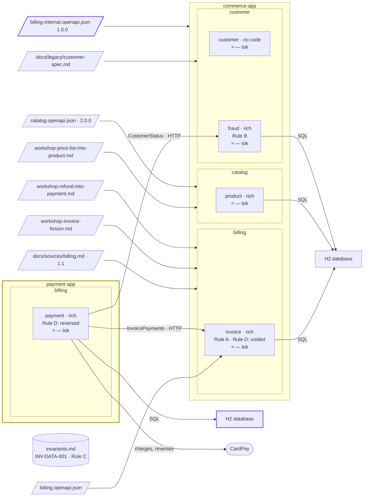

# Step 17 — `payment` becomes a deployable of its own

> **Session:** 📌 open a **fresh session.** A promotion is prepared from a budget record or a workshop, never from the chat that built the code.

## The problem

CardPay's volumes and its release rhythm differ from the rest of `commerce-app`.

## Before

Your `partition-commerce` project should be at the commit of step 16: one jar. `payment` calls `invoice` through `InvoicePayments`, and `fraud` through `CustomerStatus`, all in process.

## Provided

`[architect, PO]` give you the decision of the workshop of 2026-10-16: _`payment` is promoted from a component of `commerce-app` to a container of its own, `payment-app`; CardPay's volumes and its release rhythm differ from the rest._

`[architect]` gives you the contract that replaces the in-process calls, frozen before the move, [`docs/contracts/billing-internal.openapi.json`](17-provided/docs/contracts/billing-internal.openapi.json) (version 1.0.0): `getInvoiceForPayment`, `getInvoiceCustomer`, `recordPayment`, `recordPaymentCancelled` (tag `InvoicePayments`) and `getCustomerStatus` (tag `CustomerStatus`). It says what the two interfaces already say, and nothing more.

`[TL]` gives you the build, [`parent-pom.xml`](17-provided/parent-pom.xml): a parent `pom.xml` (packaging `pom`) with two modules, `commerce-app` and `payment-app`, each a Spring Boot jar with its own `application.yaml`, H2 database and Flyway migrations. It lands beside the current `pom.xml`, which it replaces during the move: replaced before, the build would break until both modules exist.

`[architect]`, on the two records of a payment (BR-21) once they live in two processes: _`invoice` decides: of two `recordPayment`, or a pay and a cancel, the first it records holds. `payment` stores its payment only once `invoice` has answered that it is recorded; a `409` stores nothing, as today. A payment `invoice` recorded and `payment` then failed to store stays open until REQ-5, with the charge a lost record leaves._

`[TL]`, on the data: _no instance holds data to keep, the payment rows are not copied. The migrations of `payment-app` create its tables, the payment's and the refunds', from `V1`; a new migration of `commerce-app` drops them; no merged migration is edited._

`[architect]`, on the Billing API: _each app serves its own operations of `billing.openapi.json`, which does not change: `commerce-app` the tag `Invoice`, `payment-app` the tags `Payment` and `Refund`, each on its own port. No gateway in this version._

## Prompt

**17.a** — copy the files of [`17-provided/`](17-provided/) into `partition-commerce`, at its root, and commit the contract alone:

```bash
git add docs/contracts/billing-internal.openapi.json && git commit -m "docs(contracts): billing-internal 1.0.0"
```

Leave `parent-pom.xml` uncommitted: the move turns it into `pom.xml`.

📌 In a fresh session, type:

> Prepare the promotion of `payment` from a component to a container.

**17.b** — type:

> Carry out the promotion of `payment` to `payment-app`. I validate it by name.

## Expected

### 17.a — The material and the preconditions

You should see `partition-reshape` (_The moves_, Promotion; _Before the decision_) list the dependencies that do not go through an interface, with `file:line` — there should be none since steps 06, 13 and 16; the contracts that cross the line: `InvoicePayments`, `CustomerStatus`. A promotion is not a boundary: the assistant does not ask you the way.

Preconditions of a promotion: every caller through an interface; one adapter per interface; **the contract written and frozen** — the HTTP contract of **Provided**, version 1.0.0. With the three met, the move may start.

### 17.b — The move: the callers stay where they are

You should get the record `docs/architecture/reshapes/YYYY-MM-DD-<name>.md`, its name the session's, then one plan:

- The build becomes the parent `pom.xml` of **Provided**, from `parent-pom.xml`, with the two modules.
- The code of `payment` moves to `payment-app/src/main/java/com/commerce/payment/**`, behind its interfaces.
- On each side, **the adapter is replaced** by one that speaks the frozen contract: in `payment-app`, HTTP clients for `InvoicePayments` and `CustomerStatus`; in `commerce-app`, HTTP endpoints implementing the operations of `billing-internal.openapi.json`, generated by the generator, calling the same application interfaces as before. The interfaces and their callers do not change.
- The payment tables move: new migrations in `payment-app`; a new migration in `commerce-app` drops them. No merged migration is edited.
- The two records of a payment: `payment` stores its payment only once `invoice` has recorded it; a `409` stores nothing. `Persistence` of `payment` says so, with the architect's answer, before the code.
- The proof that it was a move: outside the moved code, only the wiring and the adapters change. The real output of the command is shown. A caller that had to change means a dependency did not go through an interface: the assistant stops and tells you so.
- `payment`'s spec gives itself what a bounded context owns: its business rules unchanged, its rules with their scope (the rule files' `applyTo` now name `payment-app/src/**` too). The moved code compiles and its tests pass: the real output of the verification command is shown. A pipeline, when the project has one, is a plus, never required.

### Afterwards

- `partition-c4`: the element `payment` **changes kind and parent**, from a component of `commerce-app` to a container of `commerce`, `payment-app`, Spring Boot 4.1; its relations become HTTP. The move is prepared by `partition-reshape`; `partition-c4` only records it. Regenerated: the hand-placed boxes keep their place; the new container takes a free place, clear of the kept boxes, to move by hand once. The run names a box only when two kept boxes overlapped.
- `docs/partition.yml`: `payment`'s `code` and `layers` point to `payment-app/src/main/java/com/commerce/payment/**`. Its spec does not move: one home, `docs/specs/billing/payment/spec.md`, read by both modules of the one repository.
- `partition-budget` measured again: a promotion made to bring a gauge down shows that it did, or says it was made for another reason.

### The shape after



**New:** `payment-app`, a deployable of its own; the two interfaces over HTTP, under the internal contract. The bounded contexts are unchanged: a promotion is not a boundary.

**Cost:** calls in process become HTTP calls under a contract to version; each app has its own database.

## Verdict

- [ ] 17.a — `partition-reshape` lists the dependencies that do not go through an interface, with `file:line`: none expected
- [ ] 17.a — The contracts that cross the line: `InvoicePayments`, `CustomerStatus`
- [ ] 17.a — The three preconditions are checked: every caller through an interface, one adapter per interface, the contract written and frozen at version 1.0.0
- [ ] 17.b — The record `docs/architecture/reshapes/YYYY-MM-DD-<name>.md`, then one plan
- [ ] 17.b — `pom.xml` is the parent of **Provided**, with the modules `commerce-app` and `payment-app`
- [ ] 17.b — The code of `payment` is in `payment-app/src/main/java/com/commerce/payment/**`, behind its interfaces
- [ ] 17.b — `payment-app` has HTTP clients for `InvoicePayments` and `CustomerStatus`
- [ ] 17.b — `commerce-app` has generated HTTP endpoints implementing `billing-internal.openapi.json`, calling the same application interfaces as before
- [ ] 17.b — The interfaces and their callers do not change
- [ ] 17.b — New migrations in `payment-app`; a new migration in `commerce-app` drops the payment tables; no merged migration is edited
- [ ] 17.b — `payment` stores its payment only once `invoice` has recorded it; `Persistence` says so before the code
- [ ] 17.b — The proof is shown with the real output of its command: outside the moved code, only wiring and adapters change
- [ ] 17.b — A caller that had to change stops the move and is reported
- [ ] 17.b — The rule files' `applyTo` name `payment-app/src/**` too; the business rules of `payment` are unchanged
- [ ] 17.b — The moved code compiles and its tests pass, with the real output of the verification command
- [ ] Afterwards — `partition-c4`: `payment` becomes a container of `commerce`, `payment-app`, Spring Boot 4.1, with HTTP relations; it records the move, it does not prepare it
- [ ] Afterwards — Regenerated: the hand-placed boxes keep their place; the new container takes a free place, clear of the kept boxes
- [ ] Afterwards — `docs/partition.yml`: `code` and `layers` of `payment` point to `payment-app/src/main/java/com/commerce/payment/**`
- [ ] Afterwards — The spec stays at `docs/specs/billing/payment/spec.md`
- [ ] Afterwards — `partition-budget` is measured again: the promotion brought a gauge down, or the record says it was made for another reason
