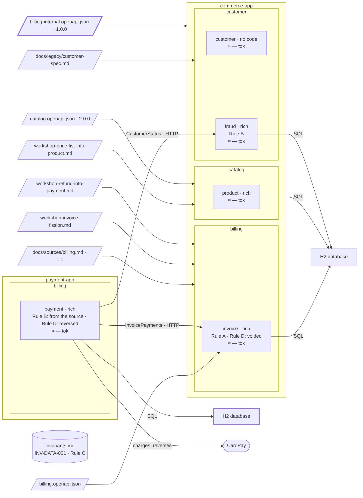

# Step 17 — CardPay's own rhythm → `payment-app`

## The situation

The project is one jar. `payment` calls `invoice` through `InvoicePayments` and `fraud` through `CustomerStatus`, all in process. CardPay's volumes and its release rhythm now differ from the rest of `commerce-app`.

## What you bring

- [architect, PO] The decision of the workshop of 2026-10-16: _`payment` is promoted from a component of `commerce-app` to a container of its own, `payment-app`_, because CardPay's volumes and rhythm differ from the rest.
- [architect] The contract that replaces the in-process calls, frozen before the move, [`docs/contracts/billing-internal.openapi.json`](17-provided/docs/contracts/billing-internal.openapi.json), in [`17-provided/`](17-provided/): it says what `InvoicePayments` and `CustomerStatus` already say, over HTTP, and nothing more.
- [TL] The build, [`parent-pom.xml`](17-provided/parent-pom.xml): two modules, each a jar with its own configuration, database and migrations.
- [architect] Who records a payment first, once the two records live in two databases: _`invoice` decides; `payment` stores its payment only once `invoice` has answered that it is recorded._
- [TL] No data to keep: the payment tables are created afresh in `payment-app` and dropped from `commerce-app`.

The assistant asks other questions along the way (which app serves which operations of the Billing API). You answer them as the role would.

## What you ask

Commit the contract alone before the prompt that reads it; leave `parent-pom.xml` uncommitted, since the move turns it into `pom.xml`. Then, in a fresh session, because a promotion is prepared from a workshop or a budget record, never from the chat that built the code:

> Prepare the promotion of `payment` from a component to a container.

If the assistant stopped once the preconditions were met, rather than carrying the promotion on:

> Carry out the promotion of `payment` to `payment-app`. I validate it by name.

## What partition does

1. **The material.** `partition-reshape` lists the dependencies that do not go through an interface, with `file:line` (none, since steps 06, 13 and 16), and the contracts that cross the line: `InvoicePayments`, `CustomerStatus`.
2. **No way to choose.** A promotion is not a boundary: the bounded contexts stay as they are, so the assistant does not ask how to decide.
3. **The decision is the validation.** The workshop's decision names the promotion and its target, with the names of who decided: it is the validation by name. The assistant may carry the promotion out in the same session; the second prompt is only needed if it stopped. The validation by name lets the move start, and the plan carries it out.
4. **The preconditions.** Every caller through an interface, one adapter per interface, the contract written and frozen at 1.0.0. All three are met: the move may start. A missing one would be a plan of its own first.
5. **The specs move first.** Two databases mean two records of one payment. Before any code, `partition-spec` writes the architect's answer into the specs: `invoice` records first and decides; `payment` stores its payment only once `invoice` has recorded it, and stores nothing on a refusal.
6. **The move.** A dated record under `docs/architecture/reshapes/`, then one plan. The build becomes the parent of two modules; the code of `payment` moves to `payment-app`, behind its interfaces. On each side the adapter is replaced by one that speaks the frozen contract: HTTP clients in `payment-app`, generated endpoints in `commerce-app` calling the same application interfaces. New migrations create the tables in `payment-app`, a new one drops them in `commerce-app`; no merged migration is edited.
7. **The proof.** The expected result written first, then the real list of changed files: outside the moved code, only wiring and adapters. A caller that had to change stops the move. The rule files' scopes now name `payment-app` too; the moved code compiles and its tests pass, with the real output shown.
8. **Afterwards.** `partition-c4` records `payment` changing kind and parent, from a component to a container, its relations now HTTP; the hand-placed boxes keep their place. `docs/partition.yml` points `payment`'s code to `payment-app`. `partition-budget` measures again, and says whether the promotion brought a gauge down or was made for another reason.

**Why it works this way.** A promotion changes where code runs, not what it means: the callers and the interfaces stay put, only the adapters change, and the move is proved by the files it touched. And the spec has one home: `payment`'s stays in `docs/specs/billing/`, read by both modules of the one repository, never copied into the new deployable.

## Worth noticing

- What two processes add, the order of two records, is a question about what `payment` holds, so it is settled in the specs before the code that implements it.

## The shape after

**New:** `payment-app`, a deployable of its own; the two interfaces over HTTP, under the internal contract. The bounded contexts are unchanged: a promotion is not a boundary.

**Cost:** calls in process become HTTP calls under a contract to version; each app has its own database.
