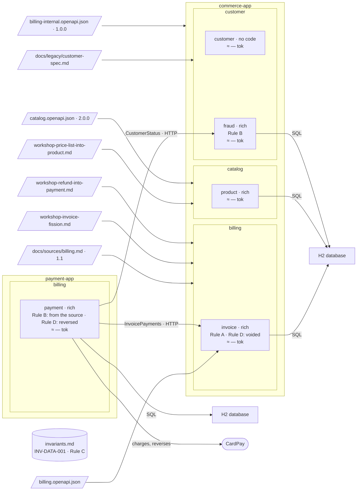

# Step 19 — Where did each rule land → the final figure

## The situation

The story is over. [Where a rule lives](../where-a-rule-lives.md) placed four rules, A to D, on paper; twenty steps later the project has placed them for real. You ask the files where each one landed, not your memory of the run.

## What you bring

Nothing new: every input was given in the steps before.

## What you ask

In a fresh session, so that the answer comes from the files, not from a memory of the build:

> For Rules A, B, C and D of `docs/guides/where-a-rule-lives.md` in the Partition repository, say where each lives in this project, and which bounded contexts load it.

Paste the four rules if the session cannot read the Partition repository.

## What partition does

1. **It reads the levels.** The instruction knows where a rule can live: a spec, an area file, the invariant register. The answer is read from the files of `partition-commerce`, each rule with its path.
2. **It reads who loads what.** `docs/partition.yml` says, for each bounded context, its spec and its area; the register is loaded by all.

The answer, and why it differs from the paper example:

| Rule | In [where a rule lives](../where-a-rule-lives.md) | In `partition-commerce` | Why it differs |
| --- | --- | --- | --- |
| Rule A | `billing/invoice/spec.md`, BR-3 | `billing/invoice/spec.md`, BR-3 | — |
| Rule B | `billing/area.md`, AR-1 | `customer/fraud/spec.md`, BR-3; `payment` consumes `CustomerStatus` and keeps its copy, a business rule from REQ-4, REQ-6, reported as a duplicate until that source is amended | an area rule (AR-3, step 07), a rule of `payment` after the merge (step 13), then of its owner once the risk team's old spec was decomposed (step 16) |
| Rule C | `invariants.md`, INV-DATA-001 | `invariants.md`, INV-DATA-001, from source | the same level; it climbed plan → spec → area → register (steps 04, 06, 08) |
| Rule D | `invoice/spec.md` and `payment/spec.md`, `Language` | the same | — |

| Bounded context | Invariant register | Area file | Its spec |
| --- | --- | --- | --- |
| `invoice`, `payment` | yes | `billing/area.md`, kept at step 13 | yes |
| `product` | yes | none: `catalog/area.md`, from step 08, emptied and deleted at step 15 | yes |
| `customer`, `fraud` | yes | none: no area rule or word validated at step 16 | yes |

What did not change through twenty steps: a rule was never written twice, but a copy a source states, which changes only through its source (Rule B in `payment`, step 16), never deduced, never moved by the assistant where a person had to move it, and never settled by editing the higher level.

**Why it works this way.** Each rule went where the set of bounded contexts that needs it says, and moved only when that set changed, on a person's decision.

## The shape after

**New:** nothing: the figure is the recap.

**Cost:** what each bounded context loads, as the table above says.
