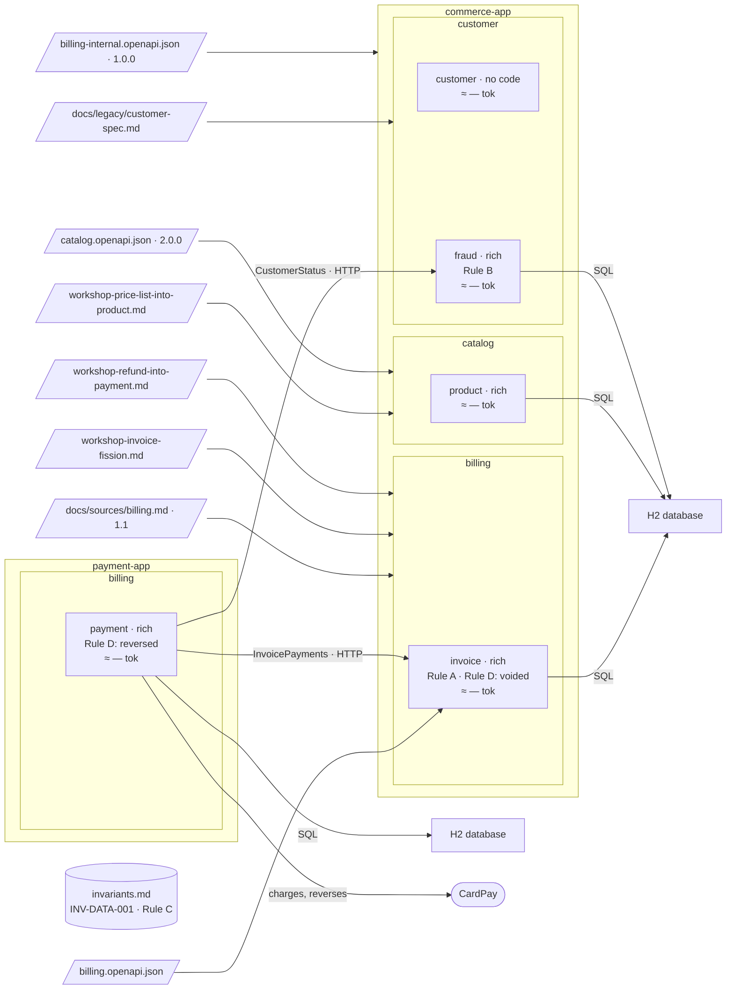

# Step 19 — Where each rule landed, against [where a rule lives](../where-a-rule-lives.md)

> **Session:** 📌 open a **fresh session.** You ask the question of the files, not of a memory of the run.

## The problem

The story is over. You ask the files, not your memory of the run, where each of the four rules landed.

## Before

Your `partition-commerce` project should be at the commit of step 18.

## Provided

Nothing. You gave every input in the steps before.

## Prompt

Type:

> For Rules A, B, C and D of `docs/guides/where-a-rule-lives.md` in the Partition repository, say where each lives in this project, and which bounded contexts load it.

Paste the four rules if the session cannot read the Partition repository.

## Expected

You should get an answer read from the files of `partition-commerce`, each with its path.

| Rule | In [where a rule lives](../where-a-rule-lives.md) | In `partition-commerce` | Why it differs |
| --- | --- | --- | --- |
| Rule A | `billing/invoice/spec.md`, BR-3 | `billing/invoice/spec.md`, BR-3 | — |
| Rule B | `billing/area.md`, AR-1 | `customer/fraud/spec.md`, BR-3; `payment` consumes `CustomerStatus` and keeps BR-35, its copy from REQ-4, REQ-6 | an area rule (AR-2, step 07), a rule of `payment` after the merge (step 13), then of its owner (step 16) |
| Rule C | `invariants.md`, INV-DATA-001 | `invariants.md`, INV-DATA-001, from source | the same level; it climbed plan → spec → area → register (steps 04, 06, 08) |
| Rule D | `invoice/spec.md` and `payment/spec.md`, `Language` | the same | — |

| Bounded context      | Invariant register | Area file                          | Its spec |
| -------------------- | ------------------ | ---------------------------------- | -------- |
| `invoice`, `payment` | yes                | `billing/area.md`, kept at step 13 | yes      |
| `product`            | yes                | `catalog/area.md`, from step 08    | yes      |
| `customer`, `fraud`  | yes                | `customer/area.md`, from step 16   | yes      |

What did not change through twenty steps: a rule was never written twice, but a copy a source states, which changes only through its source (BR-35 of `payment`, step 16), never deduced, never moved by the assistant where a person had to move it, and never settled by editing the higher level.

Once this step is checked, the index of the guide is `done`, and its table of cases has a verdict on every row.

### The shape after

**New:** nothing: the figure is the recap.

**Cost:** what each bounded context loads, as the table of the step says.

## Verdict

- [ ] The answer is read from the files of `partition-commerce`, each rule with its path
- [ ] Rule A: `billing/invoice/spec.md`, BR-3
- [ ] Rule B: `customer/fraud/spec.md`, BR-3; `payment` consumes `CustomerStatus` and keeps BR-35, its copy from REQ-4, REQ-6
- [ ] Rule C: `invariants.md`, INV-DATA-001, from source
- [ ] Rule D: `Language` of `invoice/spec.md` and `payment/spec.md`
- [ ] `invoice`, `payment` load the register, `billing/area.md` and their spec
- [ ] `product` loads the register, `catalog/area.md` and its spec
- [ ] `customer`, `fraud` load the register, `customer/area.md` and their spec
- [ ] No rule written twice but a copy a source states, none deduced, moved by the assistant where a person had to, or settled at the higher level
- [ ] The index of the guide is `done`, and its table of cases has a verdict on every row
