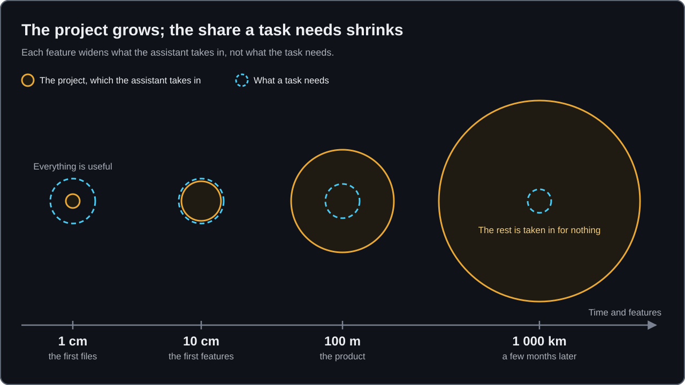
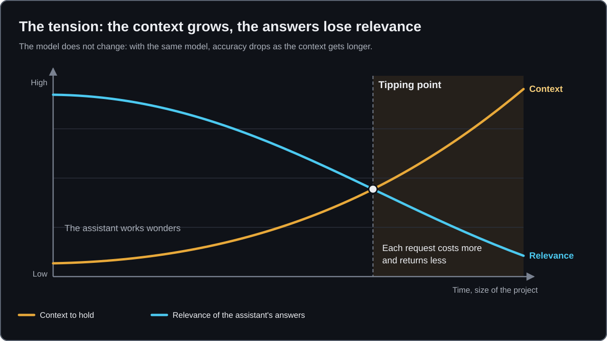

# Why Partition

An AI assistant works wonders while it can hold the whole project. Then the project grows, and the answers lose accuracy. This article says why, what it costs you, and what Partition does about it. It is the philosophy behind every other article of the [series](README.md).

## The model has not changed; the project has

On the first day, everything fits: the data model, the rules, the conventions, the few files that exist. The assistant sees all of it and answers well. A few months later, the same task asks it to know rules, exceptions and dependencies spread across the whole repository. It reads more, understands less and gets more wrong.

The model did not get worse. What it has to hold grew. That is true of a repository started last week and of one that is ten years old: the pressure is the size of what the assistant holds, not the age of the project. An existing repository simply starts further along the curve.

## What it costs

On a project that grew without boundaries, every request reads the world again, and you pay four times:

1. **In tokens.** Every file the assistant loads to understand is paid for, on every request.
2. **In review time.** A less accurate answer needs a closer reading, and often a correction.
3. **In regressions outside the scope asked.** The assistant changes what it only half sees.
4. **In explaining the same context again.** Each session learns again what the last one knew.

None of these appears on a budget line. Each spreads over every request of every developer, every day, and grows with the project.

Waiting for a larger context window does not settle it: a wider window lets more in, it does not make the assistant use it better. The [Context Budget article](https://elie29.hashnode.dev/plus-le-projet-grossit-plus-l-ia-se-trompe) (in French) gathers the public research behind that statement. The right context is the smallest set that is enough for the task.

## Two things fix it, and neither is a prompt

- **A specification that stays true.** The spec is the source of truth, the code implements it, and when something breaks the spec moves first. Otherwise the next session brings the old behaviour back from the old document.
- **Boundaries the assistant can hold.** A bounded context that fits the budget, its neighbours known through their contract only. The split is paid for once, instead of an oversized context on every request.

## Three practices

Partition turns those two things into three practices. Its always-on instruction makes the assistant keep all three in every session.

### The durable spec is the truth

Each bounded context has one durable spec. It says what is true now, in the present tense, and the code implements it. When a behaviour must change, or when the code and the spec disagree, the assistant says which side is wrong, corrects the spec and has you validate it, and only then changes the code. It never edits the spec to match the code because the code is what runs.

You write the business rules. No skill deduces one from a field name, an example or the code. A rule a source states is copied word for word and waits under a "TO VALIDATE" banner until you confirm it; while the banner stands, the bounded context is not fit for design, and the assistant says so.

Within one spec, a word has one meaning. When a word means something else in a neighbour, that is the sign of a boundary.

### The state is in the plan, not in the chat

A session can be cleared at any moment, and what exists only in the chat is lost with it. So the plan of the feature is the only place the state of the work lives. Before it replies, the assistant writes the plan: what is done, where to resume, every decision made in the conversation, every blocker. When you say _"Resume."_, it reads the plan's header, its task index, the one task named in `Resume at` and its blockers, and announces where it restarts. A decision left in the chat did not happen.

As the [Living Specification article](https://elie29.hashnode.dev/the-living-specification-how-i-keep-ai-written-code-correct) puts it: "Conversations disappear. The repository remains."

A plan closes through a `partition-gate` verdict on its changes. What the work established goes to the durable spec, the area file or the invariant register, each entry validated by you.

### Bounded contexts come from a source

A bounded context is found from what the system is specified by: an API contract, a PRD, a spec written before Partition, or a context you describe. `partition-shape` decomposes the source; each spec points to the parts of the source its context owns and copies only the business rules, invariants and decisions the source states, so nothing drifts.

You decide the split; the assistant proposes. Before a boundary moves, it asks how you want to decide: a workshop, or two or three options with one recommended. A new context, a merge, a removal or a move is validated by name.

## The Context Budget

The Context Budget is the tokens the assistant must absorb for a task. It is exceeded when a task loads more than it needs.

Partition measures it rather than arguing about it. `partition-budget` prints one gauge per bounded context: what any task of it loads before reading code, that is what every session loads, the invariant register, the area file of its area, its spec and the scoped rules that match its code. It compares the gauge to one threshold per project, 32 000 tokens by default, which measures what the model can hold, not the size of a bounded context. Every assessment is recorded by date under `docs/budget/`. A budget without a number becomes an opinion held in a meeting.

When a gauge is over, Partition does not decide where the boundary goes. It measures, names the cause, lays out the options and records; when a boundary must move, the architect draws it. `partition-reshape` then carries the move through a plan, and proves it a move: outside the moved code, only the wiring changes. The split becomes a move, not a rewrite.

The package keeps its own budget too: every session of a project that installs it pays about 1 700 tokens for the instruction and the skill descriptions, and its tests fail above 2 000.

The [step-by-step guide](https://github.com/elie29/partition/blob/main/docs/guides/a-project-step-by-step/README.md) shows it on one project, from an empty folder to two deployables: a bounded context created, split, merged, removed, promoted. Four of its moments, side by side:

![The demo project of the step-by-step guide after steps 04, 08, 15 and 17, side by side. After step 04: one deployable, one area, one bounded context. After step 08: two areas, five bounded contexts, two area files and the invariant register, once invoice was split, refund created and the catalog contract read. After step 15: two areas, three bounded contexts, no area file left, after a move, two merges and a removal. After step 17: two deployables, the area customer inherited from an old spec, payment promoted to its own app. Under each column, what one task of one bounded context loads: the instruction, the register once it exists, the area file while one exists, the spec of the context and its scoped rules. The structure grows across the columns; the slice a task loads keeps about the same length.](../../assets/project-grows-load-stays.svg)

The structure grows; what one task loads does not. That is the whole bet: the assistant is not thrown away as the project grows, it is handed one bounded context at a time.

## The stance

Three positions hold across the series.

1. **One repository, one domain.** Partition is the companion of a repository with a business domain of its own. It does not resolve a whole ERP, CRM or enterprise model.
2. **People decide, the assistant proposes.** A person writes or confirms the business rules. The architect draws the boundaries. The owner validates every spec change.
3. **The code follows, it is not rewritten.** Once installed, Partition shapes the code that comes next. On code that already exists, the spec leads and the code follows on the next change that touches it, through a plan you validate. `partition-reshape` proposes the plan; it does not change your code without your confirmation.

## What Partition is not

- **Not an enterprise ontology.** Serving the context of a large legacy estate through a knowledge graph is a different method, described in [Ontology-Based Context Engineering](https://elie29.hashnode.dev/ontology-based-context-engineering-when-rag-is-not-enough) and [From Legacy Artifacts to Served Context](https://elie29.hashnode.dev/from-legacy-artifacts-to-served-context-my-six-stage-method). Partition does not build a graph of the estate; it keeps the specs of one repository.
- **Not a product line.** It does not model a family of products or a whole estate. It bounds one domain into contexts the assistant can hold in full.
- **Not a process.** It has no workflow engine, no cast of role agents and no ceremony. It does not brainstorm, plan a sprint or run a TDD loop; it runs beside whatever drives your process.
- **Not a decision-maker.** It does not decide where a boundary goes, what a business rule says, or whether a change ships without evidence.

## Further reading

- [The Living Specification: How I Keep AI-Written Code Correct](https://elie29.hashnode.dev/the-living-specification-how-i-keep-ai-written-code-correct)
- [Plus le projet grossit, plus l'IA se trompe](https://elie29.hashnode.dev/plus-le-projet-grossit-plus-l-ia-se-trompe) (in French)
- [AI Writes the Code. So What Is the Engineer's Job Now?](https://elie29.hashnode.dev/ai-writes-the-code-so-what-is-the-engineer-s-job-now)
- [Ontology-Based Context Engineering: When RAG Is Not Enough](https://elie29.hashnode.dev/ontology-based-context-engineering-when-rag-is-not-enough)
- [From Legacy Artifacts to Served Context: My Six-Stage Method](https://elie29.hashnode.dev/from-legacy-artifacts-to-served-context-my-six-stage-method)
- [Where a rule lives](https://github.com/elie29/partition/blob/main/docs/guides/where-a-rule-lives.md), in the step-by-step guide: how the spec, the area file and the invariant register share a project's rules.

Back to the [series](README.md).
